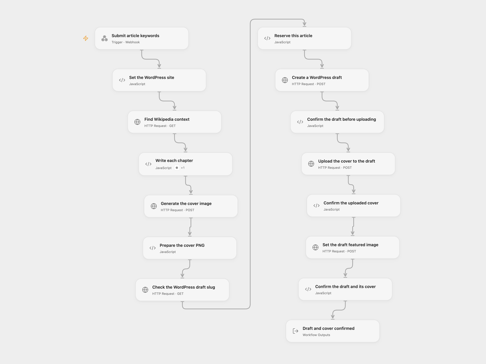

# Draft WordPress Articles from Keywords

Enter keywords, a chapter count, and a word limit to create a WordPress draft with an AI-generated cover.

<!-- template-actions:start -->
 
<!-- template-actions:end -->

<picture>
  <source media="(prefers-color-scheme: dark)" srcset="preview-dark.png">
  
</picture>

## Setup

1. Enter the HTTPS WordPress site URL in **Set the WordPress site**. Use a WordPress account allowed to create drafts and upload media. Bind the same username and application password in **Check the WordPress draft slug**, **Create a WordPress draft**, **Upload the cover to the draft**, and **Set the draft featured image**. [WordPress application passwords](https://developer.wordpress.org/rest-api/using-the-rest-api/authentication/#basic-authentication-with-application-passwords)
2. Connect OpenAI for the chapter-writing action and bind an OpenAI API key with image generation access in **Generate the cover image**.
3. Publish and enable the workflow. Use the form URL from **Submit article keywords**. Share it with people you want to allow to generate drafts.

## Behavior

Enter comma-separated keywords, 1–10 chapters, and a body word limit up to 6,000. Use at least 120 words plus 10 per chapter. Headings and the subtitle are outside that limit. The workflow reads English Wikipedia excerpts for context, prepares an outline, writes each chapter independently, and checks the complete article. It prepares the cover before creating the draft. A successful run returns the confirmed WordPress post ID and featured media ID.

The submission page confirms receipt immediately. People with access to the workflow run can see **Draft and cover confirmed** when WordPress confirms the draft and cover. The workflow saves a draft for review.

The same site, keywords, chapter count, and word limit identify one request. If a write fails or its response is lost, check the draft and Media Library before attempting recovery. A pending request is held to prevent another draft or upload.

In n8n

Set your WordPress site in **Set the WordPress site**. Use one Basic Auth credential with the same application password in all four WordPress HTTP nodes. Select an OpenAI API credential in **Generate the article outline**, **Write each chapter**, and **Generate the cover image**. Select one dedicated Data Table in **Check for a previous attempt**, **Reserve this article**, and **Record the draft receipt** with text columns `request_key`, `status`, and `receipt`. Use one production execution slot. The form waits for both the draft and cover, so allow enough time for generation and check the workflow run if the browser times out.

Inspiration &amp; credits

Adapted from [Write a WordPress post with AI (starting from a few keywords)](https://github.com/enescingoz/awesome-n8n-templates/blob/827110332c21cbe000ab13f6d292d5adb1f1f8db/WordPress/Write%20a%20WordPress%20post%20with%20AI%20(starting%20from%20a%20few%20keywords).json) in [enescingoz/awesome-n8n-templates](https://github.com/enescingoz/awesome-n8n-templates).

Source collection notice: © 2024–2026 Enes Cingoz, [CC BY 4.0](https://github.com/enescingoz/awesome-n8n-templates/blob/827110332c21cbe000ab13f6d292d5adb1f1f8db/LICENSE). The original workflow is credited to Giulio. The collection notice does not establish a separate license for the original workflow. See [repository licensing](../../README.md#licensing) for the scope of OOMOL contributions and third-party material.

[Original n8n workflow by Giulio](https://n8n.io/workflows/2187-write-a-wordpress-post-with-ai-starting-from-a-few-keywords/).

## Changes to the source

Use bounded Wikipedia context and structured output for the outline and chapters. Verify every section, generate a validated cover, and confirm its relationship with the WordPress draft.

