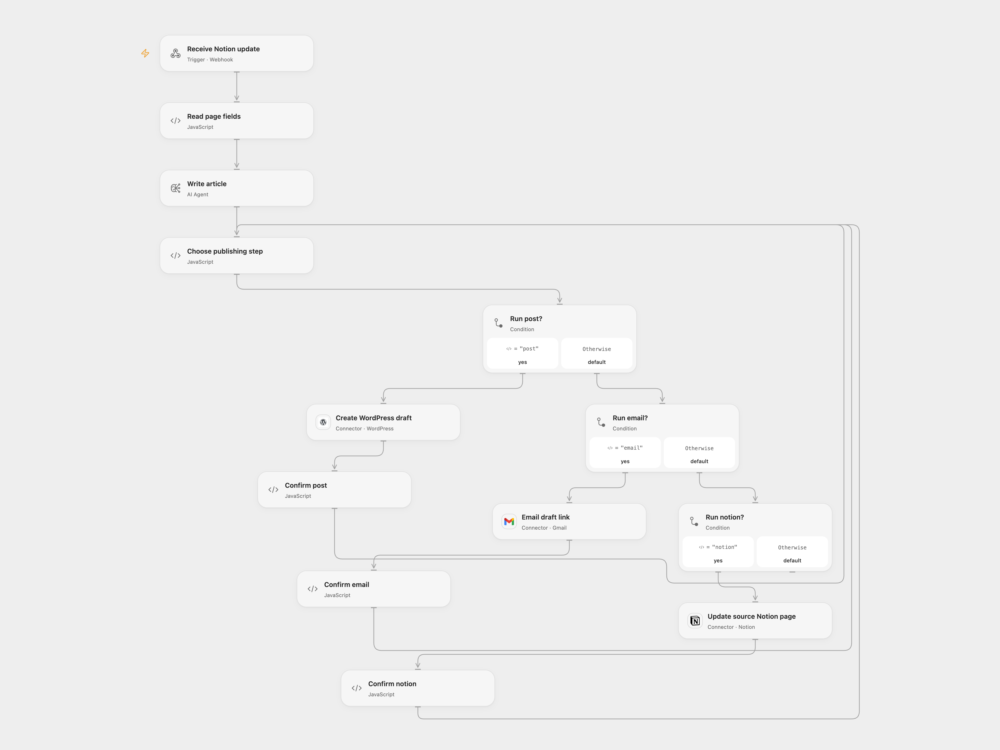

# Draft WordPress Articles from Notion Updates

Draft an SEO article from a Notion page update, email its link and update the page.

<!-- template-actions:start -->
 
<!-- template-actions:end -->

<picture>
  <source media="(prefers-color-scheme: dark)" srcset="preview-dark.png">
  
</picture>

## Setup

Connect Notion, WordPress, Gmail and an AI model. Use one mode and prevent overlapping runs for the same page.

## Behavior

An hourly Notion page update supplies the Name keywords. The model writes an article of at most 20 lines. The workflow creates a WordPress **draft**, emails its link, then updates Subject, Content, URL and Status on the same Notion page. The source asks for publication but its WordPress node creates a draft; the Notion Status value remains publish as in the source. A draft link may require WordPress access and is not proof of publication. Model output requires review.

Each page is processed once to prevent the Notion write from triggering another draft. Clear its completed checkpoint only when intentionally processing it again. Code inputs and outputs must fit 1 MiB. If a write result is unknown, inspect the corresponding service before replaying. In Open Flow set the pending key and confirmed or absent in **Choose publishing step**; for a confirmed WordPress draft also provide its URL. For pending-post, set stage to ready-email and fill link if the draft exists, or ready-post if absent. For pending-email use ready-notion if sent or ready-email if absent. For pending-notion use done if updated or ready-notion if absent. Change a row only after verifying the outcome.

In n8n

Import n8n, set the Notion database and email recipient, bind Notion Header Auth with Authorization: Bearer YOUR_NOTION_TOKEN on **Update Notion page**, and create a Data Table with item_key, stage, title, content and link text columns. For Open Flow select relay mode in n8n, set its webhook URL, configure the email in **Choose publishing step** and enable persistent State. Restrict the relay webhook to trusted n8n. In n8n inspect the pending Data Table row.

Inspiration &amp; credits

Keep the source draft status, preserve page identity and checkpoint each write.

Adapted from [Smart Content Automation Workflow](https://github.com/Zie619/n8n-workflows/blob/ae8cf6dc5b873cbb4f74587aa9180ed3a9f70682/workflows/Gmailtool/1142_Gmailtool_Stickynote_Automation_Triggered.json) in [Zie619/n8n-workflows](https://github.com/Zie619/n8n-workflows). The source export does not identify a separate template author or license.

The collection’s [MIT notice](https://github.com/Zie619/n8n-workflows/blob/94007c1445d9258a7da116646b79473e7c7c3282/LICENSE) is pinned at a later revision. This is the collection notice at that revision; it does not establish a separate original template author's license. Our changes are listed above; see [repository licensing](../../README.md#licensing).

> MIT License
>
> Copyright (c) 2025 Zie619
>
> Permission is hereby granted, free of charge, to any person obtaining a copy
> of this software and associated documentation files (the "Software"), to deal
> in the Software without restriction, including without limitation the rights
> to use, copy, modify, merge, publish, distribute, sublicense, and/or sell
> copies of the Software, and to permit persons to whom the Software is
> furnished to do so, subject to the following conditions:
>
> The above copyright notice and this permission notice shall be included in all
> copies or substantial portions of the Software.
>
> THE SOFTWARE IS PROVIDED "AS IS", WITHOUT WARRANTY OF ANY KIND, EXPRESS OR
> IMPLIED, INCLUDING BUT NOT LIMITED TO THE WARRANTIES OF MERCHANTABILITY,
> FITNESS FOR A PARTICULAR PURPOSE AND NONINFRINGEMENT. IN NO EVENT SHALL THE
> AUTHORS OR COPYRIGHT HOLDERS BE LIABLE FOR ANY CLAIM, DAMAGES OR OTHER
> LIABILITY, WHETHER IN AN ACTION OF CONTRACT, TORT OR OTHERWISE, ARISING FROM,
> OUT OF OR IN CONNECTION WITH THE SOFTWARE OR THE USE OR OTHER DEALINGS IN THE
> SOFTWARE.

