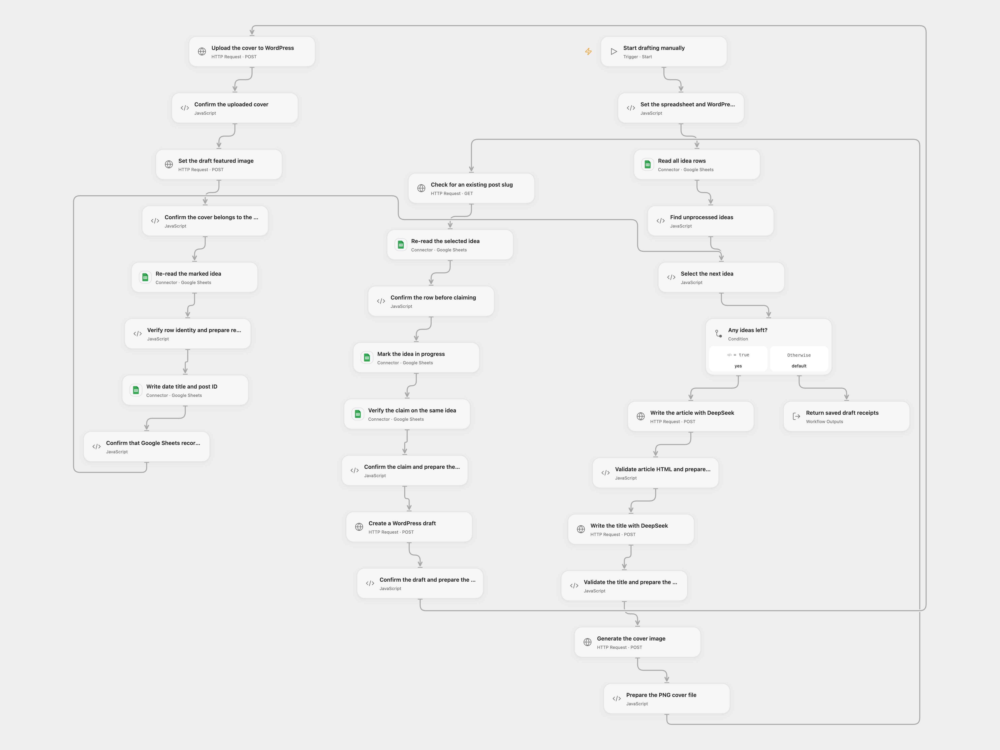

# Draft WordPress Articles from Google Sheets

Turn unprocessed Google Sheets ideas into WordPress drafts with DeepSeek text and an OpenAI cover image.

<!-- template-actions:start -->
 
<!-- template-actions:end -->

<picture>
  <source media="(prefers-color-scheme: dark)" srcset="preview-dark.png">
  
</picture>

## Setup

1. Set up one Google Sheets tab with these columns in order: `DATA`, `PROMPT`, `TITOLO`, `ID POST`, `IDEA ID`, `DRAFT STATE`. For each new idea, fill `PROMPT` and assign a permanent, site-wide unique `IDEA ID` using lowercase letters, numbers and hyphens, beginning with a letter. Leave the other cells blank.
2. In **Set the spreadsheet and WordPress site**, enter the spreadsheet ID, numeric tab ID (the URL’s `gid`), and the WordPress site’s HTTPS URL. Connect the same Google Sheets account to all Google Sheets steps. Use a WordPress user with rights to create drafts and upload media.
3. Bind secret variables for the DeepSeek and OpenAI keys at their respective HTTP nodes. Bind the same WordPress username and application password to all four WordPress HTTP nodes. [WordPress application passwords](https://make.wordpress.org/core/2020/11/05/application-passwords-integration-guide/)
4. Run manually. Use one execution at a time for this tab and keep existing rows in place until it finishes.

## Behavior

The workflow processes rows with a prompt and blank post ID and state. It generates article HTML and a title with DeepSeek V4 Pro, produces a 1792 × 1024 PNG cover with GPT Image 2.5 Flare, checks for an existing post slug, and marks the row `IN PROGRESS`. After creating a WordPress draft and attaching the PNG as its featured image, it writes the title, post ID and UTC date in `dd/mm/yyyy` format to the same row and marks it `DONE`. Posts remain in draft status. Uploaded covers follow the site’s normal media access rules.

A row marked `IN PROGRESS` is skipped on later runs. If a run stops, look for the post slug `sheet-idea-<IDEA ID>` and media slug `sheet-idea-<IDEA ID>-cover` in WordPress. If a draft exists, finish that draft in WordPress. Attach the matching existing cover, or upload one after verifying there is no matching media. Record the date, title and post ID in the row before marking it `DONE`. Clear `IN PROGRESS` only after verifying that no draft or cover exists for that idea. If a row already has a post ID, the workflow skips it. DeepSeek receives the idea and article text. OpenAI receives the generated title.

In n8n

Set the spreadsheet, tab and site in **Set the spreadsheet and WordPress site**. Attach one Google Sheets OAuth2 API credential to the Sheets HTTP steps, one DeepSeek HTTP Bearer Auth credential to both text requests, one OpenAI API credential to the image request, and one HTTP Basic Auth credential containing your WordPress username and application password to all WordPress requests. Run the workflow manually and use one execution at a time per tab.

Inspiration &amp; credits

Adapted from [Automate Content Generator for WordPress with DeepSeek R1](https://github.com/enescingoz/awesome-n8n-templates/blob/827110332c21cbe000ab13f6d292d5adb1f1f8db/WordPress/Automate%20Content%20Generator%20for%20WordPress%20with%20DeepSeek%20R1.json) in [enescingoz/awesome-n8n-templates](https://github.com/enescingoz/awesome-n8n-templates).

Source collection notice: © 2024–2026 Enes Cingoz, [CC BY 4.0](https://github.com/enescingoz/awesome-n8n-templates/blob/827110332c21cbe000ab13f6d292d5adb1f1f8db/LICENSE). The [original n8n gallery template](https://n8n.io/workflows/2813-automate-content-generator-for-wordpress-with-deepseek-r1/) credits Davide Boizza. See [repository licensing](../../README.md#licensing) for the scope of OOMOL contributions and third-party material.

## Changes to the source

DeepSeek V4 Pro and GPT Image 2.5 Flare replace the retired source models. The workflow uses a single sheet and WordPress site, filters unprocessed rows, verifies each row before writing, and marks a partial run for review. The original date, title and post-ID columns remain. [DeepSeek model retirement](https://api-docs.deepseek.com/news/news260424/) · [OpenAI model deprecations](https://developers.openai.com/api/docs/deprecations)

