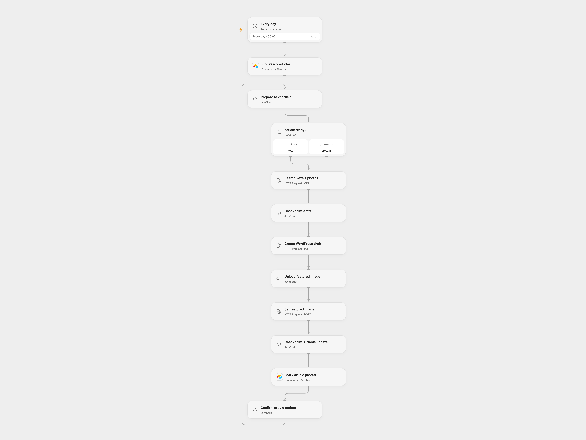

# Draft WordPress Posts from Airtable

Create WordPress drafts with Pexels featured images from Airtable articles.

<picture>
  <source media="(prefers-color-scheme: dark)" srcset="preview-dark.png">
  
</picture>

[Open Flow JSON](templates/draft-wordpress-posts-from-airtable.openflow.json) · [n8n JSON](templates/draft-wordpress-posts-from-airtable.n8n.json)

## Setup

In Airtable create fields `Status`, `Title`, `Keyword` and `Blog Post`. Mark articles ready with `To Post` in Status. Configure the base and table in both Airtable nodes, set the same HTTPS WordPress site URL in **Checkpoint draft** and **Upload featured image**, and replace `wordpress.example.com` in the upload node HTTP capabilities with the site's hostname. Connect Airtable in both nodes. Bind Secret Variables `PEXELS_API_KEY` and `WORDPRESS_AUTHORIZATION` (the full Basic authorization header made from the WordPress username and application password). Enable persistent State and prevent overlapping runs.

For n8n, connect Airtable and WordPress credentials, configure the base, table and WordPress URL in the relevant nodes, and configure HTTP Header Auth with the Pexels API key as `Authorization`. Create an n8n Data Table with a text column `record_id` and set its ID in both checkpoint nodes. Prevent overlapping runs and activate one format.

## Behavior

Daily at midnight UTC, search up to three records with Status containing `To Post`. For each article with a Blog Post, convert Markdown to HTML, create a WordPress draft, find and upload a Pexels image, set it as featured media, and mark the original Airtable row `Posted`. The post remains a draft for review. The source tripled the article text; this version converts it once. Open Flow limits each image to 1 MiB and requires the Pexels image host.

Writes are not automatically replayed after an uncertain result. Open Flow records the current stage in State; n8n inserts a Data Table checkpoint before the draft. If processing stops, inspect WordPress and Airtable, finish or undo any partial work, then clear that record's checkpoint only when it is safe to retry. Successful n8n checkpoints remain until manually removed. Prior completed posts remain.

Inspiration &amp; credits

## Changes to the source

- Replace private IDs, URL and credentials; supply the missing WordPress site setting.
- Keep one copy of the Markdown body and add checkpoints for write recovery.

Adapted from [Automating Posting content to WordPress and setting up the featured Image](https://github.com/Zie619/n8n-workflows/blob/ae8cf6dc5b873cbb4f74587aa9180ed3a9f70682/workflows/Wordpress/0502_Wordpress_Filter_Update_Scheduled.json) in [Zie619/n8n-workflows](https://github.com/Zie619/n8n-workflows). The source export does not identify a separate template author or license.

The collection’s [MIT notice](https://github.com/Zie619/n8n-workflows/blob/94007c1445d9258a7da116646b79473e7c7c3282/LICENSE) is pinned at a later revision. This is the collection notice at that revision; it does not establish a separate original template author's license. Our changes are listed above; see [repository licensing](../../README.md#licensing).

> MIT License
>
> Copyright (c) 2025 Zie619
>
> Permission is hereby granted, free of charge, to any person obtaining a copy
> of this software and associated documentation files (the "Software"), to deal
> in the Software without restriction, including without limitation the rights
> to use, copy, modify, merge, publish, distribute, sublicense, and/or sell
> copies of the Software, and to permit persons to whom the Software is
> furnished to do so, subject to the following conditions:
>
> The above copyright notice and this permission notice shall be included in all
> copies or substantial portions of the Software.
>
> THE SOFTWARE IS PROVIDED "AS IS", WITHOUT WARRANTY OF ANY KIND, EXPRESS OR
> IMPLIED, INCLUDING BUT NOT LIMITED TO THE WARRANTIES OF MERCHANTABILITY,
> FITNESS FOR A PARTICULAR PURPOSE AND NONINFRINGEMENT. IN NO EVENT SHALL THE
> AUTHORS OR COPYRIGHT HOLDERS BE LIABLE FOR ANY CLAIM, DAMAGES OR OTHER
> LIABILITY, WHETHER IN AN ACTION OF CONTRACT, TORT OR OTHERWISE, ARISING FROM,
> OUT OF OR IN CONNECTION WITH THE SOFTWARE OR THE USE OR OTHER DEALINGS IN THE
> SOFTWARE.

Open Flow bundles [Showdown 2.1.0](https://github.com/showdownjs/showdown) under MIT; the notice is included in the workflow code.

