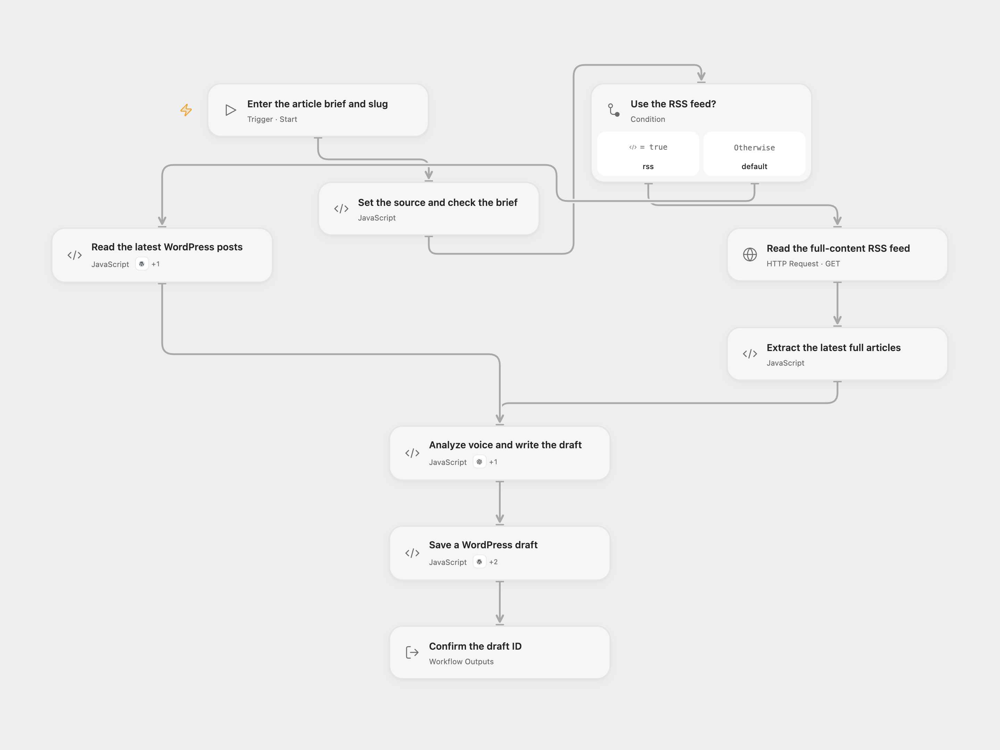

# Draft WordPress Posts in Your Brand Voice

Analyze recent brand articles for structure and voice, then write a new WordPress draft from your brief.

<!-- template-actions:start -->
 
<!-- template-actions:end -->

<picture>
  <source media="(prefers-color-scheme: dark)" srcset="preview-dark.png">
  
</picture>

## Setup

1. In **Set the source and check the brief**, select `wordpress` to use the destination site's published posts, or `rss` and a canonical public HTTPS feed URL. Use content you own or are authorized to send to OpenAI. In RSS mode, provide an RSS 2.0 feed with original article bodies in `content:encoded`. The feed may belong to a non-WordPress blog.
2. Bind the same WordPress connection in **Read the latest WordPress posts** (WordPress source mode) and **Save a WordPress draft**. Use a public HTTPS site and an application password for a user who can list posts and create drafts. Bind your OpenAI connection in **Analyze voice and write the draft**. [WordPress application passwords](https://developer.wordpress.org/rest-api/using-the-rest-api/authentication/#basic-authentication-with-application-passwords)
3. Run the workflow with a brief and a new lowercase, hyphen-separated draft slug. Use a unique slug for each intended draft.

## Behavior

The workflow reads up to five of the newest published articles. WordPress mode reads rendered post bodies. RSS mode reads bodies and publication dates from the feed itself and skips article-page requests. Excerpt-only feeds are unsupported. Use articles up to 32,000 text characters each and a feed up to 1.5 million characters. This template ships without the original demo blog URL or its content.

The workflow retains headings, paragraphs and list structure in the examples and sends them to OpenAI for two separate analyses. A third request uses the resulting structure and voice guidelines with your brief. The workflow converts supported Markdown formatting to escaped WordPress HTML and creates only a draft for review. It returns the confirmed draft ID and slug.

A reserved slug stays blocked after an inconclusive write. Check WordPress before recovering the draft. Avoid switching the WordPress connection on a workflow with existing draft reservations. Review the draft and source permissions before publishing it yourself.

In n8n

Set the WordPress HTTPS site URL, source mode, optional feed URL, brief and draft slug in **Set the source and check the brief**. Bind the same Basic Auth credential with a WordPress username and application password in **Read the latest WordPress posts** (WordPress mode), **Check the destination slug** and **Save a WordPress draft**. Bind an OpenAI credential in **Analyze article structure**, **Analyze the brand voice** and **Write the new article**.

Create a dedicated Data Table with text columns `request_key`, `status` and `receipt`. Select it in **Check for a previous draft attempt**, **Reserve this draft attempt** and **Record the confirmed draft**. Start the workflow manually, one execution at a time. Retain pending entries until you check WordPress. The saved receipt is a draft ID.

Inspiration &amp; credits

Adapted from [Automate Blog Creation in Brand Voice with AI](https://github.com/enescingoz/awesome-n8n-templates/blob/827110332c21cbe000ab13f6d292d5adb1f1f8db/WordPress/Automate%20Blog%20Creation%20in%20Brand%20Voice%20with%20AI.json) in [enescingoz/awesome-n8n-templates](https://github.com/enescingoz/awesome-n8n-templates).

Source collection notice: © 2024–2026 Enes Cingoz, [CC BY 4.0](https://github.com/enescingoz/awesome-n8n-templates/blob/827110332c21cbe000ab13f6d292d5adb1f1f8db/LICENSE). The original workflow is credited to Jimleuk. The collection notice does not establish a separate license for the original workflow. See [repository licensing](../../README.md#licensing) for the scope of OOMOL contributions and third-party material.

[Original n8n workflow by Jimleuk](https://n8n.io/workflows/2648-automate-blog-creation-in-brand-voice-with-ai/).

## Changes to the source

Read authorized published content through WordPress or a full-content RSS feed. Keep independent structure and voice analyses and create only a reviewable draft. The bundled [fast-xml-parser](https://github.com/NaturalIntelligence/fast-xml-parser) and dependency notices are included in the template code.

