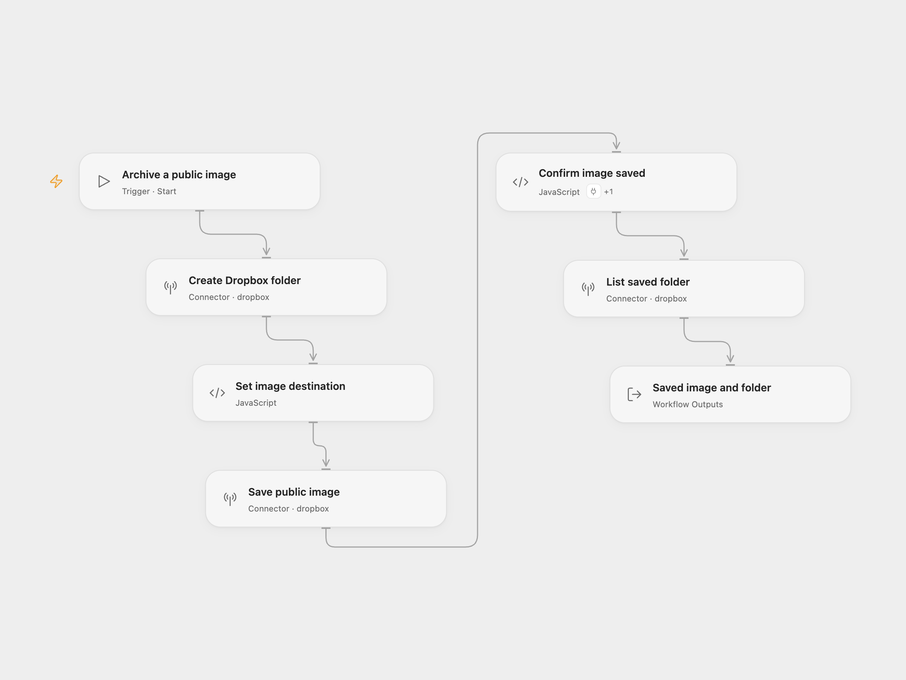

# Dropbox Public Image Archive

Create a new Dropbox folder, save an image from a public URL as `file.png`, and list the folder after the save completes.

<picture>
  <source media="(prefers-color-scheme: dark)" srcset="preview-dark.png">
  
</picture>

[Open Flow JSON](templates/dropbox-public-image-archive.openflow.json) · [n8n JSON](templates/dropbox-public-image-archive.n8n.json)

## Setup

In Open Flow, connect the same Dropbox account in **Create Dropbox folder**, **Save public image**, **List saved folder**, and the **Actions** settings of **Confirm image saved**. Set the new folder path in **Create Dropbox folder**. Edit the public image URL in **Save public image**. To change the saved filename, edit **Set image destination**.

In n8n, connect the same Dropbox OAuth2 account in all Dropbox nodes. Set the new folder path in **Dropbox**, the image URL in **HTTP Request**, and the filename in **Dropbox1**. The upload and folder listing read the folder path from **Dropbox**. The HTTP response is a binary file in the `data` field consumed by the upload.

Run manually. The defaults create `/n8n` and save `https://n8n.io/n8n-logo.png` as `/n8n/file.png`. The folder must not already exist; a creation conflict stops the run. Each successful run returns up to 100 folder entries. Open Flow also returns the completed file metadata and the listing cursor and `hasMore` flag.

Open Flow asks Dropbox to fetch the public URL directly. If Dropbox starts a background job, **Confirm image saved** checks it once per second for up to 60 seconds. Only a completed file proceeds to the listing. A failed save, request error, unknown status, or timeout stops the run without submitting the save again. After a timeout, the job may still finish in Dropbox; inspect the job ID in **Save public image** and the destination before retrying. n8n downloads the bytes and uploads them before listing.

## Changes to the source

- Make the Dropbox OAuth2 connection and binary-field settings explicit in n8n.
- Derive upload and listing paths from the folder configuration.
- Use Dropbox’s public-URL save action in Open Flow, with completion checks for asynchronous jobs.
- Expose completed file metadata and folder-list pagination information in Open Flow.

Source and license

Adapted from [Dropbox image download, upload, and folder listing](https://github.com/Zie619/n8n-workflows/blob/ae8cf6dc5b873cbb4f74587aa9180ed3a9f70682/workflows/Manual/1078_Manual_Dropbox_Automation_Webhook.json) in [Zie619/n8n-workflows](https://github.com/Zie619/n8n-workflows). The source export does not identify a separate template author or license.

The collection’s [MIT notice](https://github.com/Zie619/n8n-workflows/blob/94007c1445d9258a7da116646b79473e7c7c3282/LICENSE) is pinned at a later revision. This is the collection notice at that revision; it does not establish a separate original template author's license. Our changes are listed above; see [repository licensing](../../README.md#licensing).

> MIT License
>
> Copyright (c) 2025 Zie619
>
> Permission is hereby granted, free of charge, to any person obtaining a copy
> of this software and associated documentation files (the "Software"), to deal
> in the Software without restriction, including without limitation the rights
> to use, copy, modify, merge, publish, distribute, sublicense, and/or sell
> copies of the Software, and to permit persons to whom the Software is
> furnished to do so, subject to the following conditions:
>
> The above copyright notice and this permission notice shall be included in all
> copies or substantial portions of the Software.
>
> THE SOFTWARE IS PROVIDED "AS IS", WITHOUT WARRANTY OF ANY KIND, EXPRESS OR
> IMPLIED, INCLUDING BUT NOT LIMITED TO THE WARRANTIES OF MERCHANTABILITY,
> FITNESS FOR A PARTICULAR PURPOSE AND NONINFRINGEMENT. IN NO EVENT SHALL THE
> AUTHORS OR COPYRIGHT HOLDERS BE LIABLE FOR ANY CLAIM, DAMAGES OR OTHER
> LIABILITY, WHETHER IN AN ACTION OF CONTRACT, TORT OR OTHERWISE, ARISING FROM,
> OUT OF OR IN CONNECTION WITH THE SOFTWARE OR THE USE OR OTHER DEALINGS IN THE
> SOFTWARE.

