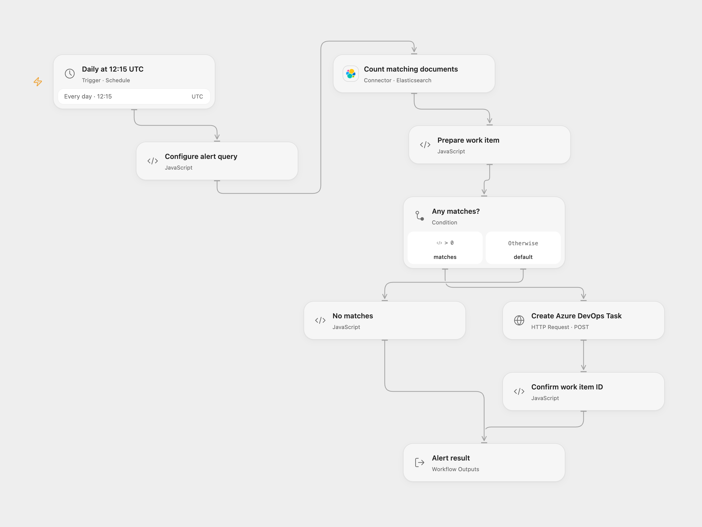

# Create Azure DevOps Tasks from Elasticsearch Alerts

Count matching Elasticsearch documents each day and create an Azure DevOps Task when there is at least one match.

<!-- template-actions:start -->
 
<!-- template-actions:end -->

<picture>
  <source media="(prefers-color-scheme: dark)" srcset="preview-dark.png">
  
</picture>

## Setup

Set the index and query string in **Configure alert query**. The example looks for error logs in the previous day. Use the field names and time range for your index. Select an Elasticsearch connection with read access in **Count matching documents**.

In **Create Azure DevOps Task**, replace **YOUR_ORGANIZATION** and **YOUR_PROJECT** in the URL with your organization and project. URL-encode project names that contain spaces. In the HTTP authentication inputs, bind a secret Variable containing your Azure DevOps username or a placeholder username and a separate secret Variable containing a personal access token with **Work Items (Read & write)** scope. The project must allow the account to create Tasks. If the project requires extra fields, add them to the JSON Patch in **Prepare work item** before enabling the schedule.

## Behavior

The workflow runs daily at 12:15 UTC. It counts documents matching the query. Zero matches produce a result with no work item ID. A positive count creates one Task with the count in its title and returns the new work item ID. A failed or incomplete Elasticsearch response stops the workflow before the write.

Each run checks the configured query anew. If consecutive runs find matches, each can create a Task. The workflow has no automatic write retry. Check Azure DevOps before repeating a run with an uncertain write result.

In n8n

Edit the index and query in **Configure alert query** and replace the example Elasticsearch origin in **Count matching documents**. Attach an HTTP Header Auth credential with the header name **Authorization** and the value **ApiKey YOUR_ENCODED_API_KEY**. In **Create Azure DevOps Task**, set the organization and project URL and attach a Basic Auth credential with the username and PAT as password. Verify the project’s Task fields and enable the workflow to start its daily schedule.

Inspiration &amp; credits

## Changes to the source

- Use a configurable Elasticsearch query and check the count response for failed shards.
- Set an explicit UTC time zone and supply the Azure DevOps Task creation method, JSON Patch title and work item ID check.

Adapted from [Elasticsearch to Azure DevOps work item workflow](https://github.com/Zie619/n8n-workflows/blob/ae8cf6dc5b873cbb4f74587aa9180ed3a9f70682/workflows/Elasticsearch/0616_Elasticsearch_Cron_Create_Webhook.json) in [Zie619/n8n-workflows](https://github.com/Zie619/n8n-workflows). Attribution: Zie619 / n8n-workflows.

The collection’s [MIT notice](https://github.com/Zie619/n8n-workflows/blob/94007c1445d9258a7da116646b79473e7c7c3282/LICENSE) is pinned at a later revision. This is the collection notice at that revision; it does not establish a separate original template author's license. Our changes are listed above; see [repository licensing](../../README.md#licensing).

> MIT License
>
> Copyright (c) 2025 Zie619
>
> Permission is hereby granted, free of charge, to any person obtaining a copy
> of this software and associated documentation files (the "Software"), to deal
> in the Software without restriction, including without limitation the rights
> to use, copy, modify, merge, publish, distribute, sublicense, and/or sell
> copies of the Software, and to permit persons to whom the Software is
> furnished to do so, subject to the following conditions:
>
> The above copyright notice and this permission notice shall be included in all
> copies or substantial portions of the Software.
>
> THE SOFTWARE IS PROVIDED "AS IS", WITHOUT WARRANTY OF ANY KIND, EXPRESS OR
> IMPLIED, INCLUDING BUT NOT LIMITED TO THE WARRANTIES OF MERCHANTABILITY,
> FITNESS FOR A PARTICULAR PURPOSE AND NONINFRINGEMENT. IN NO EVENT SHALL THE
> AUTHORS OR COPYRIGHT HOLDERS BE LIABLE FOR ANY CLAIM, DAMAGES OR OTHER
> LIABILITY, WHETHER IN AN ACTION OF CONTRACT, TORT OR OTHERWISE, ARISING FROM,
> OUT OF OR IN CONNECTION WITH THE SOFTWARE OR THE USE OR OTHER DEALINGS IN THE
> SOFTWARE.

