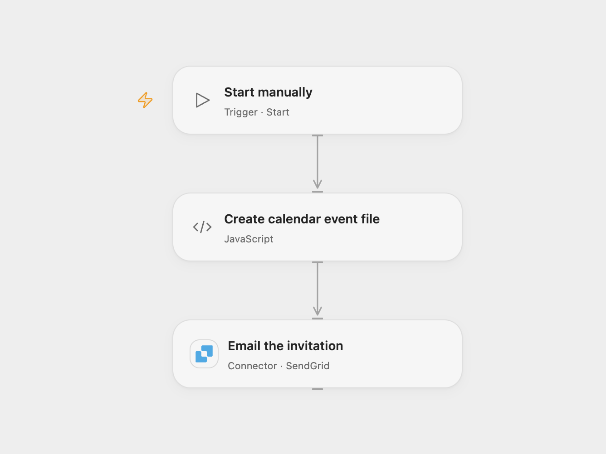

# Email a Calendar Invitation

Generate an iCalendar event file and email it as an attachment.

<picture>
  <source media="(prefers-color-scheme: dark)" srcset="preview-dark.png">
  
</picture>

[Open Flow JSON](templates/email-a-calendar-invitation.openflow.json) · [n8n JSON](templates/email-a-calendar-invitation.n8n.json)

## Setup

In Open Flow, connect SendGrid, set the verified sender and recipient in **Email the invitation**, and set the event title, start and end in **Create calendar event file**. Use UTC timestamps such as `2030-06-11T15:30:00Z`; the end must be later than the start. Edit the email body if needed.

In n8n, run the instance with its process timezone set to UTC, configure the **iCalendar** title, start and end as UTC timestamps, connect an SMTP account in **Send Email**, and set its sender, recipient and message. Each format uses its own email connection. Run the workflow manually.

## Behavior

Each run generates an iCalendar event file and emails it to the configured recipient. Open Flow creates a new event UID for each run. A failed or uncertain send may already have been delivered; check the mailbox before retrying. The attachment publishes an event; it does not manage attendee RSVPs. The recipient's mail or calendar app decides how to import it.

Inspiration &amp; credits

## Changes to the source

- Replace the 2021 example event and personal message with configurable event details. Open Flow sends with SendGrid; n8n retains SMTP.

Adapted from [Send an iCalendar event by email](https://github.com/Zie619/n8n-workflows/blob/ae8cf6dc5b873cbb4f74587aa9180ed3a9f70682/workflows/Manual/0038_Manual_Ical_Send_Triggered.json) in [Zie619/n8n-workflows](https://github.com/Zie619/n8n-workflows). The source export does not identify a separate template author or license.

The collection’s [MIT notice](https://github.com/Zie619/n8n-workflows/blob/94007c1445d9258a7da116646b79473e7c7c3282/LICENSE) is pinned at a later revision. This is the collection notice at that revision; it does not establish a separate original template author's license. Our changes are listed above; see [repository licensing](../../README.md#licensing).

> MIT License
>
> Copyright (c) 2025 Zie619
>
> Permission is hereby granted, free of charge, to any person obtaining a copy
> of this software and associated documentation files (the "Software"), to deal
> in the Software without restriction, including without limitation the rights
> to use, copy, modify, merge, publish, distribute, sublicense, and/or sell
> copies of the Software, and to permit persons to whom the Software is
> furnished to do so, subject to the following conditions:
>
> The above copyright notice and this permission notice shall be included in all
> copies or substantial portions of the Software.
>
> THE SOFTWARE IS PROVIDED "AS IS", WITHOUT WARRANTY OF ANY KIND, EXPRESS OR
> IMPLIED, INCLUDING BUT NOT LIMITED TO THE WARRANTIES OF MERCHANTABILITY,
> FITNESS FOR A PARTICULAR PURPOSE AND NONINFRINGEMENT. IN NO EVENT SHALL THE
> AUTHORS OR COPYRIGHT HOLDERS BE LIABLE FOR ANY CLAIM, DAMAGES OR OTHER
> LIABILITY, WHETHER IN AN ACTION OF CONTRACT, TORT OR OTHERWISE, ARISING FROM,
> OUT OF OR IN CONNECTION WITH THE SOFTWARE OR THE USE OR OTHER DEALINGS IN THE
> SOFTWARE.

