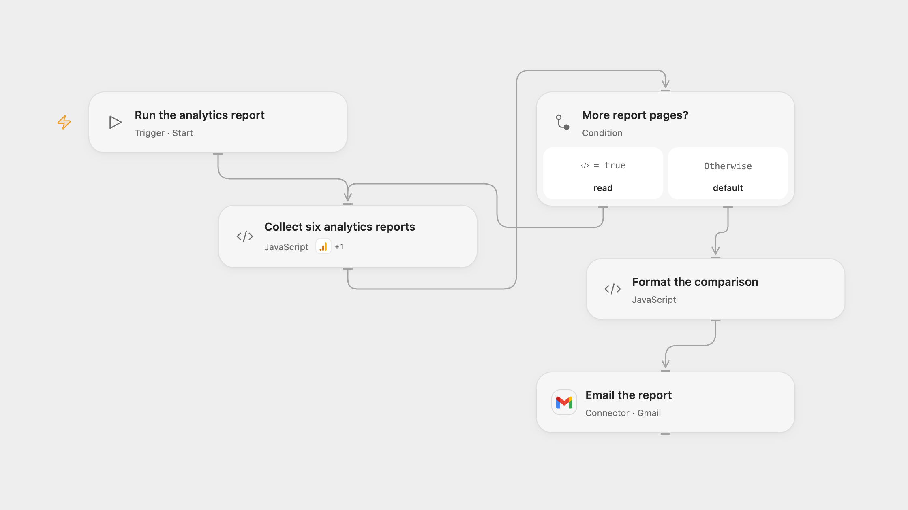

# Email a Google Analytics Comparison Report

Compare page engagement, Google Search and country data across two seven-day periods.

<picture>
  <source media="(prefers-color-scheme: dark)" srcset="preview-dark.png">
  
</picture>

[Open Flow JSON](templates/email-a-google-analytics-comparison-report.openflow.json) · [n8n JSON](templates/email-a-google-analytics-comparison-report.n8n.json)

## Setup

Connect Google Analytics with read access to the property and Gmail with permission to send. Enter the property ID in **Collect six analytics reports** and the report recipient in **Format the comparison**. Link Search Console to the property and make the organic Google Search metrics available to the selected property. In n8n, select the same Google Analytics OAuth credential on all six HTTP report nodes, connect Gmail, and set the property ID and recipient in **Prepare report dates** and **Format the comparison**. Run only one format for each report.

## Behavior

Run the workflow manually to email six tables for page engagement, Google Search and country views across the seven date labels before the current UTC date and the seven preceding dates. Google Analytics interprets those dates in the property timezone, so the latest date can still be in progress when its timezone is behind UTC. Every report page is read before email is sent. Empty reports appear as empty sections. The Google Analytics property and linked data must support all requested dimensions and metrics. Open Flow must fit the complete report in its host execution limits; a report too large for those limits fails rather than silently truncating. Google Analytics data may change while pages are read, and its reporting may aggregate high-cardinality rows or apply thresholds.

An uncertain Gmail send may already have succeeded. Check the mailbox before running again. Keep the report and its execution data restricted to people who should see the analytics.

## Changes to the source

- Keep the connected manual trigger. The source also contains a disconnected Schedule Trigger, which does not execute.
- Use two non-overlapping seven-day date windows ending before the current UTC date instead of overlapping source windows that mix relative property dates and Los Angeles workflow dates. Fill the source's missing country metric as totalUsers, which its formatter expects.
- Replace the private property ID, sender and recipient, preserve all report pages, and escape report values in HTML. n8n uses the Google Analytics Data API through HTTP with pagination in the request body; the original node placed pagination in the query.

Source and license

Adapted from [Automate Google Analytics Reporting - AlexK1919](https://github.com/Zie619/n8n-workflows/blob/ae8cf6dc5b873cbb4f74587aa9180ed3a9f70682/workflows/Googleanalytics/0475_Googleanalytics_Code_Automate_Scheduled.json) in [Zie619/n8n-workflows](https://github.com/Zie619/n8n-workflows). The matching [n8n listing](https://n8n.io/workflows/2549-automate-google-analytics-reporting/) credits Alex Kim. The original workflow also credits [Keith Rumjahn](https://rumjahn.com/how-i-used-a-i-to-be-an-seo-expert-and-analyzed-my-google-analytics-data-in-n8n-and-make-com/) for an earlier version. No separate original template license was found.

The collection’s [MIT notice](https://github.com/Zie619/n8n-workflows/blob/94007c1445d9258a7da116646b79473e7c7c3282/LICENSE) is pinned at a later revision. This is the collection notice at that revision; it does not establish a separate original template author's license. Our changes are listed above; see [repository licensing](../../README.md#licensing).

> MIT License
>
> Copyright (c) 2025 Zie619
>
> Permission is hereby granted, free of charge, to any person obtaining a copy
> of this software and associated documentation files (the "Software"), to deal
> in the Software without restriction, including without limitation the rights
> to use, copy, modify, merge, publish, distribute, sublicense, and/or sell
> copies of the Software, and to permit persons to whom the Software is
> furnished to do so, subject to the following conditions:
>
> The above copyright notice and this permission notice shall be included in all
> copies or substantial portions of the Software.
>
> THE SOFTWARE IS PROVIDED "AS IS", WITHOUT WARRANTY OF ANY KIND, EXPRESS OR
> IMPLIED, INCLUDING BUT NOT LIMITED TO THE WARRANTIES OF MERCHANTABILITY,
> FITNESS FOR A PARTICULAR PURPOSE AND NONINFRINGEMENT. IN NO EVENT SHALL THE
> AUTHORS OR COPYRIGHT HOLDERS BE LIABLE FOR ANY CLAIM, DAMAGES OR OTHER
> LIABILITY, WHETHER IN AN ACTION OF CONTRACT, TORT OR OTHERWISE, ARISING FROM,
> OUT OF OR IN CONNECTION WITH THE SOFTWARE OR THE USE OR OTHER DEALINGS IN THE
> SOFTWARE.

