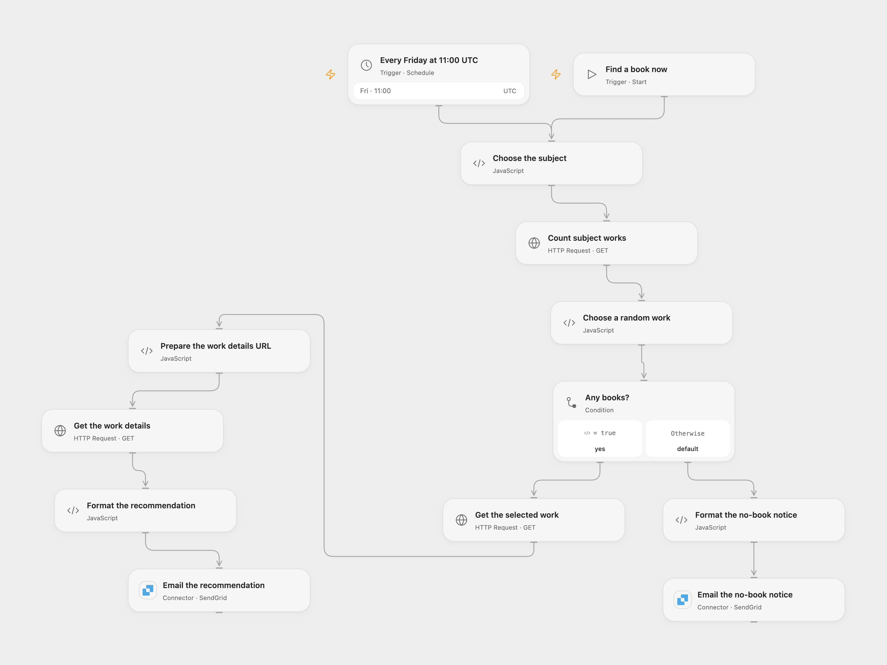

# Email a Random Open Library Book

Choose a random book from an Open Library subject and email a recommendation.

<picture>
  <source media="(prefers-color-scheme: dark)" srcset="preview-dark.png">
  
</picture>

[Open Flow JSON](templates/email-a-random-open-library-book.openflow.json) · [n8n JSON](templates/email-a-random-open-library-book.n8n.json)

## Setup

In Open Flow connect SendGrid and set the verified sender and recipient in both email nodes. Set the subject slug in **Choose the subject**. In n8n connect SMTP to both email nodes, set the addresses, and set the subject in **Set Subject**. Activate one format.

## Behavior

Run manually or every Friday at 11:00 UTC. The workflow counts works in the subject, selects one at random and emails its title, linked authors and available description. If no works are found, it emails a no-book notice. A missing description is shown as unavailable. Open Flow runs on the minute boundary; the n8n Cron V1 trigger uses a fixed second within minute 00. An unknown email outcome may have succeeded; check sent mail before retrying.

Inspiration &amp; credits

## Changes to the source

- Repair the random offset and malformed work URL, use HTTPS, and handle descriptions returned as strings or objects. Escape book data in HTML and use UTC in both formats.

Adapted from [Find a new book](https://github.com/Zie619/n8n-workflows/blob/ae8cf6dc5b873cbb4f74587aa9180ed3a9f70682/workflows/Manual/0119_Manual_Cron_Create_Webhook.json) in [Zie619/n8n-workflows](https://github.com/Zie619/n8n-workflows). The source export does not identify a separate template author or license.

The collection’s [MIT notice](https://github.com/Zie619/n8n-workflows/blob/94007c1445d9258a7da116646b79473e7c7c3282/LICENSE) is pinned at a later revision. This is the collection notice at that revision; it does not establish a separate original template author's license. Our changes are listed above; see [repository licensing](../../README.md#licensing).

> MIT License
>
> Copyright (c) 2025 Zie619
>
> Permission is hereby granted, free of charge, to any person obtaining a copy
> of this software and associated documentation files (the "Software"), to deal
> in the Software without restriction, including without limitation the rights
> to use, copy, modify, merge, publish, distribute, sublicense, and/or sell
> copies of the Software, and to permit persons to whom the Software is
> furnished to do so, subject to the following conditions:
>
> The above copyright notice and this permission notice shall be included in all
> copies or substantial portions of the Software.
>
> THE SOFTWARE IS PROVIDED "AS IS", WITHOUT WARRANTY OF ANY KIND, EXPRESS OR
> IMPLIED, INCLUDING BUT NOT LIMITED TO THE WARRANTIES OF MERCHANTABILITY,
> FITNESS FOR A PARTICULAR PURPOSE AND NONINFRINGEMENT. IN NO EVENT SHALL THE
> AUTHORS OR COPYRIGHT HOLDERS BE LIABLE FOR ANY CLAIM, DAMAGES OR OTHER
> LIABILITY, WHETHER IN AN ACTION OF CONTRACT, TORT OR OTHERWISE, ARISING FROM,
> OUT OF OR IN CONNECTION WITH THE SOFTWARE OR THE USE OR OTHER DEALINGS IN THE
> SOFTWARE.

