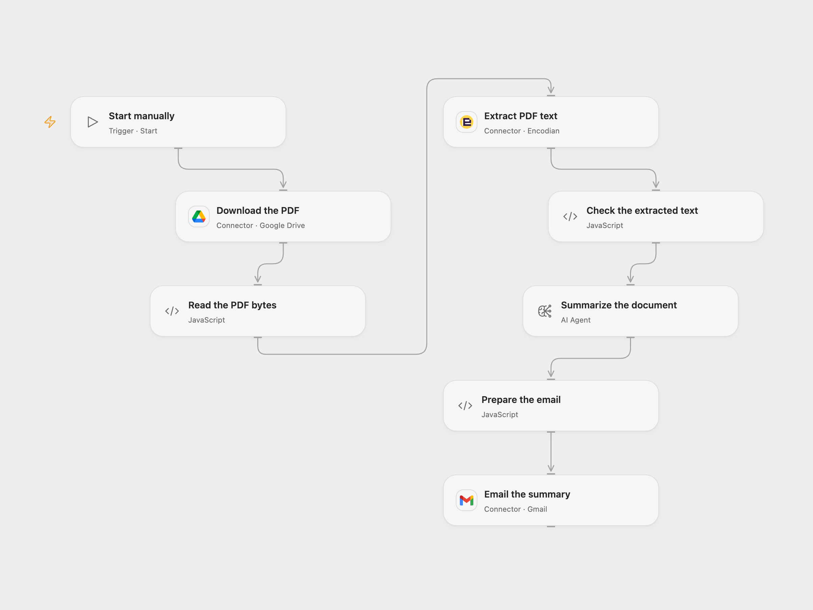

# Email a Summary of a Drive PDF

Summarize a PDF stored in Google Drive and email the result.

<picture>
  <source media="(prefers-color-scheme: dark)" srcset="preview-dark.png">
  
</picture>

[Open Flow JSON](templates/email-a-summary-of-a-drive-pdf.openflow.json) · [n8n JSON](templates/email-a-summary-of-a-drive-pdf.n8n.json)

## Setup

Connect Google Drive in **Download the PDF** and set the same PDF file ID there and in **Read the PDF bytes**. Enable Drive file transit and set its HTTPS hostname in the **Read the PDF bytes** HTTP allowlist. Connect Encodian in **Extract PDF text**. Select an available model in **Summarize the document**. Connect Gmail in **Email the summary** and set the recipient.

In n8n, set the PDF file ID in **Download uploaded File from Google Drive**, connect Google Drive and Mistral Cloud, and set the recipient and Gmail connection in **Send Summarized text to Gmail**. Run either format manually.

## Behavior

The workflow downloads one PDF, extracts its text layer, summarizes that text and emails the result with the processing time in Africa/Lagos. Open Flow accepts PDFs up to 700,000 bytes and requires an accessible text layer; scanned images without text are not transcribed. Text extraction and model results can differ between formats and should be reviewed. Large documents may exceed model or execution limits.

The document is sent to Encodian and its text to the selected model. Restrict access to execution data and temporary transit URLs. Read, extraction or model failures stop before email. A failed or uncertain send may have succeeded; check Sent mail before retrying.

Inspiration &amp; credits

## Changes to the source

- Replace private file and recipient settings. Open Flow uses Encodian text-layer extraction and a configurable AI Agent; n8n keeps the original Mistral summarization chain.
- Both formats send plain text. Open Flow checks the PDF, extracted text and model result before email.

Adapted from [Google Drive PDF summarization](https://github.com/Zie619/n8n-workflows/blob/ae8cf6dc5b873cbb4f74587aa9180ed3a9f70682/workflows/Manual/1528_Manual_Gmail_Send_Triggered.json) in [Zie619/n8n-workflows](https://github.com/Zie619/n8n-workflows). No separate original template author or license was established.

The collection’s [MIT notice](https://github.com/Zie619/n8n-workflows/blob/94007c1445d9258a7da116646b79473e7c7c3282/LICENSE) is pinned at a later revision. This is the collection notice at that revision; it does not establish a separate original template author's license. Our changes are listed above; see [repository licensing](../../README.md#licensing).

> MIT License
>
> Copyright (c) 2025 Zie619
>
> Permission is hereby granted, free of charge, to any person obtaining a copy
> of this software and associated documentation files (the "Software"), to deal
> in the Software without restriction, including without limitation the rights
> to use, copy, modify, merge, publish, distribute, sublicense, and/or sell
> copies of the Software, and to permit persons to whom the Software is
> furnished to do so, subject to the following conditions:
>
> The above copyright notice and this permission notice shall be included in all
> copies or substantial portions of the Software.
>
> THE SOFTWARE IS PROVIDED "AS IS", WITHOUT WARRANTY OF ANY KIND, EXPRESS OR
> IMPLIED, INCLUDING BUT NOT LIMITED TO THE WARRANTIES OF MERCHANTABILITY,
> FITNESS FOR A PARTICULAR PURPOSE AND NONINFRINGEMENT. IN NO EVENT SHALL THE
> AUTHORS OR COPYRIGHT HOLDERS BE LIABLE FOR ANY CLAIM, DAMAGES OR OTHER
> LIABILITY, WHETHER IN AN ACTION OF CONTRACT, TORT OR OTHERWISE, ARISING FROM,
> OUT OF OR IN CONNECTION WITH THE SOFTWARE OR THE USE OR OTHER DEALINGS IN THE
> SOFTWARE.

