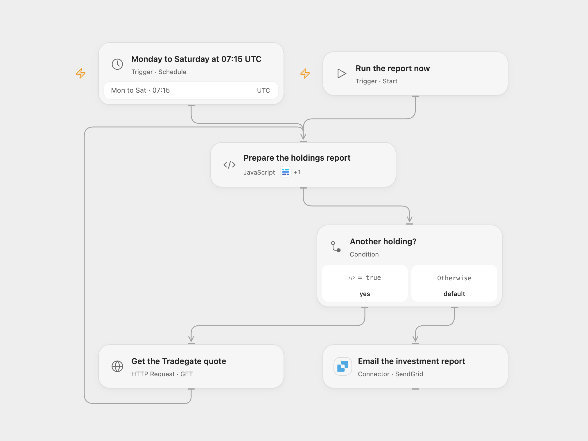

# Email a Baserow Investment Report

Read holdings from Baserow, look up Tradegate bid prices and email an investment report.

<picture>
  <source media="(prefers-color-scheme: dark)" srcset="preview-dark.png">
  
</picture>

[Open Flow JSON](templates/email-baserow-investment-report.openflow.json) · [n8n JSON](templates/email-baserow-investment-report.n8n.json)

## Setup and use

Connect Baserow and SendGrid. Configure the table ID in **Prepare the holdings report**, and set a verified sender and recipient in **Email the investment report**. The Baserow table needs Name, ISIN, Count and Purchase Price fields. In n8n, connect Baserow and SendGrid, choose the table and configure sender and recipient. Activate one format.

## Behavior

Run manually or Monday through Saturday at 07:15 UTC. For each holding, retrieve the Tradegate bid for its ISIN, calculate current value, change and percentage change, then email the combined report and total. Open Flow uses the minute boundary; n8n Cron V1 runs at a fixed second within minute 15. A missing quote or invalid holding stops the Open Flow report before email. An uncertain email outcome may have succeeded; inspect sent mail before retrying. Tradegate page format and market data availability may change. Open Flow requests the current tradegatebsx.com endpoint; n8n follows the original tradegate.de redirect.

Inspiration &amp; credits

## Changes to the source

- Remove personal table and email settings and use UTC for the schedule. Open Flow escapes HTML, validates quote identity, reads Baserow pages and uses the Tradegate bid directly.

Adapted from [Email an investment report](https://github.com/Zie619/n8n-workflows/blob/ae8cf6dc5b873cbb4f74587aa9180ed3a9f70682/workflows/Manual/0250_Manual_Baserow_Update_Webhook.json) in [Zie619/n8n-workflows](https://github.com/Zie619/n8n-workflows). The source export does not identify a separate template author or license.

The collection’s [MIT notice](https://github.com/Zie619/n8n-workflows/blob/94007c1445d9258a7da116646b79473e7c7c3282/LICENSE) is pinned at a later revision. This is the collection notice at that revision; it does not establish a separate original template author's license. Our changes are listed above; see [repository licensing](../../README.md#licensing).

> MIT License
>
> Copyright (c) 2025 Zie619
>
> Permission is hereby granted, free of charge, to any person obtaining a copy
> of this software and associated documentation files (the "Software"), to deal
> in the Software without restriction, including without limitation the rights
> to use, copy, modify, merge, publish, distribute, sublicense, and/or sell
> copies of the Software, and to permit persons to whom the Software is
> furnished to do so, subject to the following conditions:
>
> The above copyright notice and this permission notice shall be included in all
> copies or substantial portions of the Software.
>
> THE SOFTWARE IS PROVIDED "AS IS", WITHOUT WARRANTY OF ANY KIND, EXPRESS OR
> IMPLIED, INCLUDING BUT NOT LIMITED TO THE WARRANTIES OF MERCHANTABILITY,
> FITNESS FOR A PARTICULAR PURPOSE AND NONINFRINGEMENT. IN NO EVENT SHALL THE
> AUTHORS OR COPYRIGHT HOLDERS BE LIABLE FOR ANY CLAIM, DAMAGES OR OTHER
> LIABILITY, WHETHER IN AN ACTION OF CONTRACT, TORT OR OTHERWISE, ARISING FROM,
> OUT OF OR IN CONNECTION WITH THE SOFTWARE OR THE USE OR OTHER DEALINGS IN THE
> SOFTWARE.

