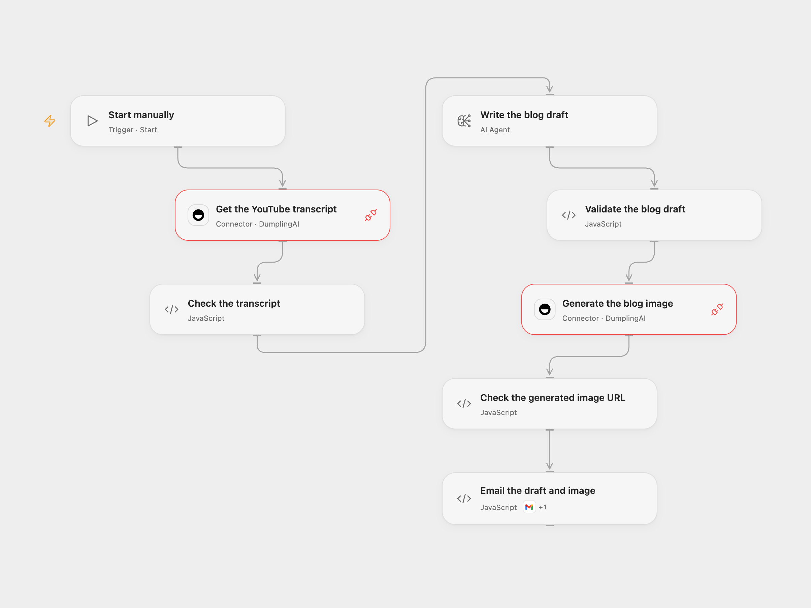

# Email a Blog Post from a YouTube Video

Turn a YouTube transcript into a blog draft and generated image, then email both.

<picture>
  <source media="(prefers-color-scheme: dark)" srcset="preview-dark.png">
  
</picture>

[Open Flow JSON](templates/email-blog-post-from-youtube-video.openflow.json) · [n8n JSON](templates/email-blog-post-from-youtube-video.n8n.json)

## Setup

Connect DumplingAI and grant Provider API Request permission for both DumplingAI nodes. Set the video URL in **Get the YouTube transcript** and choose an available model in **Write the blog draft**. Select the Gmail Action connection and set the recipient in **Email the draft and image**.

In n8n, set the video URL and recipient in **Set Variables**, connect OpenAI and Gmail, and configure Header Auth on both DumplingAI requests with name Authorization and value Bearer followed by a space and your API key. Run either format manually.

## Behavior

The workflow retrieves available captions, drafts an article and image prompt, generates one FLUX.1-dev image, downloads it and emails it with the draft. Open Flow sends the draft as plain text containing Markdown; n8n converts Markdown to HTML. Gmail downloads the generated image URL as a generic attachment; its 25 MB decoded attachment limit applies. Captions, model output and images can vary, so review the draft and media before publishing. The transcript and prompt are sent to model services.

If captions, drafting, image generation or download fail, no email is sent. A send with an unknown outcome may have succeeded; check Sent mail before retrying. Restrict access to execution data and temporary image URLs.

Inspiration &amp; credits

## Changes to the source

- Replace the example video and recipient, validate transcript, structured draft and image before sending, safely serialize the generated image prompt, and attach the downloaded n8n binary using its data field.
- Open Flow defaults to a configurable gpt-4o-mini AI Agent and sends plain-text Markdown; n8n keeps its gpt-4o structured model and HTML formatting. The Open Flow image size and type bounds are explicit.

Adapted from [Turn a YouTube video into a blog draft](https://github.com/Zie619/n8n-workflows/blob/ae8cf6dc5b873cbb4f74587aa9180ed3a9f70682/workflows/Manual/1241_Manual_HTTP_Process_Webhook.json) in [Zie619/n8n-workflows](https://github.com/Zie619/n8n-workflows). The matching [n8n listing](https://n8n.io/workflows/3531-convert-youtube-videos-into-seo-blog-posts-with-gpt-4o-dumpling-ai-and-flux/) credits Yang. The source does not state a separate template license.

The collection’s [MIT notice](https://github.com/Zie619/n8n-workflows/blob/94007c1445d9258a7da116646b79473e7c7c3282/LICENSE) is pinned at a later revision. This is the collection notice at that revision; it does not establish a separate original template author's license. Our changes are listed above; see [repository licensing](../../README.md#licensing).

> MIT License
>
> Copyright (c) 2025 Zie619
>
> Permission is hereby granted, free of charge, to any person obtaining a copy
> of this software and associated documentation files (the "Software"), to deal
> in the Software without restriction, including without limitation the rights
> to use, copy, modify, merge, publish, distribute, sublicense, and/or sell
> copies of the Software, and to permit persons to whom the Software is
> furnished to do so, subject to the following conditions:
>
> The above copyright notice and this permission notice shall be included in all
> copies or substantial portions of the Software.
>
> THE SOFTWARE IS PROVIDED "AS IS", WITHOUT WARRANTY OF ANY KIND, EXPRESS OR
> IMPLIED, INCLUDING BUT NOT LIMITED TO THE WARRANTIES OF MERCHANTABILITY,
> FITNESS FOR A PARTICULAR PURPOSE AND NONINFRINGEMENT. IN NO EVENT SHALL THE
> AUTHORS OR COPYRIGHT HOLDERS BE LIABLE FOR ANY CLAIM, DAMAGES OR OTHER
> LIABILITY, WHETHER IN AN ACTION OF CONTRACT, TORT OR OTHERWISE, ARISING FROM,
> OUT OF OR IN CONNECTION WITH THE SOFTWARE OR THE USE OR OTHER DEALINGS IN THE
> SOFTWARE.

