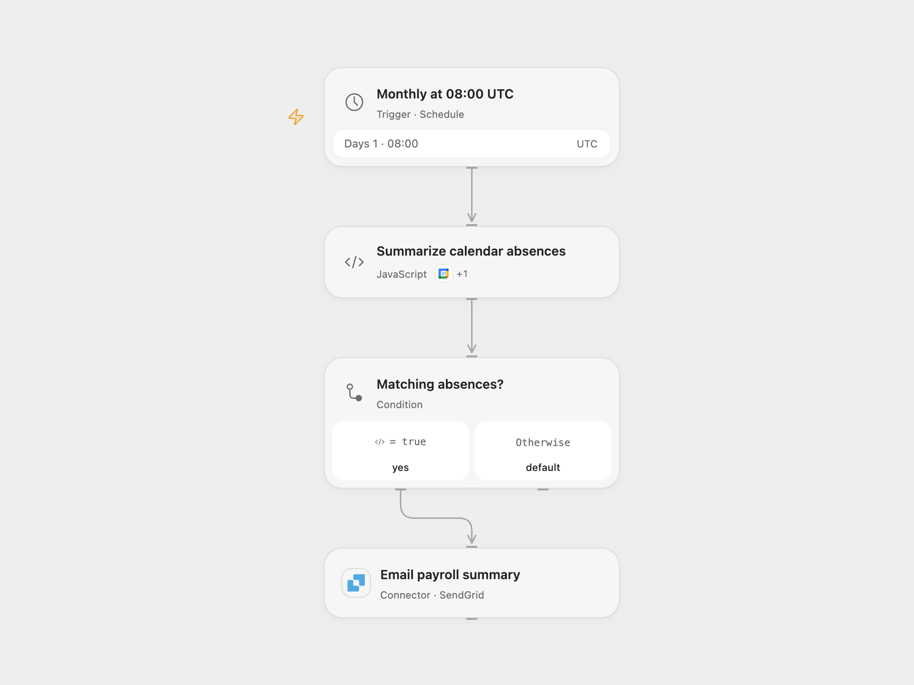

# Email Calendar Absence Summary

Summarize holiday and illness events by person and email the absence totals.

<picture>
  <source media="(prefers-color-scheme: dark)" srcset="preview-dark.png">
  
</picture>

[Open Flow JSON](templates/email-calendar-absence-summary.openflow.json) · [n8n JSON](templates/email-calendar-absence-summary.n8n.json)

## Setup

Connect Google Calendar and set the calendar ID in **Summarize calendar absences**. Connect SendGrid and set its verified sender and payroll recipient in **Email payroll summary**. In n8n select the calendar, connect Google Calendar and SMTP credentials, and replace the sender and recipient addresses. Enable one workflow.

## Behavior

At 08:00 UTC on the first of the month the workflow reads the preceding month through the current time, finds event summaries containing Holiday or Illness, and totals their all-day duration by the name before the first comma in each event description. A summary containing both terms is classified as Holiday. No matching events sends no email. Events must use all-day start and end dates and include a description. Recurring events are expanded. Calendar event details and absence information pass through execution history and email. Restrict access to these records and use an appropriate recipient.

The Open Flow email uses SendGrid instead of SMTP. An unknown send outcome may mean the email was delivered; inspect the provider before rerunning. Calendar edits during pagination can affect results.

Inspiration &amp; credits

## Changes to the source

- Set a UTC schedule and replace example addresses with setup values. Open Flow uses SendGrid and reads all calendar pages. n8n uses one aggregation path so either absence type can produce a report.

Adapted from [Monthly calendar absence summary](https://github.com/Zie619/n8n-workflows/blob/ae8cf6dc5b873cbb4f74587aa9180ed3a9f70682/workflows/Datetime/0168_Datetime_GoogleCalendar_Send_Scheduled.json) in [Zie619/n8n-workflows](https://github.com/Zie619/n8n-workflows). The source export does not identify a separate template author or license.

The collection’s [MIT notice](https://github.com/Zie619/n8n-workflows/blob/94007c1445d9258a7da116646b79473e7c7c3282/LICENSE) is pinned at a later revision. This is the collection notice at that revision; it does not establish a separate original template author's license. Our changes are listed above; see [repository licensing](../../README.md#licensing).

> MIT License
>
> Copyright (c) 2025 Zie619
>
> Permission is hereby granted, free of charge, to any person obtaining a copy
> of this software and associated documentation files (the "Software"), to deal
> in the Software without restriction, including without limitation the rights
> to use, copy, modify, merge, publish, distribute, sublicense, and/or sell
> copies of the Software, and to permit persons to whom the Software is
> furnished to do so, subject to the following conditions:
>
> The above copyright notice and this permission notice shall be included in all
> copies or substantial portions of the Software.
>
> THE SOFTWARE IS PROVIDED "AS IS", WITHOUT WARRANTY OF ANY KIND, EXPRESS OR
> IMPLIED, INCLUDING BUT NOT LIMITED TO THE WARRANTIES OF MERCHANTABILITY,
> FITNESS FOR A PARTICULAR PURPOSE AND NONINFRINGEMENT. IN NO EVENT SHALL THE
> AUTHORS OR COPYRIGHT HOLDERS BE LIABLE FOR ANY CLAIM, DAMAGES OR OTHER
> LIABILITY, WHETHER IN AN ACTION OF CONTRACT, TORT OR OTHERWISE, ARISING FROM,
> OUT OF OR IN CONNECTION WITH THE SOFTWARE OR THE USE OR OTHER DEALINGS IN THE
> SOFTWARE.

