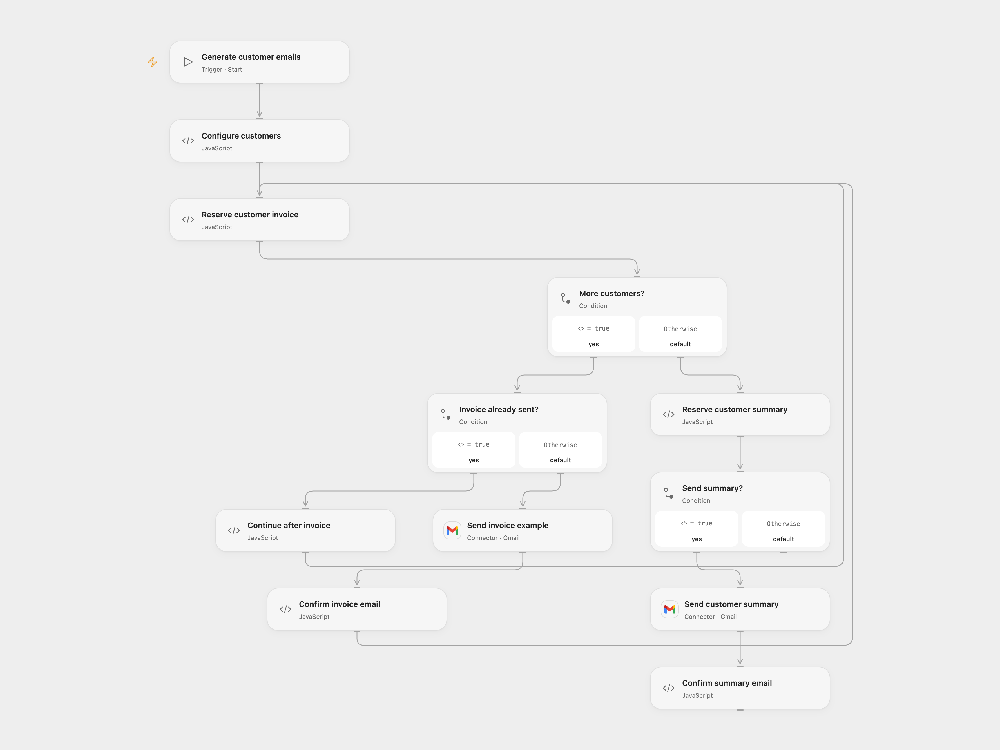

# Email Customer Invoice Examples and Summary

Generate an example invoice for each customer and one customer summary email.

<!-- template-actions:start -->
 
<!-- template-actions:end -->

<picture>
  <source media="(prefers-color-scheme: dark)" srcset="preview-dark.png">
  
</picture>

## Setup

In Open Flow, provide the customer list, unique run ID and internal recipient in **Configure customers**, connect Gmail, enable persistent State and prevent overlapping runs. Each customer needs unique id, name, email, created and optionally country. Use a new run ID for a new batch; reuse the same ID and unchanged customer list to recover a stopped batch.

## Behavior

The workflow sorts the customer list by name and sends one example invoice per customer to the configured internal recipient, followed by one HTML summary to the same recipient. Customer email addresses appear in invoice and summary bodies; they are not the recipients. The two invoice lines are fixed examples and are not an accounting system. The total is corrected to 66.55 euros. The invoice date uses each customer's created value. The source summary says the last 24 hours but did not filter customers; this workflow lists the supplied customers without date filtering.

Each email is reserved before sending. If delivery is unknown, inspect the sent mailbox before replay. In Open Flow enter the pending key and absent or confirmed in the matching reservation node, replay the unchanged batch, then clear both fields.

In n8n

In n8n edit **Configure customers**, provide the same fields and a unique run ID, configure sender and recipient in both SMTP email nodes, connect SMTP and choose a Data Table with item_key and status text columns. In n8n mark the pending Data Table row done only after confirming delivery, or delete it only if no message was sent.

Inspiration &amp; credits

Replace the training datastore with configured data, correct the invoice total and add per-email checkpoints.

Adapted from [Document generator example](https://github.com/Zie619/n8n-workflows/blob/ae8cf6dc5b873cbb4f74587aa9180ed3a9f70682/workflows/Functionitem/0255_Functionitem_Manual_Create_Triggered.json) in [Zie619/n8n-workflows](https://github.com/Zie619/n8n-workflows). The source export does not identify a separate template author or license.

The collection’s [MIT notice](https://github.com/Zie619/n8n-workflows/blob/94007c1445d9258a7da116646b79473e7c7c3282/LICENSE) is pinned at a later revision. This is the collection notice at that revision; it does not establish a separate original template author's license. Our changes are listed above; see [repository licensing](../../README.md#licensing).

> MIT License
>
> Copyright (c) 2025 Zie619
>
> Permission is hereby granted, free of charge, to any person obtaining a copy
> of this software and associated documentation files (the "Software"), to deal
> in the Software without restriction, including without limitation the rights
> to use, copy, modify, merge, publish, distribute, sublicense, and/or sell
> copies of the Software, and to permit persons to whom the Software is
> furnished to do so, subject to the following conditions:
>
> The above copyright notice and this permission notice shall be included in all
> copies or substantial portions of the Software.
>
> THE SOFTWARE IS PROVIDED "AS IS", WITHOUT WARRANTY OF ANY KIND, EXPRESS OR
> IMPLIED, INCLUDING BUT NOT LIMITED TO THE WARRANTIES OF MERCHANTABILITY,
> FITNESS FOR A PARTICULAR PURPOSE AND NONINFRINGEMENT. IN NO EVENT SHALL THE
> AUTHORS OR COPYRIGHT HOLDERS BE LIABLE FOR ANY CLAIM, DAMAGES OR OTHER
> LIABILITY, WHETHER IN AN ACTION OF CONTRACT, TORT OR OTHERWISE, ARISING FROM,
> OUT OF OR IN CONNECTION WITH THE SOFTWARE OR THE USE OR OTHER DEALINGS IN THE
> SOFTWARE.

