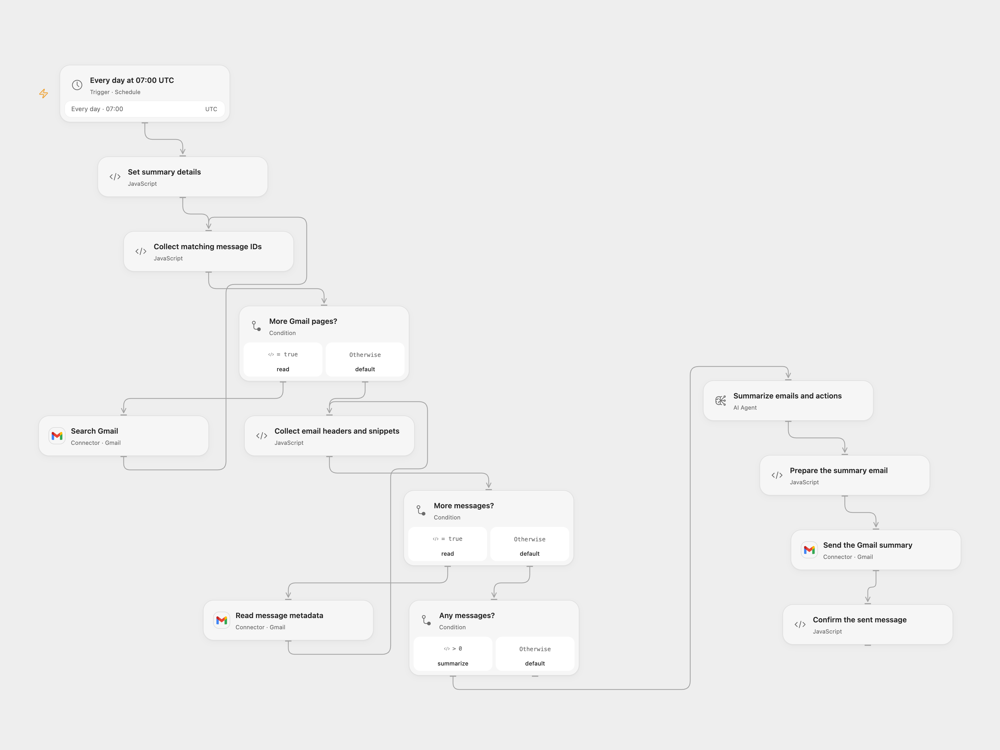

# Email a Daily Gmail Summary

Summarize the previous day’s matching Gmail messages and email the summary and actions.

<picture>
  <source media="(prefers-color-scheme: dark)" srcset="preview-dark.png">
  
</picture>

[Open Flow JSON](templates/email-daily-gmail-summary.openflow.json) · [n8n JSON](templates/email-daily-gmail-summary.n8n.json)

## Setup

Connect Gmail to **Search Gmail**, **Read message metadata**, and **Send the Gmail summary**. In **Set summary details**, enter the sender address, report recipient and optional CC addresses. Configure an AI model in **Summarize emails and actions**. In n8n, set the same addresses in **Set summary details**, connect Gmail credentials on the read and send nodes, and configure OpenAI credentials and model. Activate one format.

## Behavior

At 07:00 UTC each day, the workflow searches Gmail for messages from the configured sender in the preceding 24 hours. It collects message IDs, sender, recipient, CC and snippet, then asks the model for a summary and named actions. An empty result sends no email. Gmail search may not expand sender aliases. Open Flow stops before sending if the message list exceeds 5,000 items or 100 pages, if a page repeats, or if collected data exceeds runtime limits; n8n uses its own limits. It sends one HTML email with escaped model output.

Email headers and snippets are sent to the configured model provider. Review access, data handling and the generated summary before relying on it; email content may include instructions that the model cannot be guaranteed to ignore. Read, model or send errors stop the run. An uncertain send may already have delivered; inspect the mailbox before retrying. The source depended on the n8n instance timezone; both formats start at 07:00 UTC. n8n chooses a fixed second within the minute, while Open Flow starts on the minute boundary.

Inspiration &amp; credits

## Changes to the source

- Replace personal addresses, and use an explicit sender and rolling 24-hour search instead of the source's bare email term and calendar-date cutoff.
- Escape generated HTML and validate model output before sending. Open Flow uses an AI Agent and bounded, complete Gmail pagination; n8n retains its OpenAI node.

Adapted from [Daily Gmail summary](https://github.com/Zie619/n8n-workflows/blob/ae8cf6dc5b873cbb4f74587aa9180ed3a9f70682/workflows/Aggregate/1544_Aggregate_Schedule_Send_Scheduled.json) in [Zie619/n8n-workflows](https://github.com/Zie619/n8n-workflows). The matching [n8n listing](https://n8n.io/workflows/2722-email-summary-agent/) credits Vishal Kumar. The original template does not state a separate license.

The collection’s [MIT notice](https://github.com/Zie619/n8n-workflows/blob/94007c1445d9258a7da116646b79473e7c7c3282/LICENSE) is pinned at a later revision. This is the collection notice at that revision; it does not establish a separate original template author's license. Our changes are listed above; see [repository licensing](../../README.md#licensing).

> MIT License
>
> Copyright (c) 2025 Zie619
>
> Permission is hereby granted, free of charge, to any person obtaining a copy
> of this software and associated documentation files (the "Software"), to deal
> in the Software without restriction, including without limitation the rights
> to use, copy, modify, merge, publish, distribute, sublicense, and/or sell
> copies of the Software, and to permit persons to whom the Software is
> furnished to do so, subject to the following conditions:
>
> The above copyright notice and this permission notice shall be included in all
> copies or substantial portions of the Software.
>
> THE SOFTWARE IS PROVIDED "AS IS", WITHOUT WARRANTY OF ANY KIND, EXPRESS OR
> IMPLIED, INCLUDING BUT NOT LIMITED TO THE WARRANTIES OF MERCHANTABILITY,
> FITNESS FOR A PARTICULAR PURPOSE AND NONINFRINGEMENT. IN NO EVENT SHALL THE
> AUTHORS OR COPYRIGHT HOLDERS BE LIABLE FOR ANY CLAIM, DAMAGES OR OTHER
> LIABILITY, WHETHER IN AN ACTION OF CONTRACT, TORT OR OTHERWISE, ARISING FROM,
> OUT OF OR IN CONNECTION WITH THE SOFTWARE OR THE USE OR OTHER DEALINGS IN THE
> SOFTWARE.

