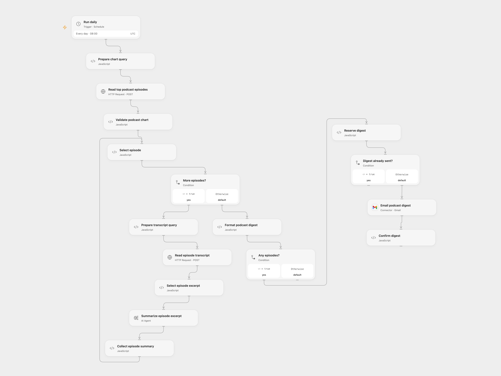

# Email Daily Podcast Chart Summaries

Summarize excerpts from the daily podcast charts and email a digest.

<picture>
  <source media="(prefers-color-scheme: dark)" srcset="preview-dark.png">
  
</picture>

[Open Flow JSON](templates/email-daily-podcast-chart-summaries.openflow.json) · [n8n JSON](templates/email-daily-podcast-chart-summaries.n8n.json)

## Setup

Configure a Taddy account, its user ID and API key, a Gmail connection and recipient, and an AI model. In Open Flow bind secret variables TADDY_USER_ID and TADDY_API_KEY to the X-USER-ID header and authentication token respectively on both Taddy HTTP nodes, and enable persistent State. In n8n configure TADDY_USER_ID as a variable, a Header Auth credential named X-API-KEY on both HTTP nodes, and a Data Table with item_key and status text columns. Set the genre, recipient, and schedule in each platform. Update the recipient in both the Gmail node and the digest checkpoint key. [Taddy-generated transcripts](https://taddy.org/developers/podcast-api/episode-transcripts) require a Pro or Business account with available transcript credits; podcast-provided transcripts are available on free accounts.

## Behavior

At 08:00 UTC, fetch up to ten US episodes for the configured genre. For each episode, select transcript segments overlapping 08:00–24:00 and summarize that excerpt, then email one digest. Segment boundaries may include nearby words, and dynamic advertisements can shift transcript timecodes. If an episode has no timecoded transcript or a request fails, the run stops instead of sending an incomplete digest. No email is sent for an empty chart. Taddy charts update around 09:00 Pacific time, so adjust the schedule to receive a newly updated chart. Transcript text is sent to the model. Prevent overlapping runs; inspect Gmail before clearing a pending checkpoint after an uncertain send.

<details>
<summary>Inspiration &amp; credits</summary>

Adapted from [Daily Podcast Summary](https://github.com/enescingoz/awesome-n8n-templates/blob/827110332c21cbe000ab13f6d292d5adb1f1f8db/OpenAI_and_LLMs/Daily%20Podcast%20Summary.json) in [enescingoz/awesome-n8n-templates](https://github.com/enescingoz/awesome-n8n-templates).

Source collection notice: © 2024–2026 Enes Cingoz, [CC BY 4.0](https://github.com/enescingoz/awesome-n8n-templates/blob/827110332c21cbe000ab13f6d292d5adb1f1f8db/LICENSE). The source export does not identify a separate template author or license. See [repository licensing](../../README.md#licensing) for the scope of OOMOL contributions and third-party material.


Changes from source: Replace the third-party audio cutter and Whisper upload with Taddy timecoded transcripts, retain the 08:00–24:00 excerpt, validate failures, and add a daily Gmail checkpoint.

Collection license notice:

```text
Creative Commons Attribution 4.0 International License

Copyright (c) 2024-2026 Enes Cingoz

You are free to:

  Share - copy and redistribute the material in any medium or format
  Adapt - remix, transform, and build upon the material for any purpose,
  even commercially.

Under the following terms:

  Attribution - You must give appropriate credit, provide a link to the
  license, and indicate if changes were made. You may do so in any
  reasonable manner, but not in any way that suggests the licensor
  endorses you or your use.

  No additional restrictions - You may not apply legal terms or
  technological measures that legally restrict others from doing
  anything the license permits.

Notices:

  You do not have to comply with the license for elements of the
  material in the public domain or where your use is permitted by an
  applicable exception or limitation.

  No warranties are given. The license may not give you all of the
  permissions necessary for your intended use. For example, other rights
  such as publicity, privacy, or moral rights may limit how you use the
  material.

For the full license text, see:
https://creativecommons.org/licenses/by/4.0/legalcode

```

</details>
