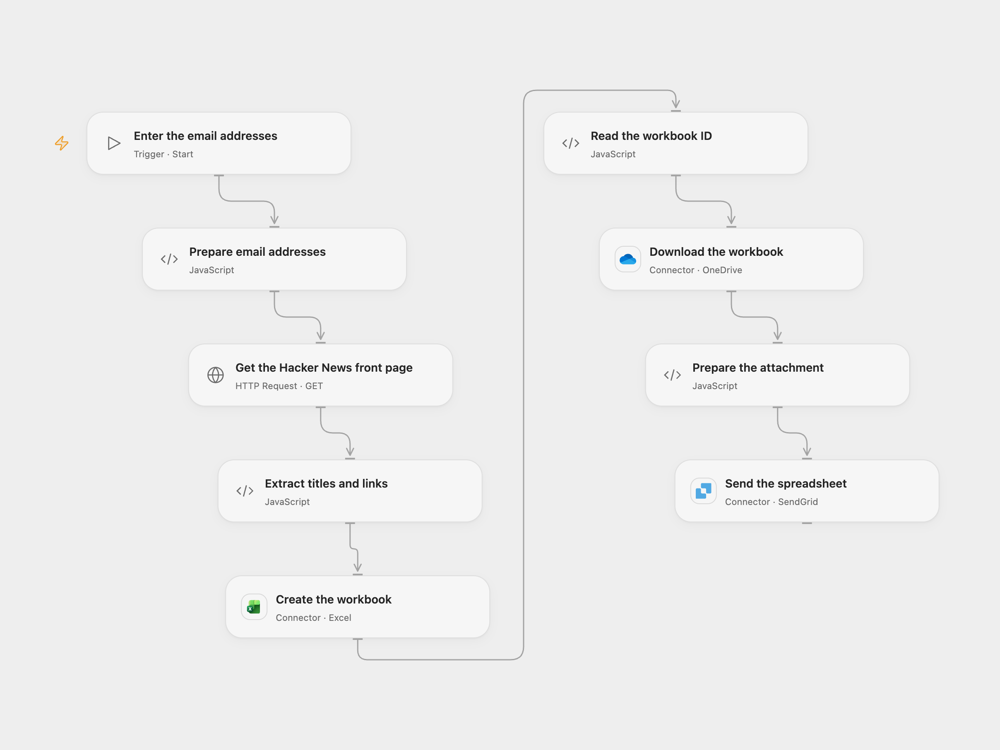

# Email Hacker News Headlines as a Spreadsheet

Email the current Hacker News front-page titles and links in a spreadsheet attachment.

<picture>
  <source media="(prefers-color-scheme: dark)" srcset="preview-dark.png">
  
</picture>

[Open Flow JSON](templates/email-hacker-news-headlines-as-a-spreadsheet.openflow.json) · [n8n JSON](templates/email-hacker-news-headlines-as-a-spreadsheet.n8n.json)

## Setup

Connect Excel and OneDrive for the same Microsoft account and connect SendGrid with a verified sender. Configure **Prepare the attachment** HTTP capability to allow your connector transit storage host. Start Open Flow with the sender and recipient email addresses. Each run leaves a uniquely named workbook in the OneDrive root; remove it when no longer needed.

In n8n connect an SMTP account and configure the sender and recipient in **Send email notification**.

## Behavior

The workflow reads the Hacker News front page and emails a spreadsheet of titles and links. Open Flow creates an XLSX workbook in OneDrive and sends it through SendGrid; n8n creates the attachment in memory and sends it through SMTP. A workbook creation or email send with an unknown outcome may have succeeded; inspect OneDrive or sent mail before retrying. The page and workbook must fit the execution limits.

Inspiration &amp; credits

## Changes to the source

- Update the source's obsolete headline selector. Both formats produce XLSX rather than the source node's default XLS; the rows and columns remain the same. Open Flow adds Excel, OneDrive and SendGrid connections.

Adapted from [Email Hacker News front-page headlines](https://github.com/Zie619/n8n-workflows/blob/ae8cf6dc5b873cbb4f74587aa9180ed3a9f70682/workflows/Manual/0102_Manual_HTTP_Create_Webhook.json) in [Zie619/n8n-workflows](https://github.com/Zie619/n8n-workflows). The source export does not identify a separate template author or license.

The collection’s [MIT notice](https://github.com/Zie619/n8n-workflows/blob/94007c1445d9258a7da116646b79473e7c7c3282/LICENSE) is pinned at a later revision. This is the collection notice at that revision; it does not establish a separate original template author's license. Our changes are listed above; see [repository licensing](../../README.md#licensing).

> MIT License
>
> Copyright (c) 2025 Zie619
>
> Permission is hereby granted, free of charge, to any person obtaining a copy
> of this software and associated documentation files (the "Software"), to deal
> in the Software without restriction, including without limitation the rights
> to use, copy, modify, merge, publish, distribute, sublicense, and/or sell
> copies of the Software, and to permit persons to whom the Software is
> furnished to do so, subject to the following conditions:
>
> The above copyright notice and this permission notice shall be included in all
> copies or substantial portions of the Software.
>
> THE SOFTWARE IS PROVIDED "AS IS", WITHOUT WARRANTY OF ANY KIND, EXPRESS OR
> IMPLIED, INCLUDING BUT NOT LIMITED TO THE WARRANTIES OF MERCHANTABILITY,
> FITNESS FOR A PARTICULAR PURPOSE AND NONINFRINGEMENT. IN NO EVENT SHALL THE
> AUTHORS OR COPYRIGHT HOLDERS BE LIABLE FOR ANY CLAIM, DAMAGES OR OTHER
> LIABILITY, WHETHER IN AN ACTION OF CONTRACT, TORT OR OTHERWISE, ARISING FROM,
> OUT OF OR IN CONNECTION WITH THE SOFTWARE OR THE USE OR OTHER DEALINGS IN THE
> SOFTWARE.

