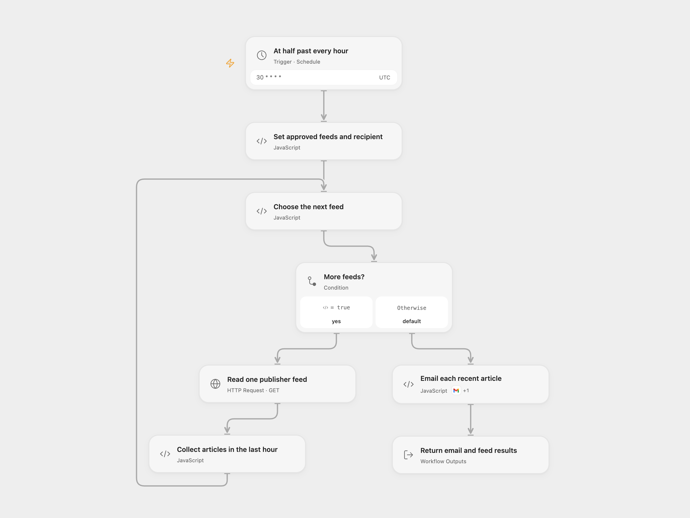

# Email Recent RSS Articles Every Hour

Check selected publisher feeds at half past each hour and email each article published in the preceding hour.

<!-- template-actions:start -->
 
<!-- template-actions:end -->

<picture>
  <source media="(prefers-color-scheme: dark)" srcset="preview-dark.png">
  
</picture>

## Setup

1. In **Set approved feeds and recipient**, enter one email address. List the public HTTPS RSS or Atom feed URLs on separate lines, and list the trusted feed and article hostnames separated by commas. The source publisher feeds are included as examples. Supply the direct feed URLs and include all approved article domains. Social platforms, their aliases and redirects are excluded.
2. Connect Gmail in **Email each recent article**. The schedule defaults to minute 30 of every hour in UTC. Change the time zone or minute in **At half past every hour**, then publish.

## Behavior

The workflow checks the feed documents for articles published after the start of the preceding hour and through the scheduled run time. Each email contains the article’s link, title and feed excerpt. If Atom omits the published date, the workflow uses its updated date. Invalid dates and links are skipped.

It reads one XML document per feed, up to 600,000 characters. The source has no feed pagination or saved article history. An article repeated in multiple feeds can produce multiple emails. Non-200 responses and unreadable feed documents are reported. A transport failure can stop the run before Gmail is called. After an unconfirmed Gmail request, check Sent before sending the article again.

In n8n

Configure feeds, approved hosts and the recipient in **Set approved feeds and recipient**. Connect Gmail OAuth2 in **Email each recent article**. The schedule is set to UTC in the workflow settings. Failed feed requests are skipped. A failed or unconfirmed Gmail request stops the remaining sends for that run.

Inspiration &amp; credits

Adapted from [Hourly RSS article emails](https://github.com/Zie619/n8n-workflows/blob/ae8cf6dc5b873cbb4f74587aa9180ed3a9f70682/workflows/Splitout/0442_Splitout_Schedule_Send_Scheduled.json) in [Zie619/n8n-workflows](https://github.com/Zie619/n8n-workflows). Attribution: Zie619 / n8n-workflows.

The collection’s [MIT notice](https://github.com/Zie619/n8n-workflows/blob/94007c1445d9258a7da116646b79473e7c7c3282/LICENSE) is pinned at a later revision. This is the collection notice at that revision; it does not establish a separate original template author's license. Our changes are listed above; see [repository licensing](../../README.md#licensing).

> MIT License
>
> Copyright (c) 2025 Zie619
>
> Permission is hereby granted, free of charge, to any person obtaining a copy
> of this software and associated documentation files (the "Software"), to deal
> in the Software without restriction, including without limitation the rights
> to use, copy, modify, merge, publish, distribute, sublicense, and/or sell
> copies of the Software, and to permit persons to whom the Software is
> furnished to do so, subject to the following conditions:
>
> The above copyright notice and this permission notice shall be included in all
> copies or substantial portions of the Software.
>
> THE SOFTWARE IS PROVIDED "AS IS", WITHOUT WARRANTY OF ANY KIND, EXPRESS OR
> IMPLIED, INCLUDING BUT NOT LIMITED TO THE WARRANTIES OF MERCHANTABILITY,
> FITNESS FOR A PARTICULAR PURPOSE AND NONINFRINGEMENT. IN NO EVENT SHALL THE
> AUTHORS OR COPYRIGHT HOLDERS BE LIABLE FOR ANY CLAIM, DAMAGES OR OTHER
> LIABILITY, WHETHER IN AN ACTION OF CONTRACT, TORT OR OTHERWISE, ARISING FROM,
> OUT OF OR IN CONNECTION WITH THE SOFTWARE OR THE USE OR OTHER DEALINGS IN THE
> SOFTWARE.

The original minute-30 schedule, one-hour filter and separate article emails are preserved. The schedule uses explicit UTC, approved HTTPS feeds and a single run-time boundary. Emails use plain text and omit the platform attribution footer.

