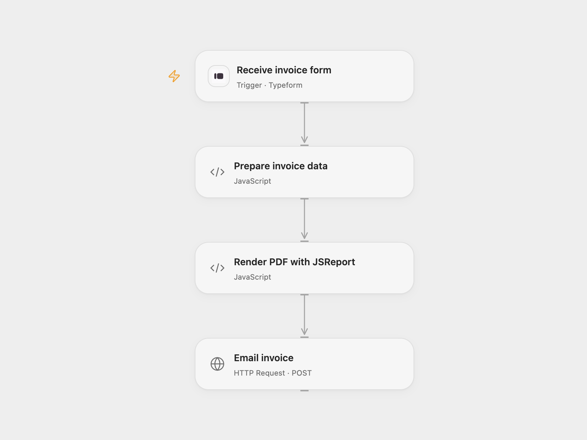

# Email a JSReport Invoice from a Form

Generate an invoice PDF with JSReport and email it after a form submission.

<picture>
  <source media="(prefers-color-scheme: dark)" srcset="preview-dark.png">
  
</picture>

[Open Flow JSON](templates/email-jsreport-invoice-from-form.openflow.json) · [n8n JSON](templates/email-jsreport-invoice-from-form.n8n.json)

## Setup

Create a Typeform with required questions titled buyer name, buyer road, buyer country, Item 1 Name, Item 1 Price, Item 2 Name and Item 2 Price. Use number fields for the two prices. Connect Typeform and set the form ID. In **Prepare invoice data**, set the invoice number and seller details. Create the JSReport Online invoice-main template, set your account hostname in **Render PDF with JSReport**, and bind secret Variables JSREPORT_USERNAME and JSREPORT_PASSWORD. Set the recipient in **Render PDF with JSReport** and bind secret Variable GMAIL_ACCESS_TOKEN containing a Gmail OAuth access token with gmail.send permission. Refresh the token when it expires. In n8n use its form, set the JSReport URL and basic-auth credential, configure the seller details and Gmail recipient, and connect Gmail. Activate one format.

## Behavior

A submission sends buyer details and two line items to JSReport, then emails the resulting PDF as an attachment. Contact and invoice data are sent to JSReport and Gmail and may be retained in execution history. Open Flow's binary encoding has a size limit: a 500 KiB PDF was verified and a 700 KiB PDF exceeded the runtime limit before email. If email delivery is uncertain, inspect the mailbox before retrying to avoid duplicates.

Inspiration &amp; credits

## Changes to the source

- Use Typeform and a Gmail API request with an OAuth token for Open Flow; make the two line-item fields required in both formats. Replace instance-specific details with setup values.

Adapted from [Get PDF with JSReport](https://github.com/Zie619/n8n-workflows/blob/ae8cf6dc5b873cbb4f74587aa9180ed3a9f70682/workflows/Http/1883_HTTP_Form_Import_Webhook.json) in [Zie619/n8n-workflows](https://github.com/Zie619/n8n-workflows). The source export does not identify a separate template author or license.

The collection’s [MIT notice](https://github.com/Zie619/n8n-workflows/blob/94007c1445d9258a7da116646b79473e7c7c3282/LICENSE) is pinned at a later revision. This is the collection notice at that revision; it does not establish a separate original template author's license. Our changes are listed above; see [repository licensing](../../README.md#licensing).

> MIT License
>
> Copyright (c) 2025 Zie619
>
> Permission is hereby granted, free of charge, to any person obtaining a copy
> of this software and associated documentation files (the "Software"), to deal
> in the Software without restriction, including without limitation the rights
> to use, copy, modify, merge, publish, distribute, sublicense, and/or sell
> copies of the Software, and to permit persons to whom the Software is
> furnished to do so, subject to the following conditions:
>
> The above copyright notice and this permission notice shall be included in all
> copies or substantial portions of the Software.
>
> THE SOFTWARE IS PROVIDED "AS IS", WITHOUT WARRANTY OF ANY KIND, EXPRESS OR
> IMPLIED, INCLUDING BUT NOT LIMITED TO THE WARRANTIES OF MERCHANTABILITY,
> FITNESS FOR A PARTICULAR PURPOSE AND NONINFRINGEMENT. IN NO EVENT SHALL THE
> AUTHORS OR COPYRIGHT HOLDERS BE LIABLE FOR ANY CLAIM, DAMAGES OR OTHER
> LIABILITY, WHETHER IN AN ACTION OF CONTRACT, TORT OR OTHERWISE, ARISING FROM,
> OUT OF OR IN CONNECTION WITH THE SOFTWARE OR THE USE OR OTHER DEALINGS IN THE
> SOFTWARE.

