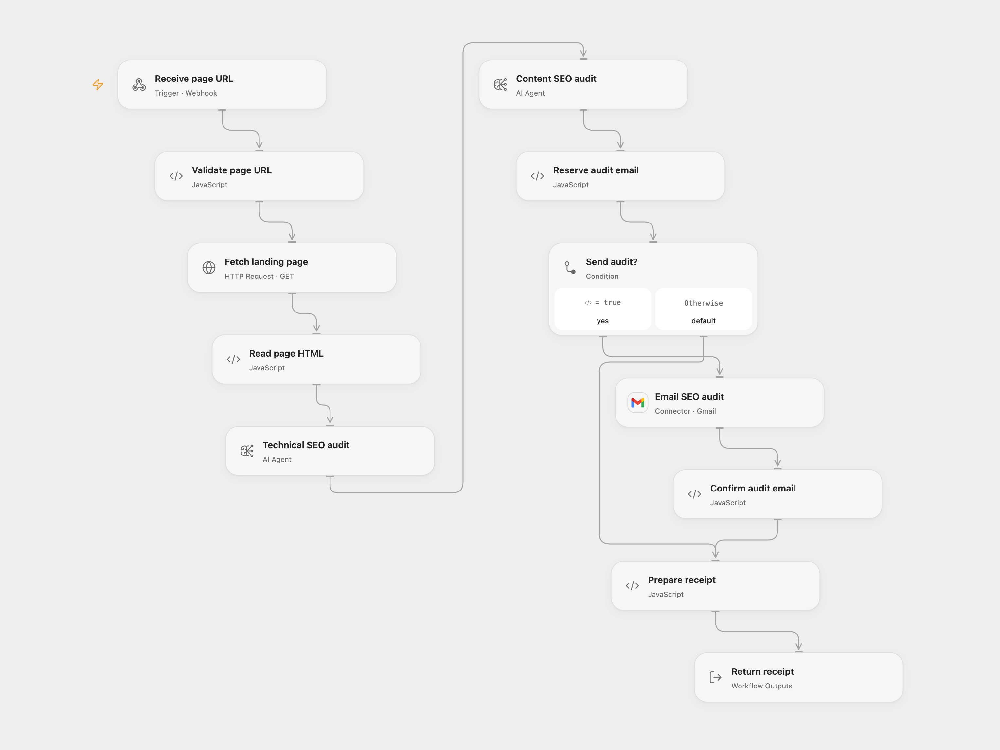

# Email Landing Page SEO Audit

Audit a landing page for technical SEO and content improvements and email the findings.

<picture>
  <source media="(prefers-color-scheme: dark)" srcset="preview-dark.png">
  
</picture>

[Open Flow JSON](templates/email-landing-page-seo-audit.openflow.json) · [n8n JSON](templates/email-landing-page-seo-audit.n8n.json)

## Setup

Import the n8n workflow, connect OpenAI and Gmail, set the audit recipient in **Gmail**, and choose a Data Table with item_key and status text columns. Prevent overlapping executions.

For Open Flow set **Prepare audit** to relay, configure the deployed webhook URL, connect Gmail, select an AI model, configure **Reserve audit email** and enable persistent State. Restrict the webhook to trusted n8n. Direct mode runs in n8n; use one mode. Submit a public HTTP(S) landing page URL. Deploy with network controls that prevent access to private or internal hosts, including redirects.

## Behavior

The workflow fetches the requested page and produces a technical audit followed by a content audit. It emails the findings to the configured recipient with the page URL in the subject. Model findings are suggestions, not measured rankings or performance; review them. HTML is sent to the model and may appear in execution history. The page and each Code input/output must fit 1 MiB.

If delivery is uncertain, inspect Gmail before replay. In Open Flow enter the pending key and confirmed or absent in **Reserve audit email**, replay the same submission and clear both fields. In n8n inspect the pending Data Table row, mark it done after confirming delivery or delete it only if no email was sent.

Inspiration &amp; credits

Add a URL relay and email checkpoint, and replace the private recipient.

Adapted from [🤖 On-Page SEO Audit](https://github.com/Zie619/n8n-workflows/blob/ae8cf6dc5b873cbb4f74587aa9180ed3a9f70682/workflows/Form/1886_Form_Markdown_Automation_Webhook.json) in [Zie619/n8n-workflows](https://github.com/Zie619/n8n-workflows). The source export does not identify a separate template author or license.

The collection’s [MIT notice](https://github.com/Zie619/n8n-workflows/blob/94007c1445d9258a7da116646b79473e7c7c3282/LICENSE) is pinned at a later revision. This is the collection notice at that revision; it does not establish a separate original template author's license. Our changes are listed above; see [repository licensing](../../README.md#licensing).

> MIT License
>
> Copyright (c) 2025 Zie619
>
> Permission is hereby granted, free of charge, to any person obtaining a copy
> of this software and associated documentation files (the "Software"), to deal
> in the Software without restriction, including without limitation the rights
> to use, copy, modify, merge, publish, distribute, sublicense, and/or sell
> copies of the Software, and to permit persons to whom the Software is
> furnished to do so, subject to the following conditions:
>
> The above copyright notice and this permission notice shall be included in all
> copies or substantial portions of the Software.
>
> THE SOFTWARE IS PROVIDED "AS IS", WITHOUT WARRANTY OF ANY KIND, EXPRESS OR
> IMPLIED, INCLUDING BUT NOT LIMITED TO THE WARRANTIES OF MERCHANTABILITY,
> FITNESS FOR A PARTICULAR PURPOSE AND NONINFRINGEMENT. IN NO EVENT SHALL THE
> AUTHORS OR COPYRIGHT HOLDERS BE LIABLE FOR ANY CLAIM, DAMAGES OR OTHER
> LIABILITY, WHETHER IN AN ACTION OF CONTRACT, TORT OR OTHERWISE, ARISING FROM,
> OUT OF OR IN CONNECTION WITH THE SOFTWARE OR THE USE OR OTHER DEALINGS IN THE
> SOFTWARE.

