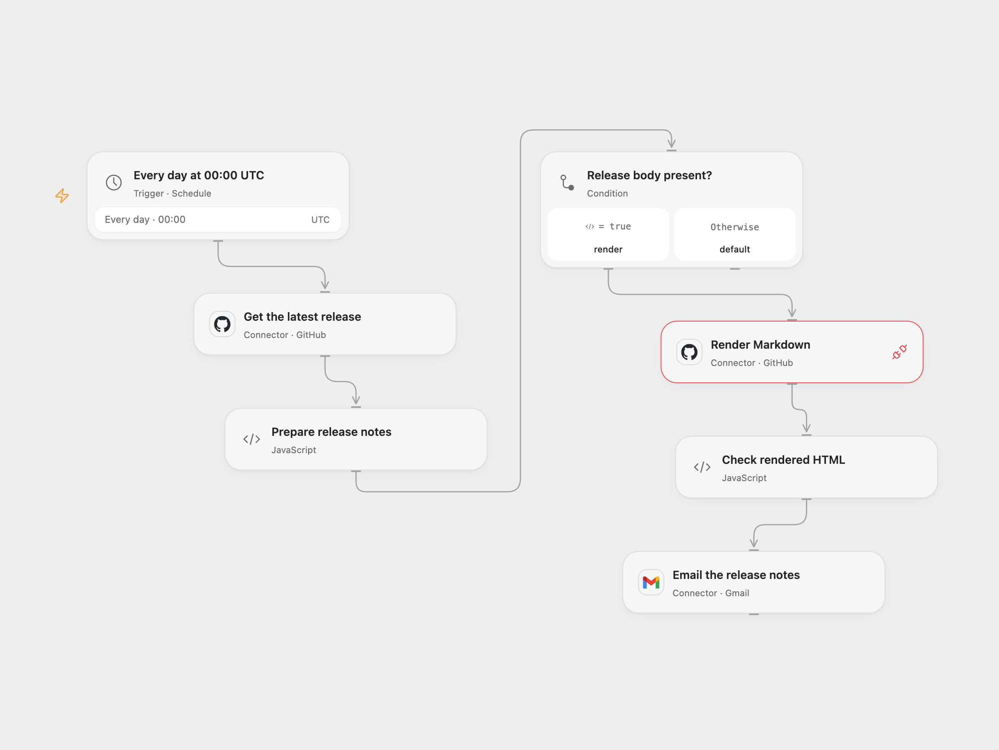

# Email the Latest GitHub Release Notes

Email the latest published GitHub release notes as HTML each day.

<picture>
  <source media="(prefers-color-scheme: dark)" srcset="preview-dark.png">
  
</picture>

[Open Flow JSON](templates/email-latest-github-release-notes.openflow.json) · [n8n JSON](templates/email-latest-github-release-notes.n8n.json)

## Setup

Connect GitHub in **Get the latest release** and **Render Markdown**, allowing release reads and Provider API Request access. Set the repository owner and name in **Get the latest release**; the defaults are n8n-io and n8n. Connect Gmail and set the recipient in **Email the release notes**. In n8n, set the repository in **Fetch Github Repo Releases**, connect Gmail and set its recipient. Enable one format.

## Behavior

Every day at 00:00 UTC, the workflow reads GitHub's latest published release and emails its notes rendered as HTML. It sends every day even when the release has not changed. An empty or null release body produces an empty message body; if the body field is absent, no email is sent. Drafts and prereleases are excluded by GitHub's latest-release endpoint. A missing release, GitHub API error or rendering failure stops before the email. GitHub may impose rate limits, and the workflow's execution limits apply to large release notes.

GitHub renders the Markdown, so its HTML can differ from the source's renderer. The source inherited the n8n instance timezone; both formats start in UTC. An uncertain Gmail send may already have succeeded, so inspect Sent mail before retrying.

Inspiration &amp; credits

## Changes to the source

- Replace the private recipient and allow the repository to be configured.
- Use the GitHub release Action and GitHub's Markdown API to render the notes; n8n uses the public GitHub API for both reads and rendering. The original n8n attribution link is omitted.
- Set the timezone explicitly. No deduplication is added.

Adapted from [Daily latest GitHub release notes](https://github.com/Zie619/n8n-workflows/blob/ae8cf6dc5b873cbb4f74587aa9180ed3a9f70682/workflows/Splitout/0500_Splitout_Schedule_Send_Scheduled.json) in [Zie619/n8n-workflows](https://github.com/Zie619/n8n-workflows). The matching [n8n community listing](https://n8n.io/workflows/2278-subscribe-to-new-releases-of-a-github-repository-via-gmail/) credits Ria. The original template does not state a separate license.

The collection’s [MIT notice](https://github.com/Zie619/n8n-workflows/blob/94007c1445d9258a7da116646b79473e7c7c3282/LICENSE) is pinned at a later revision. This is the collection notice at that revision; it does not establish a separate original template author's license. Our changes are listed above; see [repository licensing](../../README.md#licensing).

> MIT License
>
> Copyright (c) 2025 Zie619
>
> Permission is hereby granted, free of charge, to any person obtaining a copy
> of this software and associated documentation files (the "Software"), to deal
> in the Software without restriction, including without limitation the rights
> to use, copy, modify, merge, publish, distribute, sublicense, and/or sell
> copies of the Software, and to permit persons to whom the Software is
> furnished to do so, subject to the following conditions:
>
> The above copyright notice and this permission notice shall be included in all
> copies or substantial portions of the Software.
>
> THE SOFTWARE IS PROVIDED "AS IS", WITHOUT WARRANTY OF ANY KIND, EXPRESS OR
> IMPLIED, INCLUDING BUT NOT LIMITED TO THE WARRANTIES OF MERCHANTABILITY,
> FITNESS FOR A PARTICULAR PURPOSE AND NONINFRINGEMENT. IN NO EVENT SHALL THE
> AUTHORS OR COPYRIGHT HOLDERS BE LIABLE FOR ANY CLAIM, DAMAGES OR OTHER
> LIABILITY, WHETHER IN AN ACTION OF CONTRACT, TORT OR OTHERWISE, ARISING FROM,
> OUT OF OR IN CONNECTION WITH THE SOFTWARE OR THE USE OR OTHER DEALINGS IN THE
> SOFTWARE.

