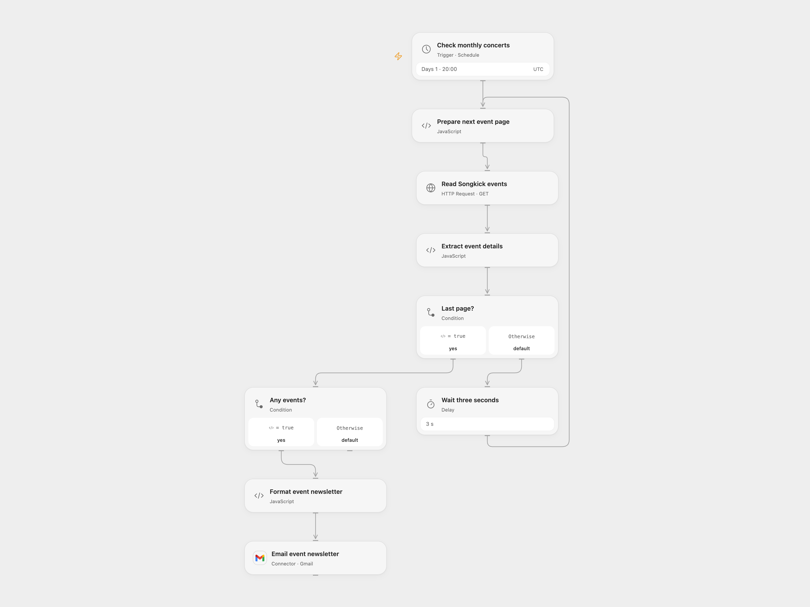

# Email Monthly Songkick Events

Email a monthly list of Songkick concerts for a chosen location.

<picture>
  <source media="(prefers-color-scheme: dark)" srcset="preview-dark.png">
  
</picture>

[Open Flow JSON](templates/email-monthly-songkick-events.openflow.json) · [n8n JSON](templates/email-monthly-songkick-events.n8n.json)

## Setup and use

Connect Gmail, set the recipient and enter a Songkick metro-area URL in **Prepare next event page** without a trailing /this-month. Adjust the monthly schedule and timezone if needed. In n8n set the location and email in **Setup location and email** and connect Gmail. Use one format.

## Behavior

On the first day of each month at 20:00 UTC, the workflow reads Songkick's this-month event pages, following 50-item pages with a three-second pause, and emails each event's date, artist, support act, location and link. It sends no email if there are no events. Songkick page structure and availability may change. Event listings and email content can appear in execution history. If sending has an unknown outcome, inspect Gmail before retrying.

Inspiration &amp; credits

## Changes to the source

- Open Flow combines events into one newsletter and uses UTC scheduling; event HTML uses a simpler table. The n8n pagination also handles an empty final page. Replace source configuration with placeholders.

Adapted from [Monthly Songkick event newsletter](https://github.com/Zie619/n8n-workflows/blob/ae8cf6dc5b873cbb4f74587aa9180ed3a9f70682/workflows/Wait/0385_Wait_Code_Send_Scheduled.json) in [Zie619/n8n-workflows](https://github.com/Zie619/n8n-workflows). The source export does not identify a separate template author or license.

The collection’s [MIT notice](https://github.com/Zie619/n8n-workflows/blob/94007c1445d9258a7da116646b79473e7c7c3282/LICENSE) is pinned at a later revision. This is the collection notice at that revision; it does not establish a separate original template author's license. Our changes are listed above; see [repository licensing](../../README.md#licensing).

> MIT License
>
> Copyright (c) 2025 Zie619
>
> Permission is hereby granted, free of charge, to any person obtaining a copy
> of this software and associated documentation files (the "Software"), to deal
> in the Software without restriction, including without limitation the rights
> to use, copy, modify, merge, publish, distribute, sublicense, and/or sell
> copies of the Software, and to permit persons to whom the Software is
> furnished to do so, subject to the following conditions:
>
> The above copyright notice and this permission notice shall be included in all
> copies or substantial portions of the Software.
>
> THE SOFTWARE IS PROVIDED "AS IS", WITHOUT WARRANTY OF ANY KIND, EXPRESS OR
> IMPLIED, INCLUDING BUT NOT LIMITED TO THE WARRANTIES OF MERCHANTABILITY,
> FITNESS FOR A PARTICULAR PURPOSE AND NONINFRINGEMENT. IN NO EVENT SHALL THE
> AUTHORS OR COPYRIGHT HOLDERS BE LIABLE FOR ANY CLAIM, DAMAGES OR OTHER
> LIABILITY, WHETHER IN AN ACTION OF CONTRACT, TORT OR OTHERWISE, ARISING FROM,
> OUT OF OR IN CONNECTION WITH THE SOFTWARE OR THE USE OR OTHER DEALINGS IN THE
> SOFTWARE.

The bundled htmlparser2 is available under the MIT license and entities under the BSD 2-Clause license; their full notices are included in the workflow module.

