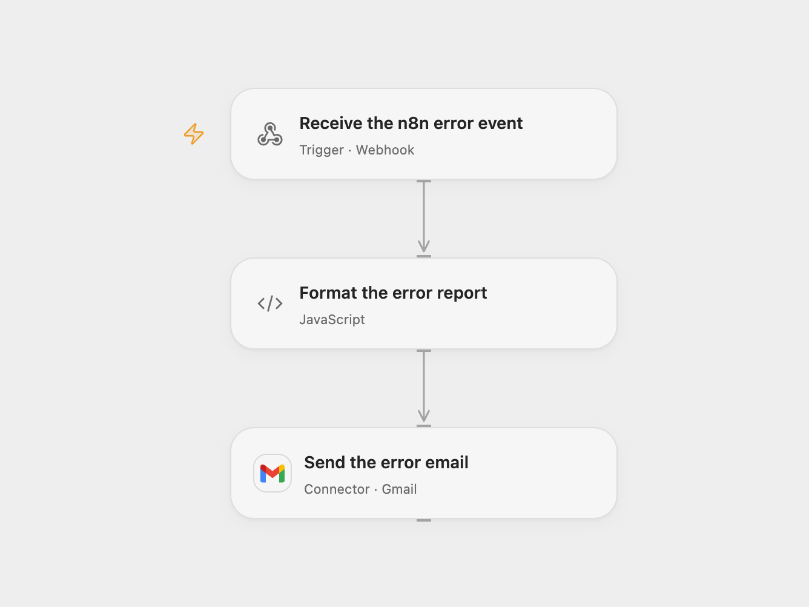

# Email n8n Execution and Trigger Errors

Email detailed n8n execution errors and trigger failures.

<picture>
  <source media="(prefers-color-scheme: dark)" srcset="preview-dark.png">
  
</picture>

[Open Flow JSON](templates/email-n8n-execution-and-trigger-errors.openflow.json) · [n8n JSON](templates/email-n8n-execution-and-trigger-errors.n8n.json)

## Setup

Connect Gmail and set the alert recipient in **Send the error email**. Optionally set the n8n base URL and error handler ID and name in **Format the error report**. Deploy the Open Flow webhook.

Import the n8n workflow and configure **Choose delivery mode**. Choose `direct` to send with the n8n Gmail credential, or `relay` to POST the complete error event to your Open Flow webhook. Set the corresponding recipient or Open Flow URL and assign the workflow as the error workflow in n8n. Choose one mode so one event produces one email.

## Behavior

Execution errors and trigger failures produce a plain-text email with the workflow, error type, handler information and the error event. Known credential fields and common secret patterns are redacted, but error messages and context can still contain sensitive data; restrict the mailbox and execution history. The Open Flow webhook accepts public requests without authentication; restrict access to its URL. Its acknowledgment does not confirm email delivery. If the send outcome is unknown, inspect Gmail before replaying an event.

Inspiration &amp; credits

## Changes to the source

- Use a plain-text report for both error types, remove the example recipient, and redact common secret fields.
- Provide an n8n relay mode for Open Flow and preserve the complete incoming event.

Adapted from [Detailed n8n error email](https://github.com/Zie619/n8n-workflows/blob/ae8cf6dc5b873cbb4f74587aa9180ed3a9f70682/workflows/Error/1991_Error_Code_Automation_Triggered.json) in [Zie619/n8n-workflows](https://github.com/Zie619/n8n-workflows). The source credits [Olek](https://n8n.io/creators/olek/) and says it extends [Send email via Gmail on workflow error](https://n8n.io/workflows/696-send-email-via-gmail-on-workflow-error/). The original template does not state a separate license.

The collection’s [MIT notice](https://github.com/Zie619/n8n-workflows/blob/94007c1445d9258a7da116646b79473e7c7c3282/LICENSE) is pinned at a later revision. This is the collection notice at that revision; it does not establish a separate original template author's license. Our changes are listed above; see [repository licensing](../../README.md#licensing).

> MIT License
>
> Copyright (c) 2025 Zie619
>
> Permission is hereby granted, free of charge, to any person obtaining a copy
> of this software and associated documentation files (the "Software"), to deal
> in the Software without restriction, including without limitation the rights
> to use, copy, modify, merge, publish, distribute, sublicense, and/or sell
> copies of the Software, and to permit persons to whom the Software is
> furnished to do so, subject to the following conditions:
>
> The above copyright notice and this permission notice shall be included in all
> copies or substantial portions of the Software.
>
> THE SOFTWARE IS PROVIDED "AS IS", WITHOUT WARRANTY OF ANY KIND, EXPRESS OR
> IMPLIED, INCLUDING BUT NOT LIMITED TO THE WARRANTIES OF MERCHANTABILITY,
> FITNESS FOR A PARTICULAR PURPOSE AND NONINFRINGEMENT. IN NO EVENT SHALL THE
> AUTHORS OR COPYRIGHT HOLDERS BE LIABLE FOR ANY CLAIM, DAMAGES OR OTHER
> LIABILITY, WHETHER IN AN ACTION OF CONTRACT, TORT OR OTHERWISE, ARISING FROM,
> OUT OF OR IN CONNECTION WITH THE SOFTWARE OR THE USE OR OTHER DEALINGS IN THE
> SOFTWARE.

