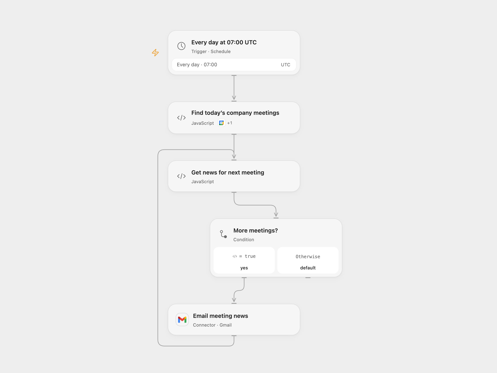

# Email News Before Company Meetings

Email recent company news for today’s matching calendar meetings.

<picture>
  <source media="(prefers-color-scheme: dark)" srcset="preview-dark.png">
  
</picture>

[Open Flow JSON](templates/email-news-before-company-meetings.openflow.json) · [n8n JSON](templates/email-news-before-company-meetings.n8n.json)

## Setup

Connect Google Calendar and Gmail. Set the calendar ID in **Find today’s company meetings**, the recipient in **Get news for next meeting**, and bind a secret Variable containing a NewsAPI key. Set the lookback days and maximum article count as needed. The NewsAPI plan must support the requested search. In n8n connect Google Calendar and Gmail, set the calendar and recipient in **Get meetings for today** and **Setup**, and configure an HTTP Header Auth credential with header `X-Api-Key` and your NewsAPI key on **Get latest news**. Activate one format.

## Behavior

Every day at 07:00 UTC the workflow checks that UTC day’s calendar. Each event whose summary begins with “call with” or “meeting with” gets a separate email with English title-search results using the configured lookback and limit (10 days and 20 articles by default). The rest of the summary is used as the company search term. No matching meetings means no email. Source results can be incomplete or inaccurate; inspect linked articles. Change the timezone and day-boundary logic together if needed.

A failed lookup stops the run. An uncertain email send may already have succeeded; inspect sent mail before rerunning. Earlier emails are not rolled back.

Inspiration &amp; credits

## Changes to the source

- Replace the exposed sample API key, calendar and recipient with configuration. Set UTC explicitly, read all calendar pages, escape article text, repair table markup and keep each meeting associated with its email.

Adapted from [Company news before meetings](https://github.com/Zie619/n8n-workflows/blob/ae8cf6dc5b873cbb4f74587aa9180ed3a9f70682/workflows/Code/0415_Code_GoogleCalendar_Create_Webhook.json) in [Zie619/n8n-workflows](https://github.com/Zie619/n8n-workflows). The source export does not identify a separate template author or license.

The collection’s [MIT notice](https://github.com/Zie619/n8n-workflows/blob/94007c1445d9258a7da116646b79473e7c7c3282/LICENSE) is pinned at a later revision. This is the collection notice at that revision; it does not establish a separate original template author's license. Our changes are listed above; see [repository licensing](../../README.md#licensing).

> MIT License
>
> Copyright (c) 2025 Zie619
>
> Permission is hereby granted, free of charge, to any person obtaining a copy
> of this software and associated documentation files (the "Software"), to deal
> in the Software without restriction, including without limitation the rights
> to use, copy, modify, merge, publish, distribute, sublicense, and/or sell
> copies of the Software, and to permit persons to whom the Software is
> furnished to do so, subject to the following conditions:
>
> The above copyright notice and this permission notice shall be included in all
> copies or substantial portions of the Software.
>
> THE SOFTWARE IS PROVIDED "AS IS", WITHOUT WARRANTY OF ANY KIND, EXPRESS OR
> IMPLIED, INCLUDING BUT NOT LIMITED TO THE WARRANTIES OF MERCHANTABILITY,
> FITNESS FOR A PARTICULAR PURPOSE AND NONINFRINGEMENT. IN NO EVENT SHALL THE
> AUTHORS OR COPYRIGHT HOLDERS BE LIABLE FOR ANY CLAIM, DAMAGES OR OTHER
> LIABILITY, WHETHER IN AN ACTION OF CONTRACT, TORT OR OTHERWISE, ARISING FROM,
> OUT OF OR IN CONNECTION WITH THE SOFTWARE OR THE USE OR OTHER DEALINGS IN THE
> SOFTWARE.

