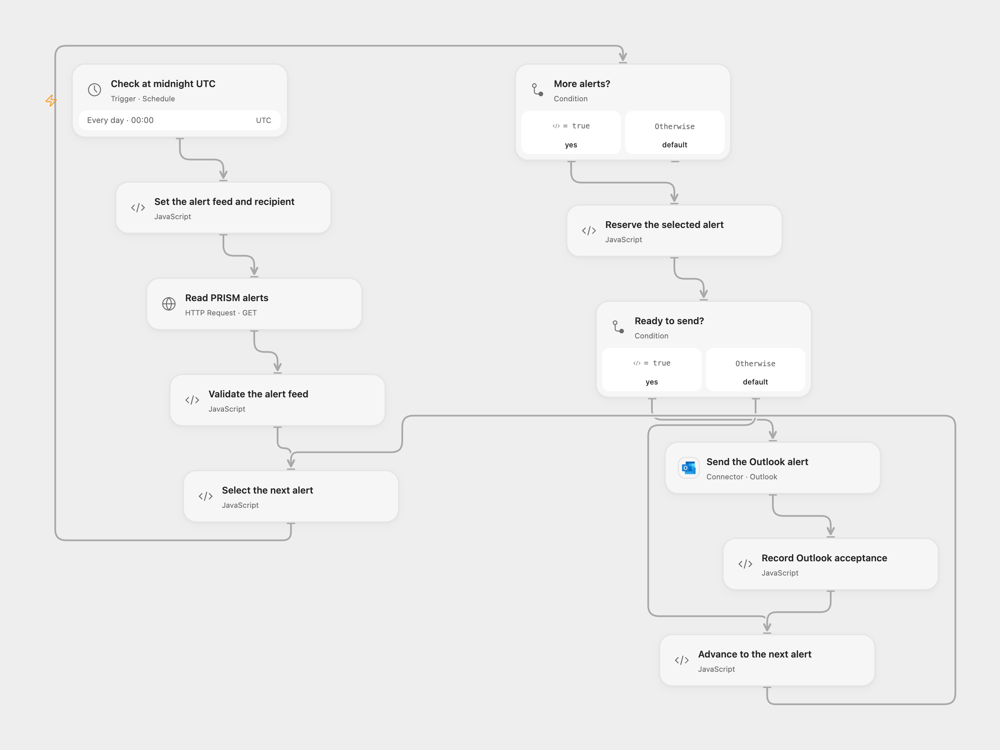

# Email PRISM Elastic Alerts

Read an authorized PRISM alert feed and send each alert to an Outlook recipient.

<!-- template-actions:start -->
 
<!-- template-actions:end -->

<picture>
  <source media="(prefers-color-scheme: dark)" srcset="preview-dark.png">
  
</picture>

## Setup

1. In **Set the alert feed and recipient**, enter your organization's HTTPS alert endpoint and one mailbox authorized to receive its alerts. Use the full URL of the feed, such as `https://alerts.example.com/alerts`. Your workflow runtime needs network access to that endpoint. If the feed requires authentication, configure it in **Read PRISM alerts** using a secret Variable for the credential.
2. Select a Microsoft Outlook connection with `Mail.Send` in **Send the Outlook alert**. It sends from the connected mailbox. [Microsoft Graph sendMail](https://learn.microsoft.com/en-us/graph/api/user-sendmail?view=graph-rest-1.0)
3. The schedule defaults to midnight UTC. Publish and enable the workflow after checking the configured feed and recipient.

## Behavior

The feed supplies one JSON object per alert, either as a root array or as a single object. Each alert needs `alert_name`, `severity`, `timestamp`, and `alert_message`. Severity can be text or a number. An empty array or empty object produces no email. The workflow validates up to 100 alerts before sending, and a failed read or malformed list stops the run.

Each email uses the corresponding alert's name, severity, timestamp, and details. Outlook saves its copy in Sent Items. Graph acceptance confirms that Outlook accepted the message for delivery. Identical alert data for the same endpoint and recipient sends at most once per UTC day. A later day's feed can include the same alert again.

If Graph does not confirm acceptance, the run stops with that alert's attempt pending. Later runs skip it until an operator checks Sent Items and reconciles the pending attempt. Use one workflow per sending mailbox and feed.

In n8n

Set the alert feed and one authorized mailbox in **Set the alert feed and recipient**. If needed, choose the feed's credential type in **Read PRISM alerts**. Attach a Microsoft Outlook OAuth2 credential with delegated `Mail.Send` to **Send the Outlook alert**.

Use one production execution slot and a dedicated Data Table with text columns `key`, `state`, and `day`. Select it in **Read the previous email attempt**, **Reserve the selected alert**, and **Record Outlook acceptance**. Check the run and Sent Items before resolving a pending record. Retry from the beginning to reapply the reservation check.

Inspiration &amp; credits

Adapted from [PRISM Elastic alert email workflow](https://github.com/Zie619/n8n-workflows/blob/ae8cf6dc5b873cbb4f74587aa9180ed3a9f70682/workflows/Http/0624_HTTP_Schedule_Send_Scheduled.json) in [Zie619/n8n-workflows](https://github.com/Zie619/n8n-workflows). Attribution: Zie619 / n8n-workflows.

The collection’s [MIT notice](https://github.com/Zie619/n8n-workflows/blob/94007c1445d9258a7da116646b79473e7c7c3282/LICENSE) is pinned at a later revision. This is the collection notice at that revision; it does not establish a separate original template author's license. Our changes are listed above; see [repository licensing](../../README.md#licensing).

> MIT License
>
> Copyright (c) 2025 Zie619
>
> Permission is hereby granted, free of charge, to any person obtaining a copy
> of this software and associated documentation files (the "Software"), to deal
> in the Software without restriction, including without limitation the rights
> to use, copy, modify, merge, publish, distribute, sublicense, and/or sell
> copies of the Software, and to permit persons to whom the Software is
> furnished to do so, subject to the following conditions:
>
> The above copyright notice and this permission notice shall be included in all
> copies or substantial portions of the Software.
>
> THE SOFTWARE IS PROVIDED "AS IS", WITHOUT WARRANTY OF ANY KIND, EXPRESS OR
> IMPLIED, INCLUDING BUT NOT LIMITED TO THE WARRANTIES OF MERCHANTABILITY,
> FITNESS FOR A PARTICULAR PURPOSE AND NONINFRINGEMENT. IN NO EVENT SHALL THE
> AUTHORS OR COPYRIGHT HOLDERS BE LIABLE FOR ANY CLAIM, DAMAGES OR OTHER
> LIABILITY, WHETHER IN AN ACTION OF CONTRACT, TORT OR OTHERWISE, ARISING FROM,
> OUT OF OR IN CONNECTION WITH THE SOFTWARE OR THE USE OR OTHER DEALINGS IN THE
> SOFTWARE.

