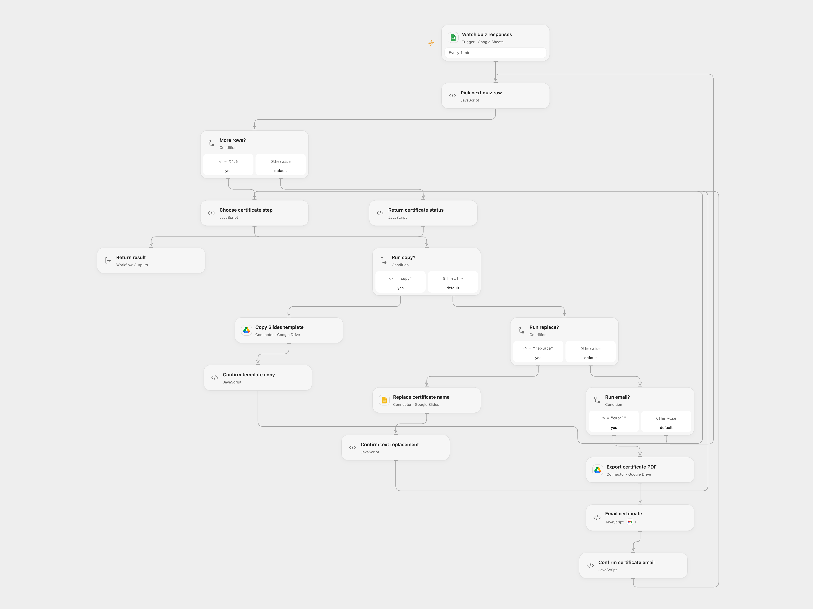

# Email Quiz Certificates from Slides

Create a personalized PDF certificate for each passing quiz response and email it to the respondent.

<!-- template-actions:start -->
 
<!-- template-actions:end -->

<picture>
  <source media="(prefers-color-scheme: dark)" srcset="preview-dark.png">
  
</picture>

## Setup

Connect Google Sheets in **Watch quiz responses** and set **spreadsheetId** and **sheet** to your quiz response sheet. Connect Google Drive, Google Slides, and Gmail in **Copy Slides template**, **Replace certificate name**, **Export certificate PDF**, and **Email certificate**. Set `templateId` and `folderId` in **Choose certificate step**.

## Behavior

Every minute, **Watch quiz responses** polls for newly added rows. For each row with a passing score (> 3), the workflow copies the Google Slides certificate template, replaces the participant name, exports a PDF, and emails it as an attachment via Gmail with idempotent state checkpoints.

In n8n

Import the n8n workflow, connect Google Sheets, Google Drive, Google Slides, and Gmail credentials, and configure the spreadsheet, template presentation, and destination folder.

Inspiration &amp; credits

Adapted from [Quiz certificate by email](https://github.com/Zie619/n8n-workflows/blob/ae8cf6dc5b873cbb4f74587aa9180ed3a9f70682/workflows/Googleslides/0754_Googleslides_Noop_Automation_Triggered.json) in [Zie619/n8n-workflows](https://github.com/Zie619/n8n-workflows). The source export does not identify a separate template author or license.

The collection’s [MIT notice](https://github.com/Zie619/n8n-workflows/blob/94007c1445d9258a7da116646b79473e7c7c3282/LICENSE) is pinned at a later revision. This is the collection notice at that revision; it does not establish a separate original template author's license. Our changes are listed above; see [repository licensing](../../README.md#licensing).

> MIT License
>
> Copyright (c) 2025 Zie619
>
> Permission is hereby granted, free of charge, to any person obtaining a copy
> of this software and associated documentation files (the "Software"), to deal
> in the Software without restriction, including without limitation the rights
> to use, copy, modify, merge, publish, distribute, sublicense, and/or sell
> copies of the Software, and to permit persons to whom the Software is
> furnished to do so, subject to the following conditions:
>
> The above copyright notice and this permission notice shall be included in all
> copies or substantial portions of the Software.
>
> THE SOFTWARE IS PROVIDED "AS IS", WITHOUT WARRANTY OF ANY KIND, EXPRESS OR
> IMPLIED, INCLUDING BUT NOT LIMITED TO THE WARRANTIES OF MERCHANTABILITY,
> FITNESS FOR A PARTICULAR PURPOSE AND NONINFRINGEMENT. IN NO EVENT SHALL THE
> AUTHORS OR COPYRIGHT HOLDERS BE LIABLE FOR ANY CLAIM, DAMAGES OR OTHER
> LIABILITY, WHETHER IN AN ACTION OF CONTRACT, TORT OR OTHERWISE, ARISING FROM,
> OUT OF OR IN CONNECTION WITH THE SOFTWARE OR THE USE OR OTHER DEALINGS IN THE
> SOFTWARE.

