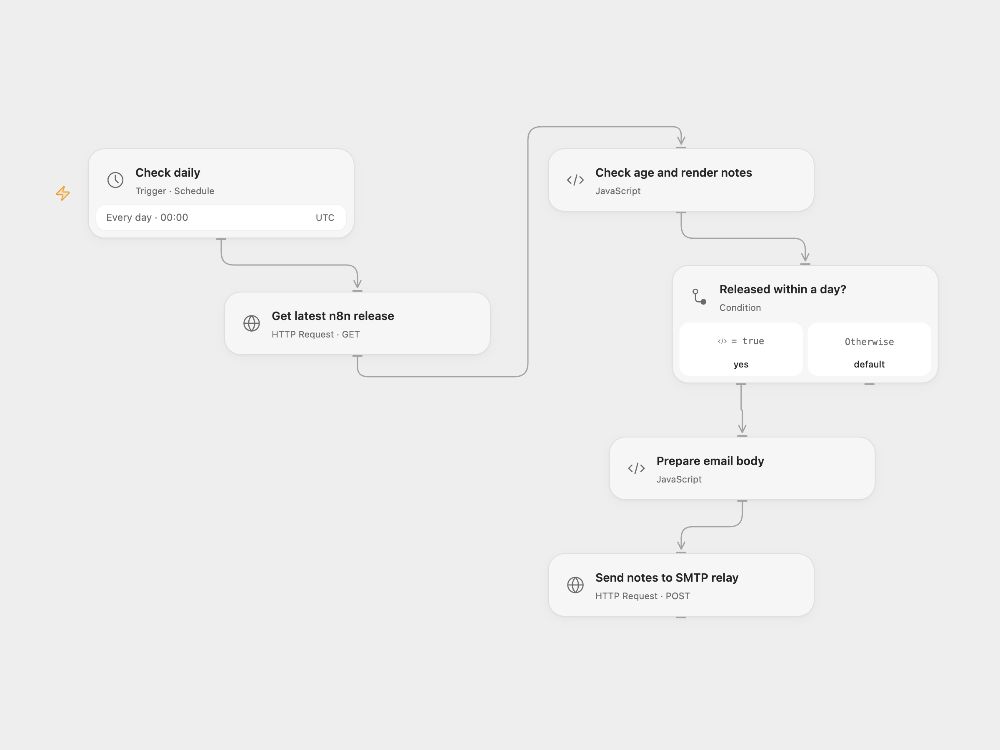

# Email Recent n8n Release Notes

Check the latest n8n GitHub release daily and email its release notes when it is less than one day old.

<picture>
  <source media="(prefers-color-scheme: dark)" srcset="preview-dark.png">
  
</picture>

[Open Flow JSON](templates/email-recent-n8n-release-notes.openflow.json) · [n8n JSON](templates/email-recent-n8n-release-notes.n8n.json)

## Setup and use

Import the supplied n8n workflow and configure SMTP credentials and sender and recipient addresses on both email nodes. For n8n mode enable **Daily Trigger** and disable **SMTP relay webhook**. For Open Flow mode disable **Daily Trigger**, enable the relay, activate n8n and enter its production URL in **Send notes to SMTP relay**. Use one mode. The relay does not authenticate callers; restrict access to it. Both formats use UTC by default; change their schedules to your timezone if desired.

## Behavior

Daily at midnight, fetch the latest n8n release. When published less than 24 hours ago, convert its Markdown notes to HTML and send an email with the subject New n8n release. The relay responds after SMTP submission; a lost response may mean the email was already sent. Inspect your mail before rerunning.

Inspiration &amp; credits

## Changes to the source

- Replace sample sender and recipient addresses with placeholders, set UTC explicitly and add an n8n SMTP relay for Open Flow.

Adapted from [Email new n8n release notes](https://github.com/Zie619/n8n-workflows/blob/ae8cf6dc5b873cbb4f74587aa9180ed3a9f70682/workflows/Splitout/0652_Splitout_Schedule_Create_Scheduled.json) in [Zie619/n8n-workflows](https://github.com/Zie619/n8n-workflows). The source export does not identify a separate template author or license.

The collection’s [MIT notice](https://github.com/Zie619/n8n-workflows/blob/94007c1445d9258a7da116646b79473e7c7c3282/LICENSE) is pinned at a later revision. This is the collection notice at that revision; it does not establish a separate original template author's license. Our changes are listed above; see [repository licensing](../../README.md#licensing).

> MIT License
>
> Copyright (c) 2025 Zie619
>
> Permission is hereby granted, free of charge, to any person obtaining a copy
> of this software and associated documentation files (the "Software"), to deal
> in the Software without restriction, including without limitation the rights
> to use, copy, modify, merge, publish, distribute, sublicense, and/or sell
> copies of the Software, and to permit persons to whom the Software is
> furnished to do so, subject to the following conditions:
>
> The above copyright notice and this permission notice shall be included in all
> copies or substantial portions of the Software.
>
> THE SOFTWARE IS PROVIDED "AS IS", WITHOUT WARRANTY OF ANY KIND, EXPRESS OR
> IMPLIED, INCLUDING BUT NOT LIMITED TO THE WARRANTIES OF MERCHANTABILITY,
> FITNESS FOR A PARTICULAR PURPOSE AND NONINFRINGEMENT. IN NO EVENT SHALL THE
> AUTHORS OR COPYRIGHT HOLDERS BE LIABLE FOR ANY CLAIM, DAMAGES OR OTHER
> LIABILITY, WHETHER IN AN ACTION OF CONTRACT, TORT OR OTHERWISE, ARISING FROM,
> OUT OF OR IN CONNECTION WITH THE SOFTWARE OR THE USE OR OTHER DEALINGS IN THE
> SOFTWARE.

Open Flow bundles [Showdown 2.1.0](https://github.com/showdownjs/showdown) under MIT; the notice is included in the workflow code.

