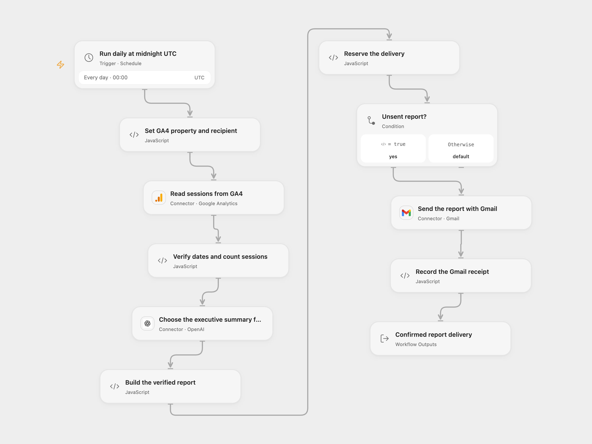

# Email Scheduled GA4 Sessions Reports

Summarize Google Analytics sessions by date and source or medium, then email the marketing manager.

<!-- template-actions:start -->
 
<!-- template-actions:end -->

<picture>
  <source media="(prefers-color-scheme: dark)" srcset="preview-dark.png">
  
</picture>

## Setup

1. In **Set GA4 property and recipient**, enter the numeric GA4 property ID, the property's IANA time zone, and one marketing report recipient.
2. Connect Google Analytics in **Read sessions from GA4**, OpenAI in **Choose the executive summary focus**, and Gmail in **Send the report with Gmail**. Give the Google Analytics connection read access to the property. Use an OpenAI connection with GPT-6 Luna access.
3. Publish and enable the workflow. It runs daily at 00:00 UTC by default. Edit **Run daily at midnight UTC** to use your preferred schedule.

## Behavior

The report covers seven days before the scheduled date through that date, inclusive, in the property time zone. It reports sessions by date and source or medium. The last day may be incomplete. It compares the two latest complete days when both are in the result.

The workflow checks that all rows are present, sums the reported sessions, and gives the model the aggregates to select which insights to emphasize. It formats every date and number from the verified data. GA4's sampling or threshold indicators appear when the API provides them. If the API returns more than 5,000 rows or the model selection fails validation, the workflow stops before sending.

For each property, day, and recipient, the workflow reserves one send. If Gmail's response is uncertain, that report stays reserved. Check the sender's Sent folder to confirm the outcome. A confirmed message ID is recorded in the run output.

In n8n

Set the property, time zone, and recipient in **Set GA4 property and recipient**. Assign a Google Analytics OAuth2 credential in **Read sessions from GA4**, an OpenAI API credential in **Choose the executive summary focus**, and Gmail OAuth2 in **Send the report with Gmail**. Use one production execution at a time and one dedicated Data Table with text columns `report_key`, `status`, and `message_id`. Select the same table in **Unsent report?**, **Reserve the delivery**, and **Record the Gmail receipt**. If a send outcome is uncertain, check Gmail Sent before removing its pending row. The workflow time zone is UTC for the default schedule.

Inspiration &amp; credits

Adapted from [UTM Link Creator & QR Code Generator with Scheduled Google Analytics Reports](https://github.com/enescingoz/awesome-n8n-templates/blob/827110332c21cbe000ab13f6d292d5adb1f1f8db/Other_Integrations_and_Use_Cases/UTM%20Link%20Creator%20%26%20QR%20Code%20Generator%20with%20Scheduled%20Google%20Analytics%20Reports.json) in [enescingoz/awesome-n8n-templates](https://github.com/enescingoz/awesome-n8n-templates).

Source collection notice: © 2024–2026 Enes Cingoz, [CC BY 4.0](https://github.com/enescingoz/awesome-n8n-templates/blob/827110332c21cbe000ab13f6d292d5adb1f1f8db/LICENSE). The original workflow is credited to Ottoflow.Ai. The collection notice does not establish a separate license for the original workflow. See [repository licensing](../../README.md#licensing) for the scope of OOMOL contributions and third-party material.

[Original n8n workflow by Ottoflow.Ai](https://n8n.io/workflows/2921-utm-link-creator-and-qr-code-generator-with-scheduled-google-analytics-reports/).

## Changes to the source

This template adapts the independent scheduled reporting branch. It retrieves the report before inviting the model to choose the executive focus. It validates the report, incorporates exact session counts, and holds one delivery per reporting day and recipient.

