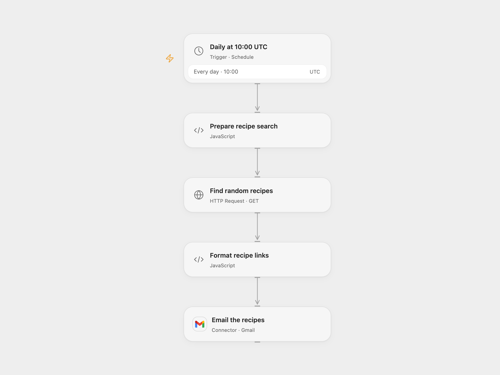

# Email Scheduled Recipe Suggestions

Find random recipes matching dietary and preparation filters and email their links each day.

<picture>
  <source media="(prefers-color-scheme: dark)" srcset="preview-dark.png">
  
</picture>

[Open Flow JSON](templates/email-scheduled-recipe-suggestions.openflow.json) · [n8n JSON](templates/email-scheduled-recipe-suggestions.n8n.json)

## Setup

Create Edamam Recipe Search v2 credentials for an application that does not require active-user tracking. In Open Flow, create secret Variables for the application ID and application key and bind them as the Basic authentication username and password in **Find random recipes**. Connect Gmail and set the recipient in **Email the recipes**. In n8n, configure HTTP Basic credentials with the Edamam application ID and key, connect SMTP credentials and set the sender and recipient in **Send Recipes**. Run only one format.

In **Prepare recipe search**, adjust the search term, diet, health filter, calorie and preparation-time ranges, ingredient limit and recipe count (1–20). The default health setting chooses one supported label at random. Review the filter and recipe details yourself when dietary restrictions matter.

## Behavior

Each day at 10:00 UTC the workflow asks Edamam for a random selection matching the configured filters and emails up to the configured number of recipe links. Edamam returns at most 20 randomized matches and can return fewer results; an empty or malformed result stops without sending. Open Flow uses Gmail and n8n uses SMTP. Open Flow runs on the minute boundary; native n8n Cron uses a fixed second within the minute. Adjust the schedule and time zone as needed.

A failed or uncertain email may already have been sent; check your mail before retrying. No automatic send retry or deduplication is configured. Email acceptance does not prove delivery.

Inspiration &amp; credits

## Changes to the source

- Replace the retired Edamam v1 endpoint and random offset with v2's random selection. The health filter is now sent in the request; the source mentioned it in the subject without filtering by it.
- Use Basic credentials, escape recipe text, validate links, and use UTC as the starting time zone. The source inherited its instance time zone.
- Open Flow uses Gmail; n8n retains SMTP.

Adapted from [What To Eat](https://github.com/Zie619/n8n-workflows/blob/ae8cf6dc5b873cbb4f74587aa9180ed3a9f70682/workflows/Http/0084_HTTP_Cron_Automation_Webhook.json) in [Zie619/n8n-workflows](https://github.com/Zie619/n8n-workflows). The matching [n8n community listing](https://n8n.io/workflows/856-send-daily-recipe-emails-automatically/) credits jason. The original template does not state a separate license.

The collection’s [MIT notice](https://github.com/Zie619/n8n-workflows/blob/94007c1445d9258a7da116646b79473e7c7c3282/LICENSE) is pinned at a later revision. This is the collection notice at that revision; it does not establish a separate original template author's license. Our changes are listed above; see [repository licensing](../../README.md#licensing).

> MIT License
>
> Copyright (c) 2025 Zie619
>
> Permission is hereby granted, free of charge, to any person obtaining a copy
> of this software and associated documentation files (the "Software"), to deal
> in the Software without restriction, including without limitation the rights
> to use, copy, modify, merge, publish, distribute, sublicense, and/or sell
> copies of the Software, and to permit persons to whom the Software is
> furnished to do so, subject to the following conditions:
>
> The above copyright notice and this permission notice shall be included in all
> copies or substantial portions of the Software.
>
> THE SOFTWARE IS PROVIDED "AS IS", WITHOUT WARRANTY OF ANY KIND, EXPRESS OR
> IMPLIED, INCLUDING BUT NOT LIMITED TO THE WARRANTIES OF MERCHANTABILITY,
> FITNESS FOR A PARTICULAR PURPOSE AND NONINFRINGEMENT. IN NO EVENT SHALL THE
> AUTHORS OR COPYRIGHT HOLDERS BE LIABLE FOR ANY CLAIM, DAMAGES OR OTHER
> LIABILITY, WHETHER IN AN ACTION OF CONTRACT, TORT OR OTHERWISE, ARISING FROM,
> OUT OF OR IN CONNECTION WITH THE SOFTWARE OR THE USE OR OTHER DEALINGS IN THE
> SOFTWARE.

