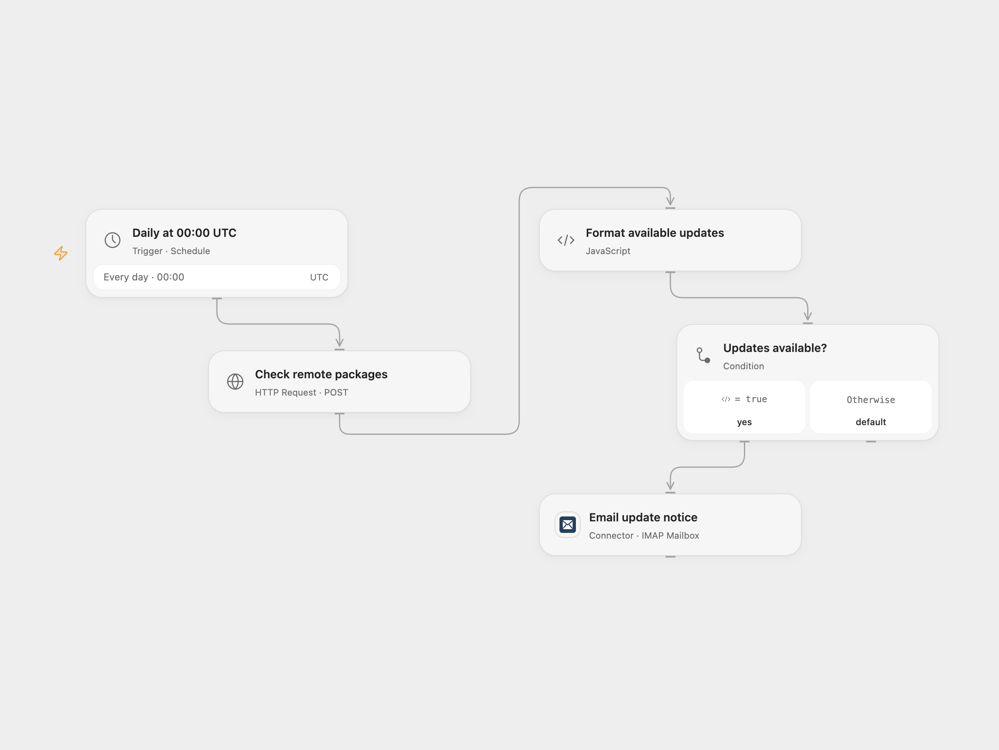

# Email Server Package Update Notice

Check a remote server for upgradable apt packages and email a notice when updates are available.

<picture>
  <source media="(prefers-color-scheme: dark)" srcset="preview-dark.png">
  
</picture>

[Open Flow JSON](templates/email-server-package-update-notice.openflow.json) · [n8n JSON](templates/email-server-package-update-notice.n8n.json)

## Setup

Import the n8n workflow and connect SSH credentials to **SSH relay** for the target Debian-based server. Enable **SSH relay webhook**, activate the workflow, and configure its production URL in **Check remote packages** in Open Flow. Disable **Run workflow every day** when using Open Flow. The relay has no built-in authentication and exposes package information; restrict access to trusted callers. Connect an IMAP/SMTP mailbox and set the recipient in **Email update notice**.

For n8n-only operation, disable **SSH relay webhook**, enable **Run workflow every day**, connect SSH credentials to **List upgradable packages**, and configure SMTP sender and recipient in **Send Email through SMTP**. Use one scheduling mode. Both formats default to midnight UTC.

## Behavior

Each day the workflow runs `apt list --upgradable` over SSH and sends an HTML list only if packages are present. It reports package information; it does not perform upgrades. SSH connection or nonzero command failures stop the run. If an email result is unknown, inspect sent mail before retrying. Package text is escaped in the email.

Inspiration &amp; credits

## Changes to the source

- Add a bundled n8n SSH relay for Open Flow, configure UTC and escape package text. Stop on nonzero command status.

Adapted from [VPS upgrade notify](https://github.com/Zie619/n8n-workflows/blob/ae8cf6dc5b873cbb4f74587aa9180ed3a9f70682/workflows/Code/0726_Code_Schedule_Update_Scheduled.json) in [Zie619/n8n-workflows](https://github.com/Zie619/n8n-workflows). The source export does not identify a separate template author or license.

The collection’s [MIT notice](https://github.com/Zie619/n8n-workflows/blob/94007c1445d9258a7da116646b79473e7c7c3282/LICENSE) is pinned at a later revision. This is the collection notice at that revision; it does not establish a separate original template author's license. Our changes are listed above; see [repository licensing](../../README.md#licensing).

> MIT License
>
> Copyright (c) 2025 Zie619
>
> Permission is hereby granted, free of charge, to any person obtaining a copy
> of this software and associated documentation files (the "Software"), to deal
> in the Software without restriction, including without limitation the rights
> to use, copy, modify, merge, publish, distribute, sublicense, and/or sell
> copies of the Software, and to permit persons to whom the Software is
> furnished to do so, subject to the following conditions:
>
> The above copyright notice and this permission notice shall be included in all
> copies or substantial portions of the Software.
>
> THE SOFTWARE IS PROVIDED "AS IS", WITHOUT WARRANTY OF ANY KIND, EXPRESS OR
> IMPLIED, INCLUDING BUT NOT LIMITED TO THE WARRANTIES OF MERCHANTABILITY,
> FITNESS FOR A PARTICULAR PURPOSE AND NONINFRINGEMENT. IN NO EVENT SHALL THE
> AUTHORS OR COPYRIGHT HOLDERS BE LIABLE FOR ANY CLAIM, DAMAGES OR OTHER
> LIABILITY, WHETHER IN AN ACTION OF CONTRACT, TORT OR OTHERWISE, ARISING FROM,
> OUT OF OR IN CONNECTION WITH THE SOFTWARE OR THE USE OR OTHER DEALINGS IN THE
> SOFTWARE.

