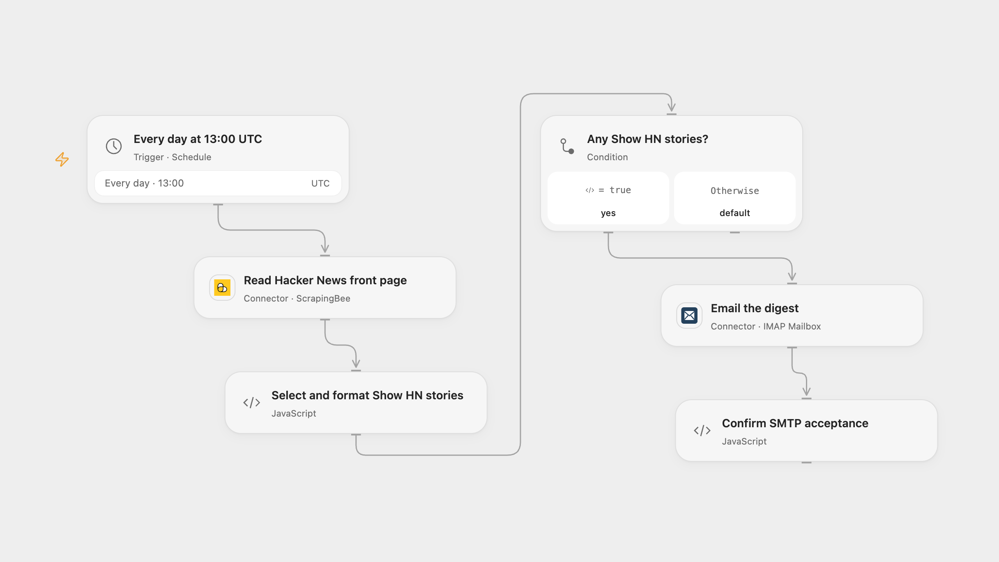

# Email Trending Show HN Stories

Get a daily email of Show HN stories currently on the Hacker News front page.

<picture>
  <source media="(prefers-color-scheme: dark)" srcset="preview-dark.png">
  
</picture>

[Open Flow JSON](templates/email-trending-show-hn-stories.openflow.json) · [n8n JSON](templates/email-trending-show-hn-stories.n8n.json)

## Setup

In Open Flow connect ScrapingBee and an IMAP Mailbox configured to send through SMTP. Set the recipient in **Email the digest**; the connection determines the sender. In n8n configure SMTP credentials, sender and recipient in **Send Email**. Activate one format and adjust the schedule and timezone if needed.

## Behavior

Each day at 13:00 UTC the workflow reads the current Hacker News front page and emails the rank, title and link of every story whose title contains Show HN:. If there are no matching stories, it sends nothing. Open Flow uses ScrapingBee without JavaScript rendering; n8n reads the page directly. The service receives the public page URL, and its network access or extraction may differ from n8n. Page structure changes or a failed read can stop the run. Open Flow stops if the story list or required story fields are missing.

SMTP acceptance does not guarantee delivery. If a send fails or its outcome is uncertain, inspect the mailbox before retrying. No automatic write retry or cross-run deduplication is added. Open Flow runs at the minute boundary; n8n uses a fixed second within that minute.

Inspiration &amp; credits

## Changes to the source

- Set UTC explicitly and configure mail addresses instead of relying on empty sender and recipient fields.
- Update the story link selector for the current Hacker News markup. Open Flow uses ScrapingBee to extract the current front page; n8n retains direct HTML extraction. Open Flow makes relative discussion links absolute; n8n retains the source relative links. The n8n condition checks the current extracted item.

Adapted from [Send trending Show HN to email](https://github.com/Zie619/n8n-workflows/blob/ae8cf6dc5b873cbb4f74587aa9180ed3a9f70682/workflows/Http/0494_HTTP_Htmlextract_Send_Webhook.json) in [Zie619/n8n-workflows](https://github.com/Zie619/n8n-workflows). The matching [n8n listing](https://n8n.io/workflows/225-send-trending-show-hn-to-email/) credits Jan Oberhauser. The original template does not state a separate license.

The collection’s [MIT notice](https://github.com/Zie619/n8n-workflows/blob/94007c1445d9258a7da116646b79473e7c7c3282/LICENSE) is pinned at a later revision. This is the collection notice at that revision; it does not establish a separate original template author's license. Our changes are listed above; see [repository licensing](../../README.md#licensing).

> MIT License
>
> Copyright (c) 2025 Zie619
>
> Permission is hereby granted, free of charge, to any person obtaining a copy
> of this software and associated documentation files (the "Software"), to deal
> in the Software without restriction, including without limitation the rights
> to use, copy, modify, merge, publish, distribute, sublicense, and/or sell
> copies of the Software, and to permit persons to whom the Software is
> furnished to do so, subject to the following conditions:
>
> The above copyright notice and this permission notice shall be included in all
> copies or substantial portions of the Software.
>
> THE SOFTWARE IS PROVIDED "AS IS", WITHOUT WARRANTY OF ANY KIND, EXPRESS OR
> IMPLIED, INCLUDING BUT NOT LIMITED TO THE WARRANTIES OF MERCHANTABILITY,
> FITNESS FOR A PARTICULAR PURPOSE AND NONINFRINGEMENT. IN NO EVENT SHALL THE
> AUTHORS OR COPYRIGHT HOLDERS BE LIABLE FOR ANY CLAIM, DAMAGES OR OTHER
> LIABILITY, WHETHER IN AN ACTION OF CONTRACT, TORT OR OTHERWISE, ARISING FROM,
> OUT OF OR IN CONNECTION WITH THE SOFTWARE OR THE USE OR OTHER DEALINGS IN THE
> SOFTWARE.

