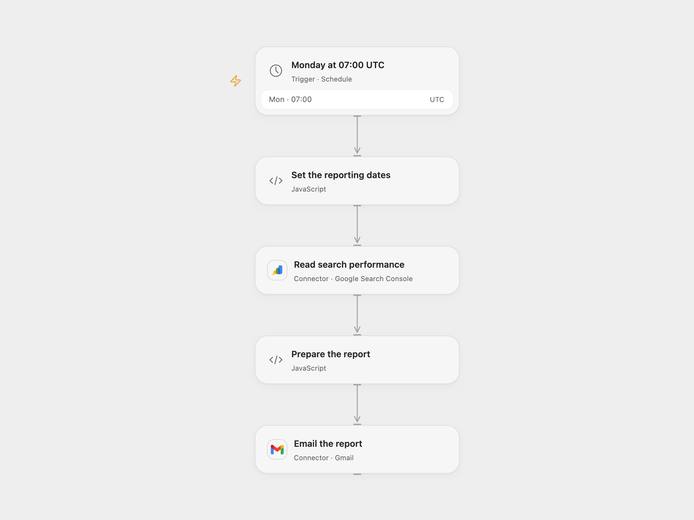

# Email a Weekly Search Console Report

Email the top Google Search queries from the previous seven complete Pacific Time dates.

<picture>
  <source media="(prefers-color-scheme: dark)" srcset="preview-dark.png">
  
</picture>

[Open Flow JSON](templates/email-weekly-search-console-report.openflow.json) · [n8n JSON](templates/email-weekly-search-console-report.n8n.json)

## Setup

Connect Google Search Console in **Read search performance** and enter the property exactly as it appears in Search Console, including its trailing slash for a URL-prefix property or the sc-domain: prefix for a domain property. Connect Gmail and set the recipient in **Email the report**. In n8n, configure a Google OAuth client with the n8n callback URL, then create a generic OAuth2 credential using Authorization Code, authorization URL https://accounts.google.com/o/oauth2/v2/auth, token URL https://oauth2.googleapis.com/token, and scope https://www.googleapis.com/auth/webmasters.readonly. Authorize an account that can read the property, set the property in **Set the reporting dates**, and connect Gmail and set the recipient in **Send Weekly Report by Email**. Activate one format.

## Behavior

Every Monday at 07:00 UTC the workflow asks Search Console for up to ten search queries ordered by clicks during the previous seven complete Pacific Time calendar dates. The email shows clicks, impressions, CTR as a decimal rounded to two places, and average position. When no rows are returned, it emails a no-data message. Search Console omits some queries and final data can lag by days, so the report may be incomplete. Check the UTC schedule against your local time. Open Flow starts on the minute boundary; n8n Cron chooses a fixed second within that minute.

A failed query stops before sending. A failed or uncertain Gmail send may have been accepted; inspect Sent mail before retrying. The workflow does not store a checkpoint, so reruns can send duplicate reports.

## Changes to the source

- Configure a Monday schedule; the source Cron had no trigger time configured despite its name. Set UTC explicitly.
- Replace the source GET/basic-auth request with Google's authenticated Search Analytics POST, request the query dimension and ten rows, and provide a seven-day date range.
- Set the email recipient and include the generated report in its body without the automatic n8n attribution.

Source and license

Adapted from [Weekly Search Console Report](https://github.com/Zie619/n8n-workflows/blob/ae8cf6dc5b873cbb4f74587aa9180ed3a9f70682/workflows/Http/1893_HTTP_Gmail_Automate_Webhook.json) in [Zie619/n8n-workflows](https://github.com/Zie619/n8n-workflows). The source export does not identify a separate template author or license.

The collection’s [MIT notice](https://github.com/Zie619/n8n-workflows/blob/94007c1445d9258a7da116646b79473e7c7c3282/LICENSE) is pinned at a later revision. This is the collection notice at that revision; it does not establish a separate original template author's license. Our changes are listed above; see [repository licensing](../../README.md#licensing).

> MIT License
>
> Copyright (c) 2025 Zie619
>
> Permission is hereby granted, free of charge, to any person obtaining a copy
> of this software and associated documentation files (the "Software"), to deal
> in the Software without restriction, including without limitation the rights
> to use, copy, modify, merge, publish, distribute, sublicense, and/or sell
> copies of the Software, and to permit persons to whom the Software is
> furnished to do so, subject to the following conditions:
>
> The above copyright notice and this permission notice shall be included in all
> copies or substantial portions of the Software.
>
> THE SOFTWARE IS PROVIDED "AS IS", WITHOUT WARRANTY OF ANY KIND, EXPRESS OR
> IMPLIED, INCLUDING BUT NOT LIMITED TO THE WARRANTIES OF MERCHANTABILITY,
> FITNESS FOR A PARTICULAR PURPOSE AND NONINFRINGEMENT. IN NO EVENT SHALL THE
> AUTHORS OR COPYRIGHT HOLDERS BE LIABLE FOR ANY CLAIM, DAMAGES OR OTHER
> LIABILITY, WHETHER IN AN ACTION OF CONTRACT, TORT OR OTHERWISE, ARISING FROM,
> OUT OF OR IN CONNECTION WITH THE SOFTWARE OR THE USE OR OTHER DEALINGS IN THE
> SOFTWARE.

