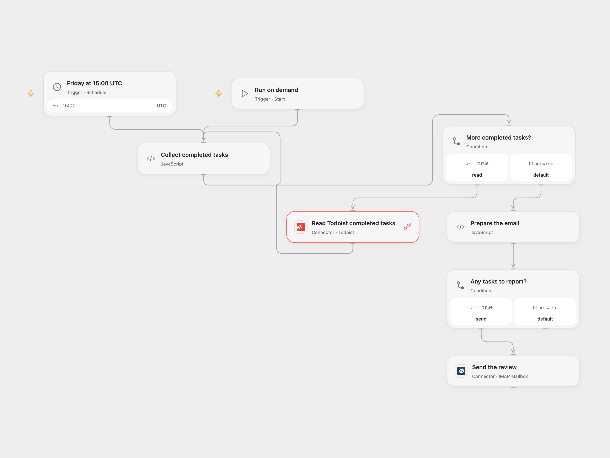

# Email a Weekly Todoist Review

Email a weekly review of completed Todoist tasks, grouped by completion date.

<picture>
  <source media="(prefers-color-scheme: dark)" srcset="preview-dark.png">
  
</picture>

[Open Flow JSON](templates/email-weekly-todoist-review.openflow.json) · [n8n JSON](templates/email-weekly-todoist-review.n8n.json)

## Setup

Connect Todoist to **Read Todoist completed tasks** and allow Provider API Request access. Connect your email account in **Send the review** and set the recipient. Optionally list Todoist project IDs to omit in **Prepare the email**. In n8n, connect Todoist and SMTP credentials, set sender and recipient in **Send Email**, and edit the ignored project ID list in **Prepare the email**. Run manually or activate one format.

## Behavior

On Friday at 15:00 UTC, or when run manually, the workflow requests completed tasks for the previous seven days and emails one HTML list grouped by UTC completion date. The start is inclusive and the end exclusive. Empty results or only ignored projects send no email. It reads all pages before sending; errors, repeated cursors or more than 100 pages stop the run before email. HTML characters in task content are escaped. The list reflects what Todoist returns and may change while pagination is in progress.

The source inherited the n8n instance timezone; both templates use UTC. Check the time before activation. An email with an uncertain outcome may have been accepted; check the recipient before retrying.

## Changes to the source

- Replace the personal ignored project ID, and configure a sender and recipient.
- Use Todoist's current completed-by-completion-date API and follow cursor pages; the source requested only its default page.
- Correct the source email node to send the generated HTML, escape task content and omit the automatic n8n attribution link. Make the schedule timezone explicit.

Source and license

Adapted from [Todoist Weekly Review Template](https://github.com/Zie619/n8n-workflows/blob/ae8cf6dc5b873cbb4f74587aa9180ed3a9f70682/workflows/Code/1724_Code_Schedule_Automation_Scheduled.json) in [Zie619/n8n-workflows](https://github.com/Zie619/n8n-workflows). The matching [n8n community listing](https://n8n.io/workflows/2805-todoist-weekly-email-of-completed-tasks/) credits Martijn Smit. The original template does not state a separate license.

The collection’s [MIT notice](https://github.com/Zie619/n8n-workflows/blob/94007c1445d9258a7da116646b79473e7c7c3282/LICENSE) is pinned at a later revision. This is the collection notice at that revision; it does not establish a separate original template author's license. Our changes are listed above; see [repository licensing](../../README.md#licensing).

> MIT License
>
> Copyright (c) 2025 Zie619
>
> Permission is hereby granted, free of charge, to any person obtaining a copy
> of this software and associated documentation files (the "Software"), to deal
> in the Software without restriction, including without limitation the rights
> to use, copy, modify, merge, publish, distribute, sublicense, and/or sell
> copies of the Software, and to permit persons to whom the Software is
> furnished to do so, subject to the following conditions:
>
> The above copyright notice and this permission notice shall be included in all
> copies or substantial portions of the Software.
>
> THE SOFTWARE IS PROVIDED "AS IS", WITHOUT WARRANTY OF ANY KIND, EXPRESS OR
> IMPLIED, INCLUDING BUT NOT LIMITED TO THE WARRANTIES OF MERCHANTABILITY,
> FITNESS FOR A PARTICULAR PURPOSE AND NONINFRINGEMENT. IN NO EVENT SHALL THE
> AUTHORS OR COPYRIGHT HOLDERS BE LIABLE FOR ANY CLAIM, DAMAGES OR OTHER
> LIABILITY, WHETHER IN AN ACTION OF CONTRACT, TORT OR OTHERWISE, ARISING FROM,
> OUT OF OR IN CONNECTION WITH THE SOFTWARE OR THE USE OR OTHER DEALINGS IN THE
> SOFTWARE.

