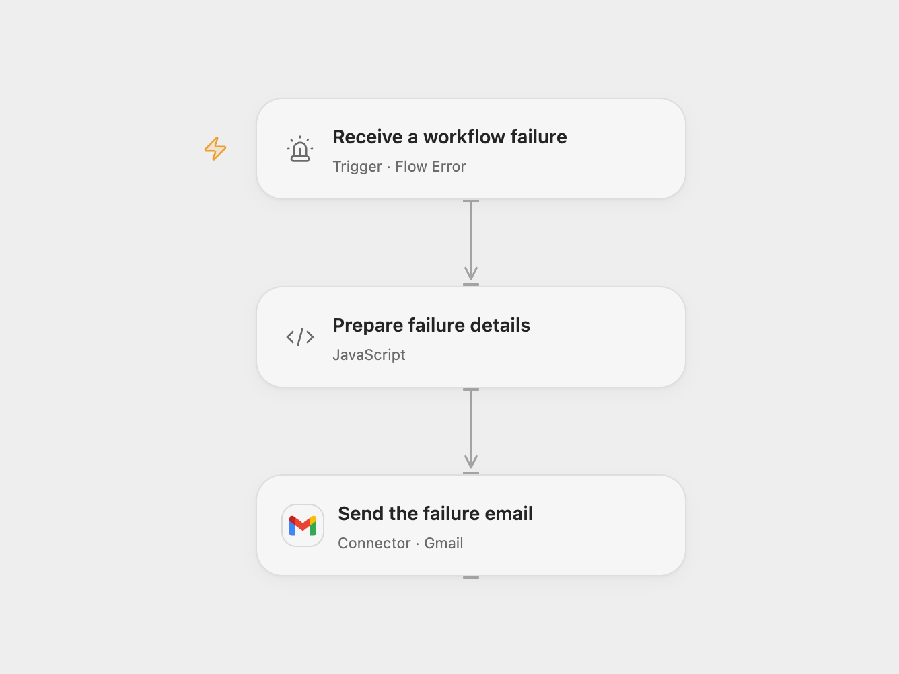

# Email Workflow Failure Details

Email diagnostic details when a configured workflow fails.

<picture>
  <source media="(prefers-color-scheme: dark)" srcset="preview-dark.png">
  
</picture>

[Open Flow JSON](templates/email-workflow-failure-details.openflow.json) · [n8n JSON](templates/email-workflow-failure-details.n8n.json)

## Setup

Connect Gmail and set the alert recipient in **Send the failure email**. In Open Flow, select the published source workflows in **Receive a workflow failure**, then publish and enable this workflow. In n8n, connect Gmail and set the recipient in **Gmail**, enable this workflow, and select it as the error workflow in each source workflow's settings. Enable one format and avoid assigning the error workflow to itself.

## Behavior

An automatic workflow failure sends a plain-text email with the workflow name and available diagnostic details. Open Flow also reports indeterminate runs. Open Flow includes the run ID, error code and message, and any node ID, job ID and path supplied by its error event. Open Flow's event does not provide an execution URL or stack trace. n8n includes the execution URL, last node, error message and stack trace when those fields are available. Missing details are shown as not available. Both formats remove line breaks from the email subject.

Error details and stack traces may contain sensitive information. Restrict the recipient and workflow history. A failed or uncertain email send may already have been delivered; check Gmail before retrying.

## Changes to the source

- Configure the recipient and bind source workflows through each platform's error trigger.
- Open Flow reports the diagnostics available in its error event; n8n retains the source's execution URL and stack trace when present.

Source and license

Adapted from [Workflow Error Email](https://github.com/Zie619/n8n-workflows/blob/ae8cf6dc5b873cbb4f74587aa9180ed3a9f70682/workflows/Error/0456_Error_Gmail_Send_Triggered.json) in [Zie619/n8n-workflows](https://github.com/Zie619/n8n-workflows). The source export does not identify a separate template author or license.

The collection’s [MIT notice](https://github.com/Zie619/n8n-workflows/blob/94007c1445d9258a7da116646b79473e7c7c3282/LICENSE) is pinned at a later revision. This is the collection notice at that revision; it does not establish a separate original template author's license. Our changes are listed above; see [repository licensing](../../README.md#licensing).

> MIT License
>
> Copyright (c) 2025 Zie619
>
> Permission is hereby granted, free of charge, to any person obtaining a copy
> of this software and associated documentation files (the "Software"), to deal
> in the Software without restriction, including without limitation the rights
> to use, copy, modify, merge, publish, distribute, sublicense, and/or sell
> copies of the Software, and to permit persons to whom the Software is
> furnished to do so, subject to the following conditions:
>
> The above copyright notice and this permission notice shall be included in all
> copies or substantial portions of the Software.
>
> THE SOFTWARE IS PROVIDED "AS IS", WITHOUT WARRANTY OF ANY KIND, EXPRESS OR
> IMPLIED, INCLUDING BUT NOT LIMITED TO THE WARRANTIES OF MERCHANTABILITY,
> FITNESS FOR A PARTICULAR PURPOSE AND NONINFRINGEMENT. IN NO EVENT SHALL THE
> AUTHORS OR COPYRIGHT HOLDERS BE LIABLE FOR ANY CLAIM, DAMAGES OR OTHER
> LIABILITY, WHETHER IN AN ACTION OF CONTRACT, TORT OR OTHERWISE, ARISING FROM,
> OUT OF OR IN CONNECTION WITH THE SOFTWARE OR THE USE OR OTHER DEALINGS IN THE
> SOFTWARE.

