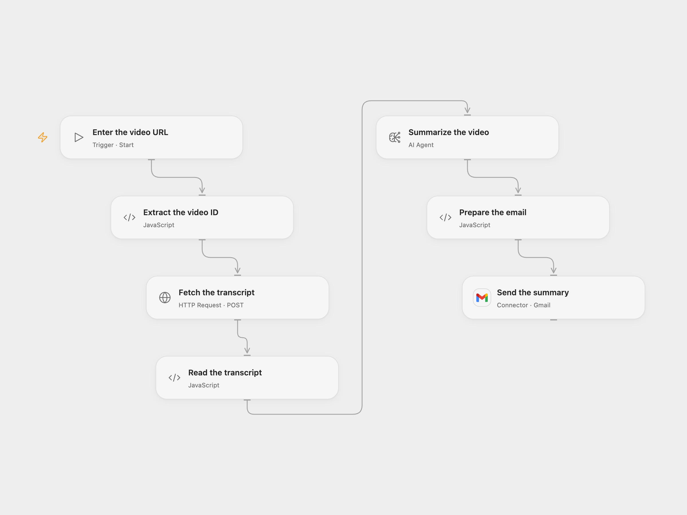

# Email a YouTube Transcript Summary

Summarize a YouTube transcript and email the result.

<picture>
  <source media="(prefers-color-scheme: dark)" srcset="preview-dark.png">
  
</picture>

[Open Flow JSON](templates/email-youtube-transcript-summary.openflow.json) · [n8n JSON](templates/email-youtube-transcript-summary.n8n.json)

## Setup

Create a [YouTube Transcript API token](https://www.youtube-transcript.io/) and store the complete authorization value `Basic YOUR_TOKEN` as Secret Variable `YOUTUBE_TRANSCRIPT_AUTH`. Configure an AI model and Gmail connection. Run with a YouTube URL and recipient email address.

In n8n set the video URL, select an HTTP Header Auth credential named `Authorization` containing `Basic YOUR_TOKEN`, connect an OpenAI model, and configure SMTP sender and recipient in **Send Email**. Run manually.

## Behavior

The workflow requests the first available transcript track and asks the model for a structured summary, then emails the title and text. The video must be public and have captions available to the transcript service. The transcript is sent to your AI provider and may appear in execution history. Long transcripts must fit model and workflow limits.

If the transcript is missing or a request fails, the workflow stops before sending. If email delivery is unknown, inspect the mailbox before rerunning; another run can send another email.

Inspiration &amp; credits

## Changes to the source

- Validate the video ID and response association, and keep the API token in a Secret or credential.
- Open Flow uses Gmail; n8n retains SMTP.

Adapted from [YouTube video analyzer](https://github.com/Zie619/n8n-workflows/blob/ae8cf6dc5b873cbb4f74587aa9180ed3a9f70682/workflows/Code/1461_Code_Manual_Automation_Webhook.json) in [Zie619/n8n-workflows](https://github.com/Zie619/n8n-workflows). The source export does not identify a separate template author or license.

The collection’s [MIT notice](https://github.com/Zie619/n8n-workflows/blob/94007c1445d9258a7da116646b79473e7c7c3282/LICENSE) is pinned at a later revision. This is the collection notice at that revision; it does not establish a separate original template author's license. Our changes are listed above; see [repository licensing](../../README.md#licensing).

> MIT License
>
> Copyright (c) 2025 Zie619
>
> Permission is hereby granted, free of charge, to any person obtaining a copy
> of this software and associated documentation files (the "Software"), to deal
> in the Software without restriction, including without limitation the rights
> to use, copy, modify, merge, publish, distribute, sublicense, and/or sell
> copies of the Software, and to permit persons to whom the Software is
> furnished to do so, subject to the following conditions:
>
> The above copyright notice and this permission notice shall be included in all
> copies or substantial portions of the Software.
>
> THE SOFTWARE IS PROVIDED "AS IS", WITHOUT WARRANTY OF ANY KIND, EXPRESS OR
> IMPLIED, INCLUDING BUT NOT LIMITED TO THE WARRANTIES OF MERCHANTABILITY,
> FITNESS FOR A PARTICULAR PURPOSE AND NONINFRINGEMENT. IN NO EVENT SHALL THE
> AUTHORS OR COPYRIGHT HOLDERS BE LIABLE FOR ANY CLAIM, DAMAGES OR OTHER
> LIABILITY, WHETHER IN AN ACTION OF CONTRACT, TORT OR OTHERWISE, ARISING FROM,
> OUT OF OR IN CONNECTION WITH THE SOFTWARE OR THE USE OR OTHER DEALINGS IN THE
> SOFTWARE.

