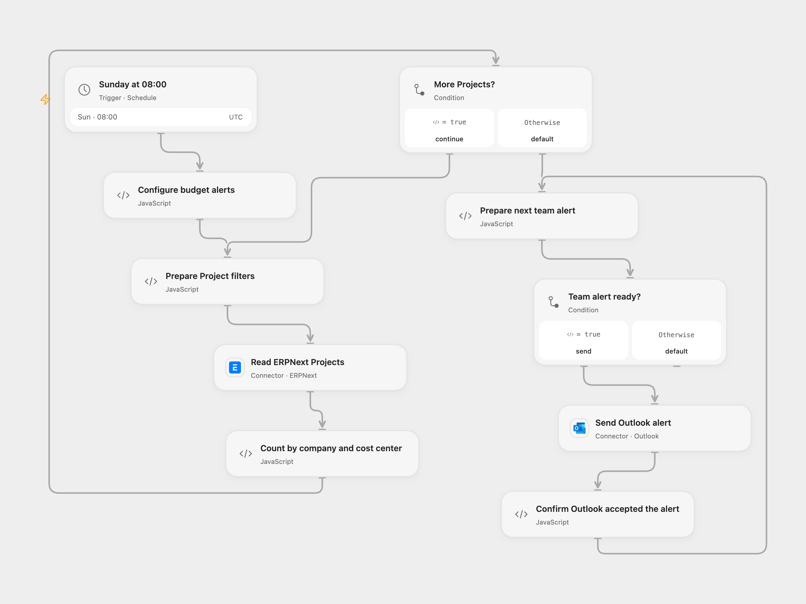

# Email Zero-Budget Project Alerts

Send weekly Outlook alerts with the number of open, active external projects that have a zero budgeted cost, grouped by company and cost center.

<!-- template-actions:start -->
 
<!-- template-actions:end -->

<picture>
  <source media="(prefers-color-scheme: dark)" srcset="preview-dark.png">
  
</picture>

## Setup

1. Connect ERPNext with your site URL, API key and API secret. Use an API user with read access to all **Project** records covered by the report in each company, including the project status, type, active flag, company, cost center and custom budget field.
2. In **Configure budget alerts**, enter the exact API fieldname for the numeric budgeted cost on **Project**. The default is `budgeted_project_cost`. Use the field that holds the budget values your team reports on. Set the exact cost center names and the Outlook recipient addresses for A, B and C. Set D to the cost center the workflow should skip.
3. Select a Microsoft Outlook connection with send permission in **Send Outlook alert**. In **Sunday at 08:00**, set your reporting timezone. The template defaults to UTC. Check the routes and addresses with a test mailbox before publishing.

## Behavior

Each Sunday at 08:00, the workflow reads open, active external projects whose budgeted cost is exactly zero. It reads all matching pages before sending anything. Projects edited while the pages are being read can affect that week's totals. Each matching company and cost center gets its own plain-text alert with the project count. Blank, unmatched and D cost centers produce no mail.

The same projects can appear in successive weekly reminders while their budgets remain zero. A failed ERPNext read stops the run before it sends mail. If an Outlook send fails or its result is unclear, the workflow stops. Check the run and Sent Items before replaying to avoid repeating messages Outlook already accepted.

In n8n

## Setup

1. Import the JSON into n8n. In **Count projects with a zero budget**, select MySQL credentials with read access. The query expects the **tabProject** table with columns **company**, **cost_center**, **status**, **project_type**, **is_active**, and **budgeted_project_cost**. Map the table and columns to your schema if needed.
2. In **Route by cost center**, replace the sample names with the exact cost center values in your query results. In each connected **Email team** node, select Microsoft Outlook OAuth2 credentials and enter the recipient address for that team. Only outputs A, B, and C have email nodes. Verify each route and address with a test mailbox before publishing.
3. Set the workflow timezone and check **Weekly schedule**. The template runs on Sundays at 08:00 in the workflow timezone, or the instance timezone when the workflow timezone is unset. Publish when ready to send scheduled mail.

## Behavior

MySQL counts open, active external projects with a budgeted cost of exactly zero. Each row represents one company and cost center. When a row matches a connected route, Outlook sends one email with the company, cost center, and count and asks the team to coordinate with Accounts. An empty result, a blank cost center, or an unmatched center produces no mail for those rows. Output D has no mail action.

The report can send reminders for the same projects each week while the budget remains zero. If a run stops during email delivery, check Sent Items before retrying because some messages may already have been accepted.

Inspiration &amp; credits

Adapted from [Original MySQL and Outlook workflow](https://github.com/Zie619/n8n-workflows/blob/ae8cf6dc5b873cbb4f74587aa9180ed3a9f70682/workflows/Microsoftoutlook/0835_Microsoftoutlook_Schedule_Automation_Scheduled.json) in [Zie619/n8n-workflows](https://github.com/Zie619/n8n-workflows). Attribution: Zie619 / n8n-workflows.

The collection’s [MIT notice](https://github.com/Zie619/n8n-workflows/blob/94007c1445d9258a7da116646b79473e7c7c3282/LICENSE) is pinned at a later revision. This is the collection notice at that revision; it does not establish a separate original template author's license. The adaptation uses configurable recipients and includes the company in each message. See [repository licensing](../../README.md#licensing).

> MIT License
>
> Copyright (c) 2025 Zie619
>
> Permission is hereby granted, free of charge, to any person obtaining a copy
> of this software and associated documentation files (the "Software"), to deal
> in the Software without restriction, including without limitation the rights
> to use, copy, modify, merge, publish, distribute, sublicense, and/or sell
> copies of the Software, and to permit persons to whom the Software is
> furnished to do so, subject to the following conditions:
>
> The above copyright notice and this permission notice shall be included in all
> copies or substantial portions of the Software.
>
> THE SOFTWARE IS PROVIDED "AS IS", WITHOUT WARRANTY OF ANY KIND, EXPRESS OR
> IMPLIED, INCLUDING BUT NOT LIMITED TO THE WARRANTIES OF MERCHANTABILITY,
> FITNESS FOR A PARTICULAR PURPOSE AND NONINFRINGEMENT. IN NO EVENT SHALL THE
> AUTHORS OR COPYRIGHT HOLDERS BE LIABLE FOR ANY CLAIM, DAMAGES OR OTHER
> LIABILITY, WHETHER IN AN ACTION OF CONTRACT, TORT OR OTHERWISE, ARISING FROM,
> OUT OF OR IN CONNECTION WITH THE SOFTWARE OR THE USE OR OTHER DEALINGS IN THE
> SOFTWARE.

