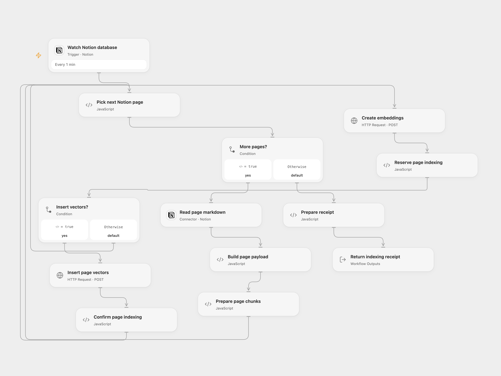

# Embed Notion Pages to Supabase Store

Embed new Notion page text and store the vectors and page metadata in Supabase.

<!-- template-actions:start -->
 
<!-- template-actions:end -->

<picture>
  <source media="(prefers-color-scheme: dark)" srcset="preview-dark.png">
  
</picture>

## Setup

Create a Supabase table with content text, metadata jsonb and embedding vector(1536) columns, and allow your API role to insert rows. Configure Notion database access, Supabase and OpenAI credentials in n8n. Name the database title property Page, or adjust the title extraction in **Prepare page text**. Select one Data Table with item_key and status text columns in all checkpoint nodes. Prevent overlapping runs.

For Open Flow set **Choose indexing mode** to relay and configure the webhook URL. Bind OPENAI_API_KEY, SUPABASE_API_KEY and SUPABASE_AUTHORIZATION as secret Variables; the last value includes the Bearer prefix. Set the Supabase REST table URL in **Insert page vectors**, and enable persistent State. Restrict access to the Open Flow webhook. Direct mode runs in n8n; use one mode.

## Behavior

New Notion database pages are handled individually. The workflow reads direct page blocks, excludes images and video, joins available text and stores chunks with page ID, creation time and title. Child blocks are not recursively retrieved. n8n uses the source 256-token splitter with 30-token overlap; Open Flow uses 1,000-character windows with 120-character overlap and accepts at most 20 chunks per page. Open Flow uses text-embedding-ada-002 and validates 1,536 dimensions. Match the table vector dimension to your configured model. No vector search is included. Page content is sent to OpenAI and Supabase and can appear in execution history. Code input and output ports must each fit 1 MiB.

If insertion or relay completion is uncertain, inspect the table for the page ID before retrying. In Open Flow enter the pending key in **Reserve page indexing**, choose confirmed if all rows exist or absent only if none exist, replay the same page and clear the fields. In n8n inspect the pending row and vector table, mark done after all chunks are present or delete the reservation only when none were inserted. Partial insertion needs manual reconciliation.

Inspiration &amp; credits

Process pages separately and stop on uncertain writes; Open Flow uses character windows.

Adapted from [Store Notion pages as vector documents](https://github.com/Zie619/n8n-workflows/blob/ae8cf6dc5b873cbb4f74587aa9180ed3a9f70682/workflows/Filter/1667_Filter_Summarize_Automation_Triggered.json) in [Zie619/n8n-workflows](https://github.com/Zie619/n8n-workflows). The source export does not identify a separate template author or license.

The collection’s [MIT notice](https://github.com/Zie619/n8n-workflows/blob/94007c1445d9258a7da116646b79473e7c7c3282/LICENSE) is pinned at a later revision. This is the collection notice at that revision; it does not establish a separate original template author's license. Our changes are listed above; see [repository licensing](../../README.md#licensing).

> MIT License
>
> Copyright (c) 2025 Zie619
>
> Permission is hereby granted, free of charge, to any person obtaining a copy
> of this software and associated documentation files (the "Software"), to deal
> in the Software without restriction, including without limitation the rights
> to use, copy, modify, merge, publish, distribute, sublicense, and/or sell
> copies of the Software, and to permit persons to whom the Software is
> furnished to do so, subject to the following conditions:
>
> The above copyright notice and this permission notice shall be included in all
> copies or substantial portions of the Software.
>
> THE SOFTWARE IS PROVIDED "AS IS", WITHOUT WARRANTY OF ANY KIND, EXPRESS OR
> IMPLIED, INCLUDING BUT NOT LIMITED TO THE WARRANTIES OF MERCHANTABILITY,
> FITNESS FOR A PARTICULAR PURPOSE AND NONINFRINGEMENT. IN NO EVENT SHALL THE
> AUTHORS OR COPYRIGHT HOLDERS BE LIABLE FOR ANY CLAIM, DAMAGES OR OTHER
> LIABILITY, WHETHER IN AN ACTION OF CONTRACT, TORT OR OTHERWISE, ARISING FROM,
> OUT OF OR IN CONNECTION WITH THE SOFTWARE OR THE USE OR OTHER DEALINGS IN THE
> SOFTWARE.

