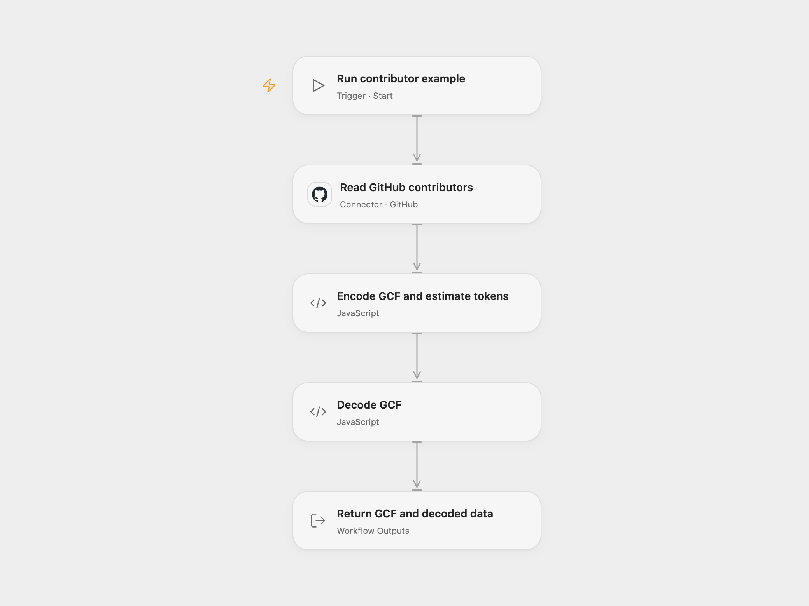

# Encode GitHub Contributors with GCF

Fetch GitHub contributors, encode them as GCF, estimate token use and decode them back to JSON.

<picture>
  <source media="(prefers-color-scheme: dark)" srcset="preview-dark.png">
  
</picture>

[Open Flow JSON](templates/encode-github-contributors-with-gcf.openflow.json) · [n8n JSON](templates/encode-github-contributors-with-gcf.n8n.json)

## Setup

Connect GitHub in Open Flow and run the workflow manually. The GitHub Action defaults to the first page of up to 100 contributors to n8n; change owner and repository as needed.

For n8n, install the community node [n8n-nodes-gcf](https://github.com/blackwell-systems/gcf-n8n-nodes) version 0.1.3 with its @blackwell-systems/gcf dependency pinned to 2.4.0 and run the imported workflow manually. In a self-hosted installation, add `"overrides": {"n8n-nodes-gcf": {"@blackwell-systems/gcf": "2.4.0"}}` to the community nodes installation package.json and reinstall before starting n8n; check the installed version with `npm ls @blackwell-systems/gcf`. Later codec versions may return Map objects, which n8n JSON output cannot preserve. Community nodes require a compatible n8n installation.

## Behavior

The workflow batches the API response, encodes it in Graph Compact Format (GCF) and decodes it to the original array. The token comparison is an estimate of one token per four characters, not a model tokenizer measurement. Open Flow exposes the encoded text, estimate and decoded data as outputs. The n8n decode node returns the decoded array; inspect the preceding encode node for its metrics.

Inspiration &amp; credits

## Changes to the source

- Implement the same codec in Open Flow using the bundled MIT-licensed @blackwell-systems/gcf 2.4.0 library, copyright 2026 Dayna Blackwell. The full MIT notice is included in the Code nodes.
- Expose the encoded text and token estimates alongside decoded data in Open Flow.

Adapted from [GCF Token Optimization for LLM Tool Responses](https://github.com/enescingoz/awesome-n8n-templates/blob/827110332c21cbe000ab13f6d292d5adb1f1f8db/OpenAI_and_LLMs/GCF%20Token%20Optimization%20for%20LLM%20Tool%20Responses.json) in [enescingoz/awesome-n8n-templates](https://github.com/enescingoz/awesome-n8n-templates).

Source collection notice: © 2024–2026 Enes Cingoz, [CC BY 4.0](https://github.com/enescingoz/awesome-n8n-templates/blob/827110332c21cbe000ab13f6d292d5adb1f1f8db/LICENSE). The source export does not identify a separate template author or license. See [repository licensing](../../README.md#licensing) for the scope of OOMOL contributions and third-party material.

