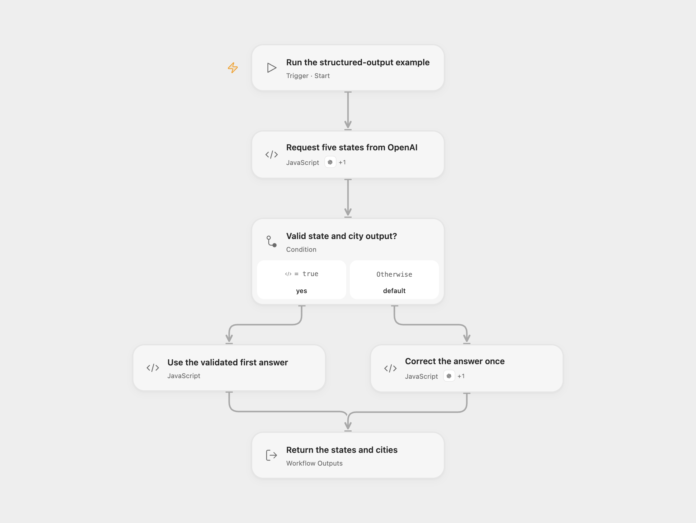

# Enforce Structured Output for Five States

Return a validated JSON list of five states and their three largest cities, with one correction when the first answer is invalid.

<!-- template-actions:start -->
 
<!-- template-actions:end -->

<picture>
  <source media="(prefers-color-scheme: dark)" srcset="preview-dark.png">
  
</picture>

## Setup

1. Connect the same OpenAI account in **Request five states from OpenAI** and **Correct the answer once**. The workflow defaults to GPT-4o mini. Choose a base model that supports Structured Outputs with array length constraints if you change it.
2. Run **Run the structured-output example** manually. Use the example prompt for the five largest U.S. states by area or replace the `input` prompt with another region that has at least five states. The output shape stays the same. [OpenAI Structured Outputs](https://developers.openai.com/api/docs/guides/structured-outputs)

## Behavior

The workflow returns a `states` array with exactly five entries. Each entry has a `state` name and three `cities` with a `name` and a numeric integer `population`. Each city stays in its parent state's list. The workflow checks for repeated state names, repeated cities within a state, extra or duplicate JSON fields, invalid populations and cities out of population order. It preserves the state order returned by the model.

When the first answer fails validation, OpenAI receives one correction request containing the original prompt and the validation issue. A second invalid answer stops the run with the failed check. Provider errors, incomplete responses and refusals also stop the run.

The template demonstrates format validation. The model provides the area ranking, city membership and population figures. The workflow does not retrieve a census dataset or verify those facts.

In n8n

Edit the `input` prompt and model in **Set the prompt and model**. Set the same **HTTP Bearer Auth** credential with your OpenAI API key in **Request five states from OpenAI** and **Request the corrected answer**. Run the Manual Trigger. **Return the states and cities** returns the validated object with one `states` array.

Inspiration &amp; credits

Adapted from [Force AI to use a specific output format](https://github.com/enescingoz/awesome-n8n-templates/blob/827110332c21cbe000ab13f6d292d5adb1f1f8db/OpenAI_and_LLMs/Force%20AI%20to%20use%20a%20specific%20output%20format.json) in [enescingoz/awesome-n8n-templates](https://github.com/enescingoz/awesome-n8n-templates).

Source collection notice: © 2024–2026 Enes Cingoz, [CC BY 4.0](https://github.com/enescingoz/awesome-n8n-templates/blob/827110332c21cbe000ab13f6d292d5adb1f1f8db/LICENSE). The [original template](https://n8n.io/workflows/1957-force-ai-to-use-a-specific-output-format/) was published by the n8n Team. See [repository licensing](../../README.md#licensing) for the scope of OOMOL contributions and third-party material.

The adaptation aligns the example with a five-state schema, defines the city types, and preserves one model-assisted correction.

