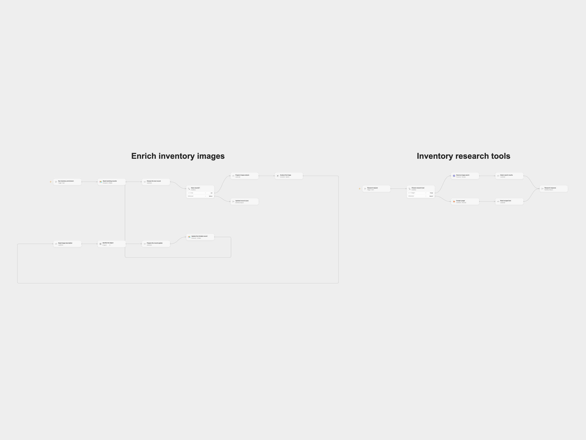

# Enrich Airtable Inventory with Image Research

Research inventory images and update Airtable records with product attributes.

<picture>
  <source media="(prefers-color-scheme: dark)" srcset="preview-dark.png">
  
</picture>

[Open Flow JSON](templates/enrich-airtable-inventory-with-image-research.openflow.json) · [n8n JSON](templates/enrich-airtable-inventory-with-image-research.n8n.json)

## Setup and use

Connect Airtable, OpenAI, SerpApi and Firecrawl. Set the same Airtable base and table in **Read matching records** and **Update the Airtable record**. Import the Open Flow bundle, publish **Inventory research tools**, then refresh its two tool interfaces in **Identify the object** within **Enrich inventory images**. Configure the AI model. In n8n, configure the Airtable base, table and credentials, OpenAI, SerpApi and Firecrawl credentials, and ensure the workflow tools point to this workflow.

## Behavior

A manual run selects up to 100 records matching `AND(Image!="", AI_status=FALSE())`. It analyzes the first image's large thumbnail, optionally researches visually similar images and pages, then updates that same record's Title, Description, Model, Material, Color, Condition and AI_status. Uncertain attributes should be left blank. The model can be wrong; review the updated records. Each record is processed in order; if a later step fails, earlier updates remain. An unknown update may already have succeeded, so inspect Airtable before retrying.

Inspiration &amp; credits

## Changes to the source

- Use the OpenAI Responses image input and a bundled research workflow for the agent tools. Open Flow requires worker publication and interface refresh. It confirms each update before proceeding and returns the updated count.
- Replace source-specific base, table and workflow identifiers with configuration placeholders.

Adapted from [Inventory image research](https://github.com/Zie619/n8n-workflows/blob/ae8cf6dc5b873cbb4f74587aa9180ed3a9f70682/workflows/Manual/1436_Manual_HTTP_Automation_Webhook.json) in [Zie619/n8n-workflows](https://github.com/Zie619/n8n-workflows). The source export does not identify a separate template author or license.

The collection’s [MIT notice](https://github.com/Zie619/n8n-workflows/blob/94007c1445d9258a7da116646b79473e7c7c3282/LICENSE) is pinned at a later revision. This is the collection notice at that revision; it does not establish a separate original template author's license. Our changes are listed above; see [repository licensing](../../README.md#licensing).

> MIT License
>
> Copyright (c) 2025 Zie619
>
> Permission is hereby granted, free of charge, to any person obtaining a copy
> of this software and associated documentation files (the "Software"), to deal
> in the Software without restriction, including without limitation the rights
> to use, copy, modify, merge, publish, distribute, sublicense, and/or sell
> copies of the Software, and to permit persons to whom the Software is
> furnished to do so, subject to the following conditions:
>
> The above copyright notice and this permission notice shall be included in all
> copies or substantial portions of the Software.
>
> THE SOFTWARE IS PROVIDED "AS IS", WITHOUT WARRANTY OF ANY KIND, EXPRESS OR
> IMPLIED, INCLUDING BUT NOT LIMITED TO THE WARRANTIES OF MERCHANTABILITY,
> FITNESS FOR A PARTICULAR PURPOSE AND NONINFRINGEMENT. IN NO EVENT SHALL THE
> AUTHORS OR COPYRIGHT HOLDERS BE LIABLE FOR ANY CLAIM, DAMAGES OR OTHER
> LIABILITY, WHETHER IN AN ACTION OF CONTRACT, TORT OR OTHERWISE, ARISING FROM,
> OUT OF OR IN CONNECTION WITH THE SOFTWARE OR THE USE OR OTHER DEALINGS IN THE
> SOFTWARE.

