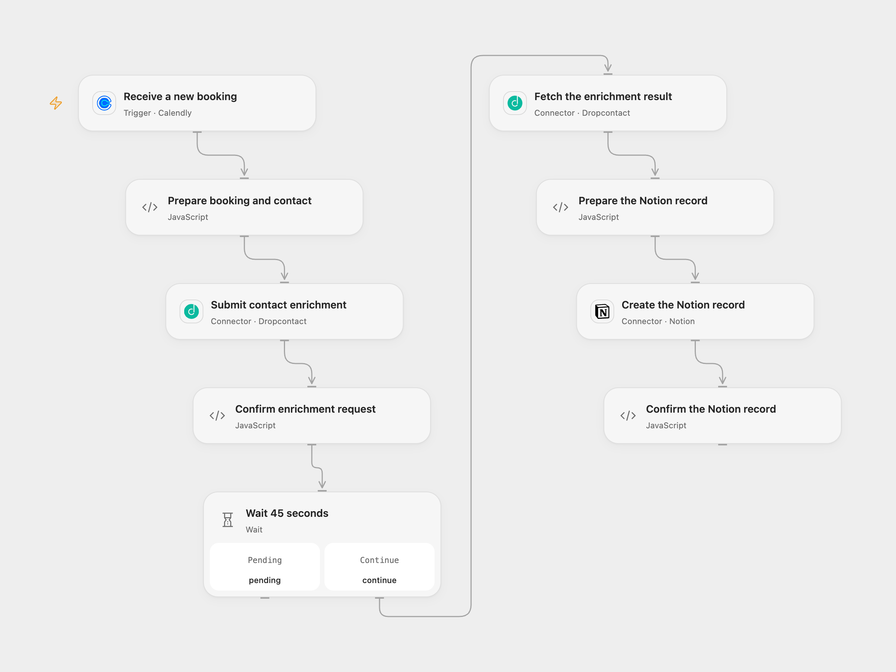

# Enrich Calendly Bookings in Notion

Enrich each new Calendly invitee and save the booking and contact details in Notion.

<picture>
  <source media="(prefers-color-scheme: dark)" srcset="preview-dark.png">
  
</picture>

[Open Flow JSON](templates/enrich-calendly-bookings-in-notion.openflow.json) · [n8n JSON](templates/enrich-calendly-bookings-in-notion.n8n.json)

## Setup

Connect Calendly with a personal access token able to manage user webhooks and provide a public HTTPS callback. Connect Dropcontact and Notion. In **Prepare booking and contact**, set a Notion data source ID and an existing Notion person ID. Grant the Notion integration insert access. The data source needs **Leads** (title), **Date** (date), **email** (email), **Person** (people), **LinkedIn Profile**, **Website**, **LinkedIn Company** (URL), and **Civility** (rich text) properties. Configure the same IDs and connections in n8n. Activate one format.

## Behavior

For each new booking, the workflow submits the invitee email and name for French Dropcontact enrichment, waits 45 seconds, fetches the result once and creates a Notion record with booking start/end, the first enriched email, enriched name, configured person and available profile, website, company LinkedIn and civility. Missing optional enriched fields are omitted. A missing name, email, booking time, incomplete enrichment or invalid configuration stops before the Notion write. Enrichment can consume credits.

If enrichment is still pending after 45 seconds, inspect its request before retrying. A failed or uncertain Notion write can have created a page; inspect Notion before replaying. Repeated bookings or webhook deliveries can create additional pages. New subscriptions verify signatures; Open Flow accepts a three-minute signature window and n8n five minutes. An acknowledgment does not confirm the Notion write.

## Changes to the source

- Read the current Calendly invitee and scheduled-event fields and repair the source's reference to a missing Function node.
- Replace private Notion IDs, use the current data-source API, validate the enrichment and confirm the returned page ID.

Source and license

Adapted from [Calendly booking enrichment to Notion](https://github.com/Zie619/n8n-workflows/blob/ae8cf6dc5b873cbb4f74587aa9180ed3a9f70682/workflows/Calendly/0125_Calendly_Notion_Automate_Triggered.json) in [Zie619/n8n-workflows](https://github.com/Zie619/n8n-workflows). The source export does not identify a separate template author or license.

The collection’s [MIT notice](https://github.com/Zie619/n8n-workflows/blob/94007c1445d9258a7da116646b79473e7c7c3282/LICENSE) is pinned at a later revision. This is the collection notice at that revision; it does not establish a separate original template author's license. Our changes are listed above; see [repository licensing](../../README.md#licensing).

> MIT License
>
> Copyright (c) 2025 Zie619
>
> Permission is hereby granted, free of charge, to any person obtaining a copy
> of this software and associated documentation files (the "Software"), to deal
> in the Software without restriction, including without limitation the rights
> to use, copy, modify, merge, publish, distribute, sublicense, and/or sell
> copies of the Software, and to permit persons to whom the Software is
> furnished to do so, subject to the following conditions:
>
> The above copyright notice and this permission notice shall be included in all
> copies or substantial portions of the Software.
>
> THE SOFTWARE IS PROVIDED "AS IS", WITHOUT WARRANTY OF ANY KIND, EXPRESS OR
> IMPLIED, INCLUDING BUT NOT LIMITED TO THE WARRANTIES OF MERCHANTABILITY,
> FITNESS FOR A PARTICULAR PURPOSE AND NONINFRINGEMENT. IN NO EVENT SHALL THE
> AUTHORS OR COPYRIGHT HOLDERS BE LIABLE FOR ANY CLAIM, DAMAGES OR OTHER
> LIABILITY, WHETHER IN AN ACTION OF CONTRACT, TORT OR OTHERWISE, ARISING FROM,
> OUT OF OR IN CONNECTION WITH THE SOFTWARE OR THE USE OR OTHER DEALINGS IN THE
> SOFTWARE.

