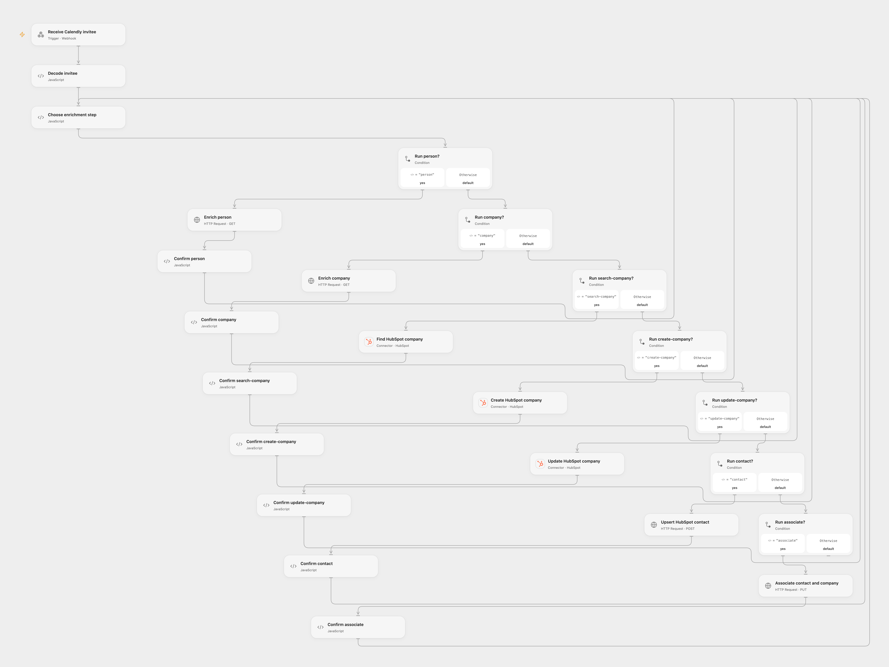

# Enrich Calendly Invitees in HubSpot

Enrich Calendly invitees and their companies in HubSpot.

<!-- template-actions:start -->
 
<!-- template-actions:end -->

<picture>
  <source media="(prefers-color-scheme: dark)" srcset="preview-dark.png">
  
</picture>

## Setup

Use an existing Clearbit account with Person and Company API access. Connect HubSpot, and bind secret Variables CLEARBIT_API_KEY and HUBSPOT_PRIVATE_APP_TOKEN for the same HubSpot account. Enable persistent State and prevent overlapping executions. In n8n connect Calendly, Clearbit and HubSpot; choose one Data Table for checkpoint nodes with text columns item_key and status. For Open Flow enable the n8n forwarding node and disconnect the direct path. Use one format.

## Behavior

Business invitees are enriched by email. If a company domain is found, the company is enriched and searched in HubSpot. An existing company is updated; a new company is created and the contact is associated with it. Without a company domain, the contact is upserted. The source excludes several personal email providers. Clearbit errors do not produce a contact.

If a write result is unknown, inspect HubSpot before replay. In **Choose enrichment step**, enter the pending key and choose confirmed or absent; supply the created company or contact ID when confirmed. In n8n, inspect the matching pending row and HubSpot. If some writes succeeded, complete the remaining writes manually and mark the row done; if none succeeded, delete the row before replay. Protect webhook access and execution history, which contain personal information.

Inspiration &amp; credits

Added a Calendly relay for Open Flow and checkpoints for writes.

Adapted from [Enrich Calendly invitees in HubSpot](https://github.com/Zie619/n8n-workflows/blob/ae8cf6dc5b873cbb4f74587aa9180ed3a9f70682/workflows/Calendly/0430_Calendly_Filter_Create_Triggered.json) in [Zie619/n8n-workflows](https://github.com/Zie619/n8n-workflows). The [original n8n listing](https://n8n.io/workflows/2129-enrich-lead-that-booked-a-call-on-calendly-and-save-it-on-hubspot/) credits Ricardo Espinozaas. No separate original template license is stated.

The collection’s [MIT notice](https://github.com/Zie619/n8n-workflows/blob/94007c1445d9258a7da116646b79473e7c7c3282/LICENSE) is pinned at a later revision. This is the collection notice at that revision; it does not establish a separate original template author's license. Our changes are listed above; see [repository licensing](../../README.md#licensing).

> MIT License
>
> Copyright (c) 2025 Zie619
>
> Permission is hereby granted, free of charge, to any person obtaining a copy
> of this software and associated documentation files (the "Software"), to deal
> in the Software without restriction, including without limitation the rights
> to use, copy, modify, merge, publish, distribute, sublicense, and/or sell
> copies of the Software, and to permit persons to whom the Software is
> furnished to do so, subject to the following conditions:
>
> The above copyright notice and this permission notice shall be included in all
> copies or substantial portions of the Software.
>
> THE SOFTWARE IS PROVIDED "AS IS", WITHOUT WARRANTY OF ANY KIND, EXPRESS OR
> IMPLIED, INCLUDING BUT NOT LIMITED TO THE WARRANTIES OF MERCHANTABILITY,
> FITNESS FOR A PARTICULAR PURPOSE AND NONINFRINGEMENT. IN NO EVENT SHALL THE
> AUTHORS OR COPYRIGHT HOLDERS BE LIABLE FOR ANY CLAIM, DAMAGES OR OTHER
> LIABILITY, WHETHER IN AN ACTION OF CONTRACT, TORT OR OTHERWISE, ARISING FROM,
> OUT OF OR IN CONNECTION WITH THE SOFTWARE OR THE USE OR OTHER DEALINGS IN THE
> SOFTWARE.

