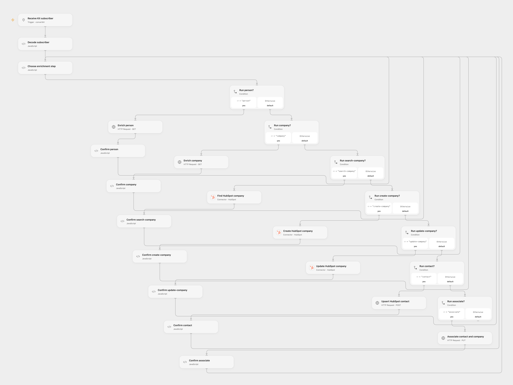

# Enrich Kit Subscribers in HubSpot

Enrich Kit subscribers and their companies in HubSpot.

<!-- template-actions:start -->
 
<!-- template-actions:end -->

<picture>
  <source media="(prefers-color-scheme: dark)" srcset="preview-dark.png">
  
</picture>

## Setup

Connect Kit (ConvertKit) in **Receive Kit subscriber** (**eventName** is preconfigured to `subscriber.form_subscribe`). Create Secret Variables for your Clearbit API key and HubSpot private app token and bind them to **Enrich person**, **Enrich company**, **Upsert HubSpot contact**, and **Associate contact and company**. Connect HubSpot in **Find HubSpot company**, **Create HubSpot company**, and **Update HubSpot company**.

## Behavior

When a subscriber joins a Kit form, **Decode subscriber** extracts the email address, **Enrich person** and **Enrich company** look up profile and company details via Clearbit, and the workflow searches, creates or updates the HubSpot company, upserts the HubSpot contact, and associates them with idempotent state checkpoints.

In n8n

Import the n8n workflow, connect ConvertKit, Clearbit, and HubSpot credentials, and select the target form in **ConvertKit Trigger**.

Inspiration &amp; credits

Added a Kit relay for the workflow and checkpoints for writes.

Adapted from [Enrich Kit subscribers in HubSpot](https://github.com/Zie619/n8n-workflows/blob/ae8cf6dc5b873cbb4f74587aa9180ed3a9f70682/workflows/Filter/0431_Filter_Convertkit_Create_Triggered.json) in [Zie619/n8n-workflows](https://github.com/Zie619/n8n-workflows). The source export does not identify a separate template author or license.

The collection’s [MIT notice](https://github.com/Zie619/n8n-workflows/blob/94007c1445d9258a7da116646b79473e7c7c3282/LICENSE) is pinned at a later revision. This is the collection notice at that revision; it does not establish a separate original template author's license. Our changes are listed above; see [repository licensing](../../README.md#licensing).

> MIT License
>
> Copyright (c) 2025 Zie619
>
> Permission is hereby granted, free of charge, to any person obtaining a copy
> of this software and associated documentation files (the "Software"), to deal
> in the Software without restriction, including without limitation the rights
> to use, copy, modify, merge, publish, distribute, sublicense, and/or sell
> copies of the Software, and to permit persons to whom the Software is
> furnished to do so, subject to the following conditions:
>
> The above copyright notice and this permission notice shall be included in all
> copies or substantial portions of the Software.
>
> THE SOFTWARE IS PROVIDED "AS IS", WITHOUT WARRANTY OF ANY KIND, EXPRESS OR
> IMPLIED, INCLUDING BUT NOT LIMITED TO THE WARRANTIES OF MERCHANTABILITY,
> FITNESS FOR A PARTICULAR PURPOSE AND NONINFRINGEMENT. IN NO EVENT SHALL THE
> AUTHORS OR COPYRIGHT HOLDERS BE LIABLE FOR ANY CLAIM, DAMAGES OR OTHER
> LIABILITY, WHETHER IN AN ACTION OF CONTRACT, TORT OR OTHERWISE, ARISING FROM,
> OUT OF OR IN CONNECTION WITH THE SOFTWARE OR THE USE OR OTHER DEALINGS IN THE
> SOFTWARE.

