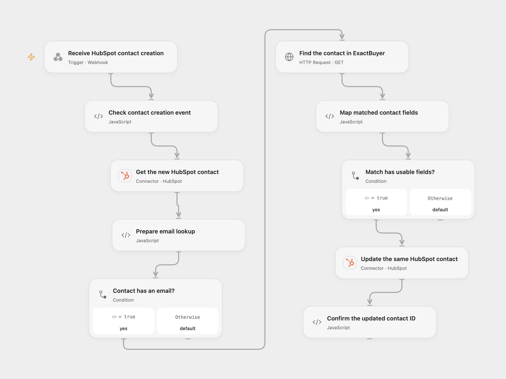

# Enrich New HubSpot Contacts with ExactBuyer

Look up each new HubSpot contact by email and update that same record with the available ExactBuyer details.

<!-- template-actions:start -->
 
<!-- template-actions:end -->

<picture>
  <source media="(prefers-color-scheme: dark)" srcset="preview-dark.png">
  
</picture>

## Setup

1. Connect the same HubSpot account in **Get the new HubSpot contact** and **Update the same HubSpot contact**. The account needs contact read and write access and must have writable properties for the fields you want to update.
2. In **Find the contact in ExactBuyer**, bind the secret Variable `EXACTBUYER_API_KEY` to the API key input.
3. In **Receive HubSpot contact creation**, enable **Header** authentication with header name `X-HubSpot-Workflow-Secret`. Bind a new secret Variable to that header. Deploy after configuring authentication.
4. In HubSpot Data Hub Professional or Enterprise, create a contact-based workflow with **When an event occurs → CRM → Object created**. Add **Send a webhook** with method POST and use the published webhook URL. Choose **API key**, set the location to **Request header**, and use `X-HubSpot-Workflow-Secret` and the shared secret. In **Customize request body**, map `contactId` to the enrolled contact’s **Record ID**, and add the static field `event` with value `contact.creation`. Turn on the HubSpot workflow for future events.

## Behavior

The webhook accepts the new contact’s Record ID. The workflow reads that record’s current email, then asks ExactBuyer for a match that has verified work email, personal email, and email. A contact without an email or an ExactBuyer 404 is skipped. A lookup also needs an exact match to the queried email in ExactBuyer's current work or personal addresses. The comparison ignores surrounding spaces and letter case, and keeps plus tags. Other lookup errors stop the run before the update.

A match updates the available first and last names, phone, gender, school, country, job title, company, and company size on the original contact record. Empty fields are omitted and the workflow keeps the contact's existing email and company associations. Verify the corresponding HubSpot properties are available in your account or remove unwanted fields in **Map matched contact fields**. A webhook acknowledgment confirms receipt. Check the run for the update outcome.

In n8n

Bind an n8n Header Auth credential in **Receive HubSpot contact creation** with name `X-HubSpot-Workflow-Secret` and the shared secret. Bind another Header Auth credential with header `X-API-Key` in **Find the contact in ExactBuyer**. In **Get the new HubSpot contact** and **Update the same HubSpot contact**, bind the same Header Auth credential with header `Authorization` and value `Bearer YOUR_HUBSPOT_ACCESS_TOKEN`. Use an authorized HubSpot app token or Service Key with `crm.objects.contacts.read` and `crm.objects.contacts.write`.

Activate the workflow. Create a contact-based workflow with **When an event occurs → CRM → Object created**. Add **Send a webhook** with method POST and use the published webhook URL. Choose **API key**, set the location to **Request header**, and use `X-HubSpot-Workflow-Secret` and the shared secret. In **Customize request body**, map `contactId` to the enrolled contact’s **Record ID**, and add the static field `event` with value `contact.creation`. Turn on the HubSpot workflow for future events. Use this import's production webhook URL when configuring HubSpot. HubSpot Data Hub Professional or Enterprise is required for **Send a webhook**.

Inspiration &amp; credits

## Changes to the source

- Receive the CRM creation event directly from HubSpot over an authenticated POST.
- Read and update by Record ID. Keep the ExactBuyer email query criteria, verify the returned current email against the original address, and omit empty enrichment fields.
- [Original n8n listing by Mutasem](https://n8n.io/workflows/2111-enrich-new-hubspot-contacts-with-contact-and-company-data-from-exactbuyer/)
- [HubSpot Object created enrollment](https://knowledge.hubspot.com/workflows/set-event-enrollment-triggers)
- [HubSpot Send a webhook](https://knowledge.hubspot.com/workflows/how-do-i-use-webhooks-with-hubspot-workflows)
- [ExactBuyer enrichment API](https://docs.exactbuyer.com/contact-enrichment/enrichment) and [response schema](https://docs.exactbuyer.com/master/openapi-specification)

Adapted from [Enrich new HubSpot contacts with contact and company data from ExactBuyer](https://github.com/Zie619/n8n-workflows/blob/ae8cf6dc5b873cbb4f74587aa9180ed3a9f70682/workflows/Noop/0416_Noop_HubSpot_Create_Webhook.json) in [Zie619/n8n-workflows](https://github.com/Zie619/n8n-workflows). Attribution: Mutasem (original workflow); Zie619 / n8n-workflows (collection).

The collection’s [MIT notice](https://github.com/Zie619/n8n-workflows/blob/94007c1445d9258a7da116646b79473e7c7c3282/LICENSE) is pinned at a later revision. This is the collection notice at that revision; it does not establish a separate original template author's license. Our changes are listed above; see [repository licensing](../../README.md#licensing).

> MIT License
>
> Copyright (c) 2025 Zie619
>
> Permission is hereby granted, free of charge, to any person obtaining a copy
> of this software and associated documentation files (the "Software"), to deal
> in the Software without restriction, including without limitation the rights
> to use, copy, modify, merge, publish, distribute, sublicense, and/or sell
> copies of the Software, and to permit persons to whom the Software is
> furnished to do so, subject to the following conditions:
>
> The above copyright notice and this permission notice shall be included in all
> copies or substantial portions of the Software.
>
> THE SOFTWARE IS PROVIDED "AS IS", WITHOUT WARRANTY OF ANY KIND, EXPRESS OR
> IMPLIED, INCLUDING BUT NOT LIMITED TO THE WARRANTIES OF MERCHANTABILITY,
> FITNESS FOR A PARTICULAR PURPOSE AND NONINFRINGEMENT. IN NO EVENT SHALL THE
> AUTHORS OR COPYRIGHT HOLDERS BE LIABLE FOR ANY CLAIM, DAMAGES OR OTHER
> LIABILITY, WHETHER IN AN ACTION OF CONTRACT, TORT OR OTHERWISE, ARISING FROM,
> OUT OF OR IN CONNECTION WITH THE SOFTWARE OR THE USE OR OTHER DEALINGS IN THE
> SOFTWARE.

