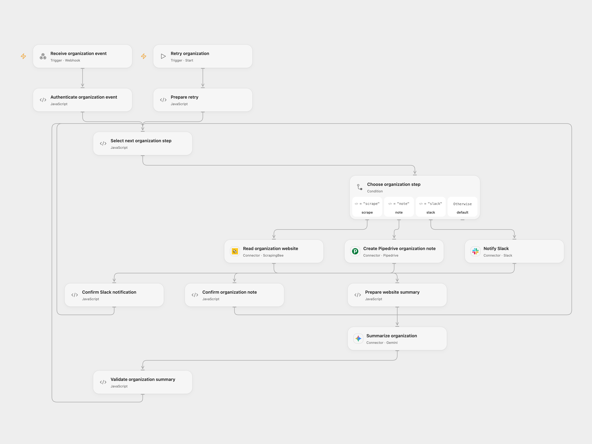

# Enrich Pipedrive Organization Website and Notify Slack

Summarize a new organization website, add a Pipedrive note and notify Slack.

<!-- template-actions:start -->
 
<!-- template-actions:end -->

<picture>
  <source media="(prefers-color-scheme: dark)" srcset="preview-dark.png">
  
</picture>

## Setup

Connect Pipedrive, ScrapingBee, Gemini and Slack. Set the Slack channel, Pipedrive company ID and organization website custom-field key. Enable persistent State. In n8n configure the v2 Pipedrive trigger with Basic Auth, connect Pipedrive, ScrapingBee HTTP Query Auth with parameter name api_key, Gemini and Slack, set the company ID and website custom-field key in **Validate organization**, and select a Data Table with item_key, status, summary and website text columns. For a pending note, inspect the organization notes and set status to note_done if confirmed or delete the row if absent. For a pending Slack notification, inspect the channel and set status to done if confirmed or note_done if absent. Configure the original identifiers in **Configure retry** before rerunning. Create a Pipedrive v2 webhook for organization create events pointing at **Receive organization event**. Configure HTTP Basic Authentication on the subscription and bind its full Authorization header as the secret PIPEDRIVE_WEBHOOK_AUTH.

## Behavior

A new organization with a website custom field is scraped and summarized. A note is added to that organization and the same summary is sent to Slack. Verify AI-generated details before relying on them. Website HTML over 100,000 characters stops processing.

For an unknown note or Slack write, inspect the destination, set the pending key and confirmed or absent in **Select next organization step**, and run **Retry organization** with the original company ID, organization ID, name and website. Clear recovery fields afterward. Avoid overlapping runs for the same organization.

Inspiration &amp; credits

Use a Pipedrive v2 organization event, configurable website field and checkpoints before note and Slack writes.

Adapted from [piepdrive-test](https://github.com/Zie619/n8n-workflows/blob/ae8cf6dc5b873cbb4f74587aa9180ed3a9f70682/workflows/Code/1796_Code_Slack_Automation_Webhook.json) in [Zie619/n8n-workflows](https://github.com/Zie619/n8n-workflows). Attribution: Zie619 / n8n-workflows.

The collection’s [MIT notice](https://github.com/Zie619/n8n-workflows/blob/94007c1445d9258a7da116646b79473e7c7c3282/LICENSE) is pinned at a later revision. This is the collection notice at that revision; it does not establish a separate original template author's license. Our changes are listed above; see [repository licensing](../../README.md#licensing).

> MIT License
>
> Copyright (c) 2025 Zie619
>
> Permission is hereby granted, free of charge, to any person obtaining a copy
> of this software and associated documentation files (the "Software"), to deal
> in the Software without restriction, including without limitation the rights
> to use, copy, modify, merge, publish, distribute, sublicense, and/or sell
> copies of the Software, and to permit persons to whom the Software is
> furnished to do so, subject to the following conditions:
>
> The above copyright notice and this permission notice shall be included in all
> copies or substantial portions of the Software.
>
> THE SOFTWARE IS PROVIDED "AS IS", WITHOUT WARRANTY OF ANY KIND, EXPRESS OR
> IMPLIED, INCLUDING BUT NOT LIMITED TO THE WARRANTIES OF MERCHANTABILITY,
> FITNESS FOR A PARTICULAR PURPOSE AND NONINFRINGEMENT. IN NO EVENT SHALL THE
> AUTHORS OR COPYRIGHT HOLDERS BE LIABLE FOR ANY CLAIM, DAMAGES OR OTHER
> LIABILITY, WHETHER IN AN ACTION OF CONTRACT, TORT OR OTHERWISE, ARISING FROM,
> OUT OF OR IN CONNECTION WITH THE SOFTWARE OR THE USE OR OTHER DEALINGS IN THE
> SOFTWARE.

