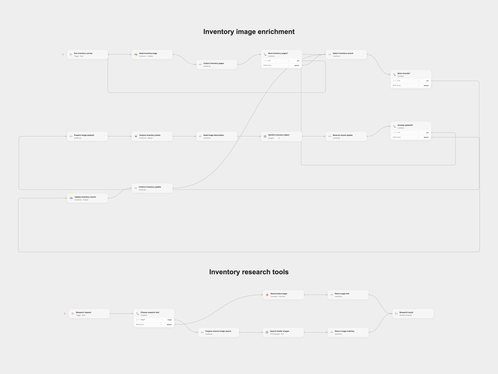

# Enrich Property Inventory from Images

Analyze inventory photos and enrich Airtable records with product attributes.

<!-- template-actions:start -->
[](https://openflow.run/templates/enrich-property-inventory-from-images/) [](templates/enrich-property-inventory-from-images.n8n.json)
<!-- template-actions:end -->

<picture>
  <source media="(prefers-color-scheme: dark)" srcset="preview-dark.png">
  
</picture>

## Setup

Import **Inventory image enrichment** and **Inventory research tools**, publish the research workflow and refresh both tool interfaces. Configure Airtable, OpenAI and Firecrawl connections, SERPAPI_API_KEY, and persistent State. The Airtable table needs Title, Image, Description, Model, Material, Color, Condition and AI_status fields. Avoid overlapping runs.

## Behavior

The workflow reads records with images and AI_status false, analyzes the image, optionally searches similar images and product pages, then updates the same record. Model output and search results can be inaccurate; review the changes. Image URLs and related content are sent to the model and research services. Inspect Airtable before clearing a pending update after an uncertain outcome. To deliberately reprocess an already completed record, reset its AI_status and clear its completed checkpoint.

<details>
<summary>In n8n</summary>

In n8n configure the Airtable base and table, OpenAI, SerpApi and Firecrawl credentials, select a Data Table with item_key and status text columns, and activate the imported workflow so its self-referencing research tools can run.

</details>

<details>
<summary>Inspiration &amp; credits</summary>

Adapted from [Enrich Property Inventory Survey with Image Recognition and AI Agent](https://github.com/enescingoz/awesome-n8n-templates/blob/827110332c21cbe000ab13f6d292d5adb1f1f8db/AI_Research_RAG_and_Data_Analysis/Enrich%20Property%20Inventory%20Survey%20with%20Image%20Recognition%20and%20AI%20Agent.json) in [enescingoz/awesome-n8n-templates](https://github.com/enescingoz/awesome-n8n-templates).

Source collection notice: © 2024–2026 Enes Cingoz, [CC BY 4.0](https://github.com/enescingoz/awesome-n8n-templates/blob/827110332c21cbe000ab13f6d292d5adb1f1f8db/LICENSE). The source export does not identify a separate template author or license. See [repository licensing](../../README.md#licensing) for the scope of OOMOL contributions and third-party material.

Changes from source: Update the image model and Firecrawl API, fix tool routing, paginate Airtable reads and add update checkpoints.

Collection license notice:

```text
Creative Commons Attribution 4.0 International License

Copyright (c) 2024-2026 Enes Cingoz

You are free to:

  Share - copy and redistribute the material in any medium or format
  Adapt - remix, transform, and build upon the material for any purpose,
  even commercially.

Under the following terms:

  Attribution - You must give appropriate credit, provide a link to the
  license, and indicate if changes were made. You may do so in any
  reasonable manner, but not in any way that suggests the licensor
  endorses you or your use.

  No additional restrictions - You may not apply legal terms or
  technological measures that legally restrict others from doing
  anything the license permits.

Notices:

  You do not have to comply with the license for elements of the
  material in the public domain or where your use is permitted by an
  applicable exception or limitation.

  No warranties are given. The license may not give you all of the
  permissions necessary for your intended use. For example, other rights
  such as publicity, privacy, or moral rights may limit how you use the
  material.

For the full license text, see:
https://creativecommons.org/licenses/by/4.0/legalcode
```

</details>
