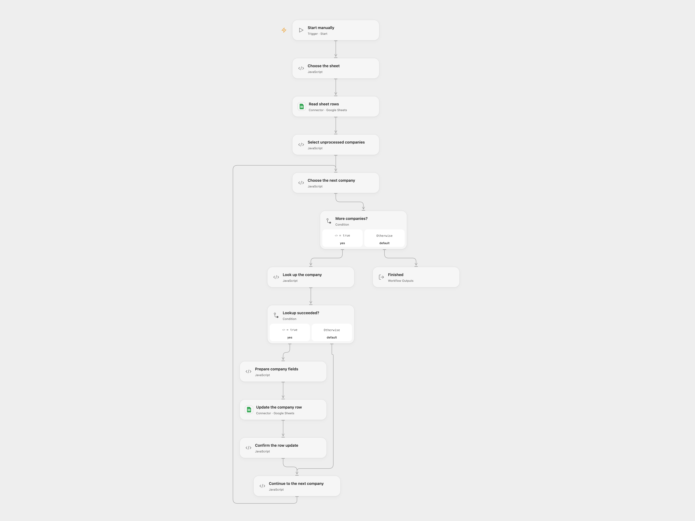

# Enrich Sheet Companies with ProspectLens

Enrich unprocessed company domains in Google Sheets with ProspectLens data.

<picture>
  <source media="(prefers-color-scheme: dark)" srcset="preview-dark.png">
  
</picture>

[Open Flow JSON](templates/enrich-sheet-companies-with-prospectlens.openflow.json) · [n8n JSON](templates/enrich-sheet-companies-with-prospectlens.n8n.json)

## Setup

Create a sheet whose first row contains unique headers **domain**, **name**, **description**, **processed_at**, **data**, **domain_name**, **traffic**, **location**, **funds**, **year_founded**, **funding_round**, and **last_funding_at**, all within columns A:Z. Add domains and leave processed_at empty. In **Choose the sheet**, set the spreadsheet ID and sheet name. Connect Google Sheets in **Read sheet rows** and **Update the company row**. Create a secret Variable PROSPECTLENS_API_KEY and bind it to **Look up the company**.

In n8n, set the same spreadsheet ID and sheet name in **Choose the sheet**, connect Google Sheets OAuth2 credentials to its HTTP nodes, and configure Header Auth on **ProspectLens API call** with name x-apiroad-key and the API key as its value. Run either format manually.

## Behavior

The workflow reads the sheet and processes rows with a domain and an empty processed_at field. Each domain is sent to ProspectLens. A failed lookup is tried twice, one second apart; after a second failure the workflow leaves that row unprocessed and continues. A successful response must contain the expected company fields. The workflow updates the corresponding row's twelve named fields, including a timestamp and the first 2,000 UTF-16 code units of the returned data JSON. Values are written as raw cells. The source domain, research data and execution history may be sensitive; review service access and storage.

Missing expected fields or a sheet write failure stops the run. An uncertain write may already have changed cells; inspect the sheet before retrying. Earlier updates remain, and a subsequent run skips rows with processed_at populated. Do not reorder or edit rows during a run, or run copies concurrently. Open Flow's Code and HTTP response size limits apply; large sheets or responses can fail. The workflow does not create spreadsheet rows.

Inspiration &amp; credits

## Changes to the source

- Replace private sheet settings and use the documented x-apiroad-key credential. Write only the selected row's mapped cells and use raw input to preserve unrelated columns and avoid formula execution.
- Skip empty domains, validate response shape, and preserve the source's two lookup attempts and continue-on-error behavior. Both formats use the same row index captured at the beginning of the run.

Adapted from [ProspectLens company research](https://github.com/Zie619/n8n-workflows/blob/ae8cf6dc5b873cbb4f74587aa9180ed3a9f70682/workflows/Filter/2006_Filter_Manual_Automation_Webhook.json) in [Zie619/n8n-workflows](https://github.com/Zie619/n8n-workflows). The matching [n8n listing](https://n8n.io/workflows/2390-automate-company-research-using-prospectlens-and-google-sheets/) credits Anthony. No separate original template license was found.

The collection’s [MIT notice](https://github.com/Zie619/n8n-workflows/blob/94007c1445d9258a7da116646b79473e7c7c3282/LICENSE) is pinned at a later revision. This is the collection notice at that revision; it does not establish a separate original template author's license. Our changes are listed above; see [repository licensing](../../README.md#licensing).

> MIT License
>
> Copyright (c) 2025 Zie619
>
> Permission is hereby granted, free of charge, to any person obtaining a copy
> of this software and associated documentation files (the "Software"), to deal
> in the Software without restriction, including without limitation the rights
> to use, copy, modify, merge, publish, distribute, sublicense, and/or sell
> copies of the Software, and to permit persons to whom the Software is
> furnished to do so, subject to the following conditions:
>
> The above copyright notice and this permission notice shall be included in all
> copies or substantial portions of the Software.
>
> THE SOFTWARE IS PROVIDED "AS IS", WITHOUT WARRANTY OF ANY KIND, EXPRESS OR
> IMPLIED, INCLUDING BUT NOT LIMITED TO THE WARRANTIES OF MERCHANTABILITY,
> FITNESS FOR A PARTICULAR PURPOSE AND NONINFRINGEMENT. IN NO EVENT SHALL THE
> AUTHORS OR COPYRIGHT HOLDERS BE LIABLE FOR ANY CLAIM, DAMAGES OR OTHER
> LIABILITY, WHETHER IN AN ACTION OF CONTRACT, TORT OR OTHERWISE, ARISING FROM,
> OUT OF OR IN CONNECTION WITH THE SOFTWARE OR THE USE OR OTHER DEALINGS IN THE
> SOFTWARE.

