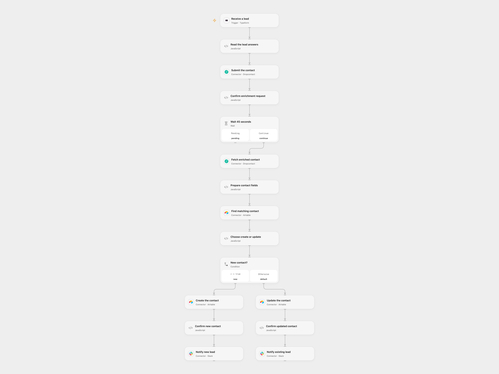

# Enrich Typeform Leads in Airtable and Notify Slack

Enrich a Typeform lead, create or update its Airtable contact and notify Slack.

<picture>
  <source media="(prefers-color-scheme: dark)" srcset="preview-dark.png">
  
</picture>

[Open Flow JSON](templates/enrich-typeform-leads-in-airtable-and-notify-slack.openflow.json) · [n8n JSON](templates/enrich-typeform-leads-in-airtable-and-notify-slack.n8n.json)

## Setup

Connect Typeform with webhook-management access, select the form, deploy to a public callback and activate it. In **Read the lead answers**, set the unique titles of the first name, last name, company and website questions, plus the Airtable base, table and Slack channel IDs. The form must supply first and last names and at least a company or website. Connect Dropcontact, Airtable and Slack.

The Airtable table needs writable fields firstName, lastName, linkedInProfile, Email, Phone, website, LinkedIn Company, Industry and Address. It also needs a searchable **fullName** formula such as TRIM({firstName} & ' ' & {lastName}). In n8n, configure the form, Airtable base/table and Slack channel in their service nodes and in **Read the lead answers**, and set the question titles in that Code node. Connect Typeform, Dropcontact, Airtable and Slack credentials. Activate one format.

## Behavior

Each completed form submits the contact for French Dropcontact enrichment with SIREN, waits 45 seconds and reads the result once. It searches Airtable by the enriched full name. With no match it creates a contact; with one match it updates that record; multiple matches stop before writing. Only returned nonempty optional fields are written. A confirmed Airtable write is followed by the corresponding Slack notice.

A pending or failed enrichment stops before Airtable. Unknown Airtable or Slack results may already have succeeded; inspect both services before replaying. Earlier writes are not rolled back and repeated form deliveries can repeat notifications. Restrict execution history and service access to protect lead data.

Inspiration &amp; credits

## Changes to the source

- Replace the private form fields, Airtable and Slack configuration. Clarify the source's misleading create/update Set names and stop on duplicate names.
- Resolve Typeform answers by unique question title, omit unavailable optional enrichment fields and verify the Airtable result before notifying.

Adapted from [Typeform lead enrichment to Airtable and Slack](https://github.com/Zie619/n8n-workflows/blob/ae8cf6dc5b873cbb4f74587aa9180ed3a9f70682/workflows/Slack/0124_Slack_Typeform_Create_Triggered.json) in [Zie619/n8n-workflows](https://github.com/Zie619/n8n-workflows). The source export does not identify a separate template author or license.

The collection’s [MIT notice](https://github.com/Zie619/n8n-workflows/blob/94007c1445d9258a7da116646b79473e7c7c3282/LICENSE) is pinned at a later revision. This is the collection notice at that revision; it does not establish a separate original template author's license. Our changes are listed above; see [repository licensing](../../README.md#licensing).

> MIT License
>
> Copyright (c) 2025 Zie619
>
> Permission is hereby granted, free of charge, to any person obtaining a copy
> of this software and associated documentation files (the "Software"), to deal
> in the Software without restriction, including without limitation the rights
> to use, copy, modify, merge, publish, distribute, sublicense, and/or sell
> copies of the Software, and to permit persons to whom the Software is
> furnished to do so, subject to the following conditions:
>
> The above copyright notice and this permission notice shall be included in all
> copies or substantial portions of the Software.
>
> THE SOFTWARE IS PROVIDED "AS IS", WITHOUT WARRANTY OF ANY KIND, EXPRESS OR
> IMPLIED, INCLUDING BUT NOT LIMITED TO THE WARRANTIES OF MERCHANTABILITY,
> FITNESS FOR A PARTICULAR PURPOSE AND NONINFRINGEMENT. IN NO EVENT SHALL THE
> AUTHORS OR COPYRIGHT HOLDERS BE LIABLE FOR ANY CLAIM, DAMAGES OR OTHER
> LIABILITY, WHETHER IN AN ACTION OF CONTRACT, TORT OR OTHERWISE, ARISING FROM,
> OUT OF OR IN CONNECTION WITH THE SOFTWARE OR THE USE OR OTHER DEALINGS IN THE
> SOFTWARE.

