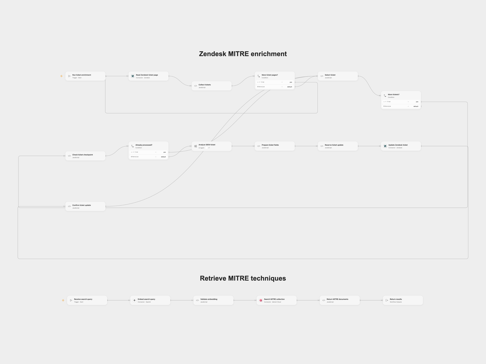

# Enrich Zendesk Tickets with MITRE Context

Retrieve MITRE ATT&CK context and add a private summary and technique fields to Zendesk tickets.

<!-- template-actions:start -->
[](https://openflow.run/templates/enrich-zendesk-tickets-with-mitre-context/) [](templates/enrich-zendesk-tickets-with-mitre-context.n8n.json)
<!-- template-actions:end -->

<picture>
  <source media="(prefers-color-scheme: dark)" srcset="preview-dark.png">
  
</picture>

## Setup

Import **Zendesk MITRE enrichment** and **Retrieve MITRE techniques**, publish the retrieval workflow and refresh the agent tool. Configure Zendesk, Qdrant and OpenAI connections, the collection name, custom field IDs and persistent State. The Qdrant collection must contain MITRE documents embedded with **text-embedding-3-large at 1536 dimensions**. Dimension alone does not make vectors from different models compatible. The source's separate Drive indexing path is not included; prepare that collection before use.

## Behavior

Run manually to list tickets, retrieve relevant ATT&CK context and write a private summary plus first technique ID and tactic to the matching ticket. Results are suggestions for human review, not incident determinations. Ticket content goes to the model and embedding services. Inspect Zendesk before clearing a pending checkpoint after an uncertain update. Completed ticket IDs are skipped on later runs; clear a checkpoint deliberately to reprocess a ticket. Avoid overlapping runs.

<details>
<summary>In n8n</summary>

In n8n configure the corresponding credentials, collection, custom field IDs and a Data Table with item_key and status columns.

</details>

<details>
<summary>Inspiration &amp; credits</summary>

Adapted from [Automate SIEM Alert Enrichment with MITRE ATT&CK, Qdrant & Zendesk in n8n](https://github.com/enescingoz/awesome-n8n-templates/blob/827110332c21cbe000ab13f6d292d5adb1f1f8db/Other_Integrations_and_Use_Cases/Automate%20SIEM%20Alert%20Enrichment%20with%20MITRE%20ATT%26CK%2C%20Qdrant%20%26%20Zendesk%20in%20n8n.json) in [enescingoz/awesome-n8n-templates](https://github.com/enescingoz/awesome-n8n-templates).

Source collection notice: © 2024–2026 Enes Cingoz, [CC BY 4.0](https://github.com/enescingoz/awesome-n8n-templates/blob/827110332c21cbe000ab13f6d292d5adb1f1f8db/LICENSE). The source export does not identify a separate template author or license. See [repository licensing](../../README.md#licensing) for the scope of OOMOL contributions and third-party material.

Changes from source: isolate the Zendesk enrichment entry from the chat and Drive indexing paths, add a manual trigger and pagination, require matching embedding model and dimensions, and add update checkpoints.

Collection license notice:

```text
Creative Commons Attribution 4.0 International License

Copyright (c) 2024-2026 Enes Cingoz

You are free to:

  Share - copy and redistribute the material in any medium or format
  Adapt - remix, transform, and build upon the material for any purpose,
  even commercially.

Under the following terms:

  Attribution - You must give appropriate credit, provide a link to the
  license, and indicate if changes were made. You may do so in any
  reasonable manner, but not in any way that suggests the licensor
  endorses you or your use.

  No additional restrictions - You may not apply legal terms or
  technological measures that legally restrict others from doing
  anything the license permits.

Notices:

  You do not have to comply with the license for elements of the
  material in the public domain or where your use is permitted by an
  applicable exception or limitation.

  No warranties are given. The license may not give you all of the
  permissions necessary for your intended use. For example, other rights
  such as publicity, privacy, or moral rights may limit how you use the
  material.

For the full license text, see:
https://creativecommons.org/licenses/by/4.0/legalcode
```

</details>
